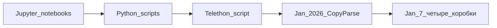

# H01 · До января · Скрипт бота, не сервис

## Пост

H01 · История · ноутбуки и один бот, потом CopyParse

До января 2026 CopyParse ещё нет. Черновики живут в двух местах: ноутбуки Jupyter в репозитории `AlexanderNY/python-notebook` и скрипты Python в `AlexanderNY/py`. Там же — простой Telegram-бот: один скрипт на Telethon в папке `bot/`. Нет шлюза, нет UI, нет отдельных сервисов. Процесс сам ходит в Telegram. Это не кросспостер.

1 января 2026 в `py` появляется коммит `feb6f841` с сообщением `cursor test`. В диффе четыре файла правил Cursor (FastAPI, микросервисы, scraping, React). Папки `api-gateway` ещё нет. С этого месяца начинается разработка CopyParse: сначала правила и идея слоёв, через неделю — каталоги сервисов. Свой репозиторий продукт получит только в июне. Это переезд, не день рождения.

Зачем это в живом сервисе. Полезно держать три даты отдельно: когда написан скрипт бота, когда начался продукт, когда у продукта появился свой git. Иначе история «микросервисы были сразу» врёт, и в первую неделю тащат лишние коробки.

Скрипт бота умеет одну работу в одном процессе. У него нет второго пользователя, нет статуса поста «собрали / готово / опубликовано» и нет отдельной площадки, куда тот же текст уходит без копипаста. Именно эту дыру закрывает CopyParse, а не «ещё один файл main.py».

Граница. Ноутбук и один Telethon-скрипт не становятся сервисом от того, что лежат в git. Правила IDE тоже не заменяют слои UI / API / БД. Пока нет контракта HTTP и таблицы со статусом — CopyParse ещё не запущен, даже если бот уже читает чат.

Следующий выпуск: 7–10 января — четыре коробки: gateway, auth, core, ui-app. Это уже продукт, не скрипт.

## Лаба

25 минут. Откройте три места и подпишите, что это:

1. https://github.com/AlexanderNY/python-notebook — ноутбуки, не продукт.
2. Папка `bot/` в https://github.com/AlexanderNY/py — один скрипт бота.
3. Коммит https://github.com/AlexanderNY/py/commit/feb6f841 — старт CopyParse в январе 2026. Чего в диффе нет: API, БД, UI.

В группу: три подписи одной строкой каждая + фраза «CopyParse начался …, потому что…».

Проверка: бот-скрипт и коммит 1 января не названы одним и тем же этапом.

## Ссылки

- Ноутбуки до продукта: https://github.com/AlexanderNY/python-notebook
- Скрипты и бот: https://github.com/AlexanderNY/py
- Старт CopyParse, 1 января 2026: https://github.com/AlexanderNY/py/commit/feb6f841
- CopyParse (регистрация): https://www.copyparse.ru/sign-up?utm_source=tg&utm_campaign=h01
- Карточка слоёв в учебном сезоне: docs/telegram-s01/S01E01-sloi.md

## Схема

