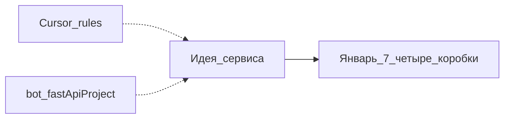

# H01 · 1 января · Репозиторий ещё не сервис

## Пост

H01 · История · правила Cursor, не продукт

1 января 2026 в публичном репозитории `AlexanderNY/py` появляется коммит `feb6f841` с сообщением `cursor test`. В диффе четыре файла: правила для Cursor (FastAPI, микросервисы, scraping, React Native). Папки `api-gateway` ещё нет.

Рядом в том же `py` лежат старые деревья `bot/`, `fastApiProject/`, `faTest/` — скрипты и эксперименты прошлых лет. Это не CopyParse. CopyParse начнёт жить папкой `cursor_test` внутри `py`, а свой репозиторий получит только в июне.

Зачем это в живом сервисе. Любой большой монорепо когда-то был «четырьмя правилами и идеей». Полезно уметь отличить день рождения продукта от дня появления git-репозитория и от дня, когда в дереве впервые легли четыре слоя.

Граница. Правила IDE и чужие скрипты в соседней папке не заменяют слои UI / API / БД / деплой. Пока нет контракта HTTP и таблицы со статусом — сервиса ещё нет, даже если Cursor «уже знает FastAPI».

Следующий выпуск: 7–10 января — в дереве появляются четыре коробки: gateway, auth, core, ui-app.

## Лаба

20 минут. Откройте коммит: https://github.com/AlexanderNY/py/commit/feb6f841

Выпишите на бумаге: (1) что реально добавилось, (2) чего в диффе нет (API, БД, UI, бот).

В группу: скрин списка файлов коммита + одна фраза «это ещё не сервис, потому что…».

Проверка: в ответе нет путаницы между правилами Cursor и работающим API.

## Ссылки

- Коммит: https://github.com/AlexanderNY/py/commit/feb6f841
- Репозиторий-источник (январь–июнь): https://github.com/AlexanderNY/py
- CopyParse (регистрация): https://www.copyparse.ru/sign-up?utm_source=tg&utm_campaign=h01
- Карточка слоёв в учебном сезоне: docs/telegram-s01/S01E01-sloi.md

## Схема

