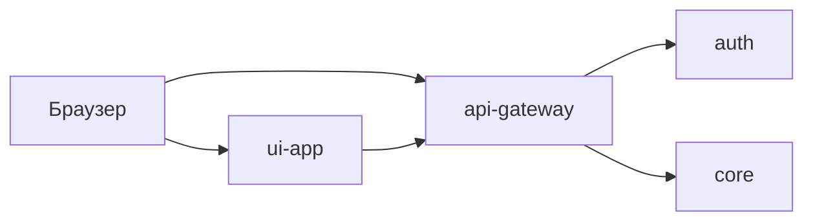

# H02 · 7–10 января · Четыре коробки

## Пост

H02 · История · gateway / auth / core / ui-app

7 января коммит `c0d145b9` (`cursor test with fastapi`) кладёт в `py/cursor_test` четыре каталога: `api-gateway`, `auth`, `core`, `ui-app`. Это уже не правила — это границы процессов.

10 января `4b1b58eb` — сообщение «масштабный рефакторинг и разделение на сервисы». В шлюзе появляется `wp_routes`, у Telegram в дереве ещё планы (`IMPLEMENTATION_PLAN.md`, `ARCHITECTURE_ANALYSIS.md`), а не сбор сообщений в БД.

Зачем это в живом сервисе. CopyParse до сих пор читается теми же четырьмя ролями: браузер → UI, публичный `/api` → шлюз, пользователи/токены → auth, домен профилей и постов → core. Боты площадок пришли позже; каркас — раньше.

Граница. Резать процесс стоит, когда у кусков разная роль (шлюз vs пользователи vs домен), а не «микросервис на каждый файл». План бота в markdown — ещё не коннектор.

Следующий выпуск: маршруты соцсетей в шлюзе появляются раньше живых ботов.

## Лаба

25 минут. Откройте https://github.com/AlexanderNY/py/commit/c0d145b9 и список папок на этом коммите.

Нарисуйте четыре прямоугольника и стрелку «браузер → UI → gateway → …». Отметьте, куда пойдёт auth, куда — домен.

В группу: схема + ответ «почему tg-bot 10 января ещё не сервис сбора».

Проверка: на схеме UI не пишет в Postgres в обход API.

## Ссылки

- Коммит четырёх коробок: https://github.com/AlexanderNY/py/commit/c0d145b9
- Коммит разделения: https://github.com/AlexanderNY/py/commit/4b1b58eb
- CopyParse: https://www.copyparse.ru/sign-up?utm_source=tg&utm_campaign=h02
- Текущая карта стенда: docs/ARCHITECTURE.md

## Схема

