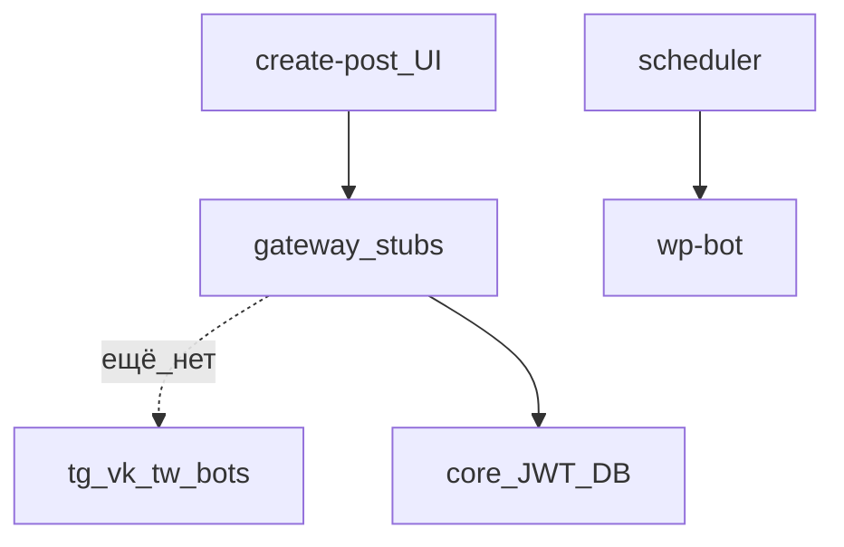

# H03 · 16–25 января · Контракт раньше платформы

## Пост

H03 · История · stub в шлюзе ≠ подключённая сеть

16 января (`515253b5`) в шлюзе появляются маршруты `tg`, `vk`, `tw`, `cpost`, в UI — страница create-post. Папок живых ботов под эти сети ещё нет: контракт нарисован раньше реализации.

18 января (`19d74e63`, `UI and JWT Updated`) — живой `core`: `database.py`, `models.py`, Dockerfile; правки JWT в gateway и auth. 23 января — экспериментальный сервис `selectcb`. 25 января (`ee4d8d02`) — `scheduler`, `wp-bot`, прокси ботов в шлюзе (`bot_proxy`).

Зачем это в живом сервисе. В зрелом CopyParse путь тот же: UI и gateway объявляют API, бот появляется, когда есть что проксировать и куда писать статус. Студенту полезно видеть, что «кнопка VK в сайдбаре» и «бот публикует в VK» — разные этапы.

Граница. Stub-роут в шлюзе не считается подключённой соцсетью. Экспериментальный сервис (`selectcb`) можно завести для UI-проб — и не путать его с прод-контуром кросспостинга.

Следующий выпуск: февраль — WordPress и Telegram становятся сервисами с БД.

## Лаба

30 минут. Откройте https://github.com/AlexanderNY/py/commit/515253b5 — найдите новые `*_routes` в api-gateway.

Составьте таблицу из трёх колонок: маршрут шлюза | есть ли бот в том же коммите | что ещё нужно (БД, профиль, poller).

В группу: скрин таблицы.

Проверка: хотя бы у одного маршрута в колонке «бот» стоит «нет».

## Ссылки

- Маршруты в шлюзе: https://github.com/AlexanderNY/py/commit/515253b5
- JWT и core: https://github.com/AlexanderNY/py/commit/19d74e63
- Scheduler и wp-bot: https://github.com/AlexanderNY/py/commit/ee4d8d02
- CopyParse: https://www.copyparse.ru/sign-up?utm_source=tg&utm_campaign=h03

## Схема

