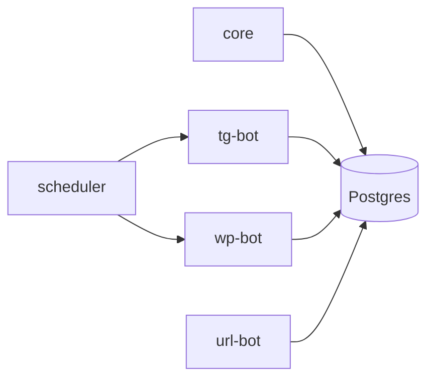

# H04 · Февраль · Первый живой контур

## Пост

H04 · История · одна публикация до статуса в БД

С конца января WordPress перестаёт быть только роутом шлюза: меняется сервис wp, появляются новые функции публикации, правки в `core` (wordpress, notifications, post_service). 6 февраля (`b8ecc340`) у CopyParse появляется сервис `tg-bot`: `config.py`, `database.py`, роутеры — рядом с `core/routers/telegram.py`. Это уже не одиночный Telethon-скрипт из `py/bot`: у сервиса своя БД и место за шлюзом.

8 февраля (`89b1c9e8`) добавляется `url-bot` и файл `SERVICES_OVERVIEW.md`. Третья площадка появляется после того, как в дереве уже есть живые WP и TG, а не одновременно с первой кнопкой в UI.

Зачем это в живом сервисе. Пайплайн CopyParse держится на статусах поста в Postgres. Пока одна площадка не доводит пост до записи и публикации, вторая и третья только размножают незакрытый контур.

Граница. Вторая и третья площадка — только после того, как одна публикация доходит до статуса в БД. Документ обзора сервисов пишите, когда папок уже больше трёх: иначе он устареет быстрее, чем вы его прочитаете.

Следующий выпуск: 20 февраля — collector и processor; очередь статусов вместо «шины».

## Лаба

30 минут. Откройте https://github.com/AlexanderNY/py/commit/b8ecc340 — перечислите новые файлы под `tg-bot/` (без `__pycache__`).

Ответьте одной фразой: что должно появиться в БД, чтобы публикация считалась «дошла».

В группу: список файлов + фраза про статус.

Проверка: в ответе есть таблица или статус поста, а не только «отправил в Telegram API».

## Ссылки

- TG + WP update: https://github.com/AlexanderNY/py/commit/b8ecc340
- url-bot: https://github.com/AlexanderNY/py/commit/89b1c9e8
- Изменение wp (30 янв.): https://github.com/AlexanderNY/py/commit/af247ed1
- CopyParse: https://www.copyparse.ru/sign-up?utm_source=tg&utm_campaign=h04
- Жизненный цикл постов сейчас: docs/POSTS_LIFECYCLE.md

## Схема

