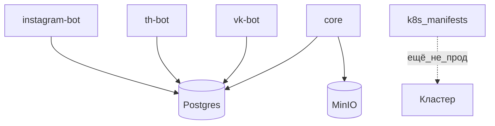

# H06 · 6–15 марта · Пачка платформ

## Пост

H06 · История · манифесты ≠ прод, cv ≠ продукт

6 марта (`bcd50b4e`) в дерево падают `vk-bot`, `th-bot` и каталог `k8s` сразу на десятки файлов. 9 марта рядом оказываются `cv/` и `portfolio-site` — личные материалы в том же git, что и кросспостинг. 15 марта (`b6e63363`, сообщение `vk`) — Instagram, маршруты Дзена в gateway, MinIO как объектное хранилище, docs.

Зачем это в живом сервисе. Рост платформ после живого контура TG/WP логичен: контракт и статусы уже есть. MinIO отделяет медиа от диска пода. Kubernetes в репозитории — учебный и задельный контур; Compose остаётся основным способом поднять стенд.

Граница. Манифесты Kubernetes в репо не равны проду на кластере. Личные сайты и выгрузки CV не часть кросспостинга: они засоряют дифф и путают читателя карты сервисов. Держите продукт и портфолио в разных деревьях, как только объём мешает читать историю.

Следующий выпуск: отдельное vite-приложение для графиков и появление dzen/twitter-ботов.

## Лаба

30 минут. Откройте https://github.com/AlexanderNY/py/commit/bcd50b4e

Посчитайте примерно: сколько файлов в `k8s/`, сколько в `vk-bot/` / `th-bot/`. Отметьте одним цветом «платформа», другим «деплой на бумаге».

В группу: два числа + фраза, запущен ли у вас кластер после появления папки `k8s` (обычно нет).

Проверка: вы не написали «с 6 марта сервис в Kubernetes в проде» без доказательств.

## Ссылки

- VK + Threads + k8s: https://github.com/AlexanderNY/py/commit/bcd50b4e
- Instagram / MinIO / dzen routes: https://github.com/AlexanderNY/py/commit/b6e63363
- CopyParse: https://www.copyparse.ru/sign-up?utm_source=tg&utm_campaign=h06
- k8s сейчас: k8s/README.md

## Схема

