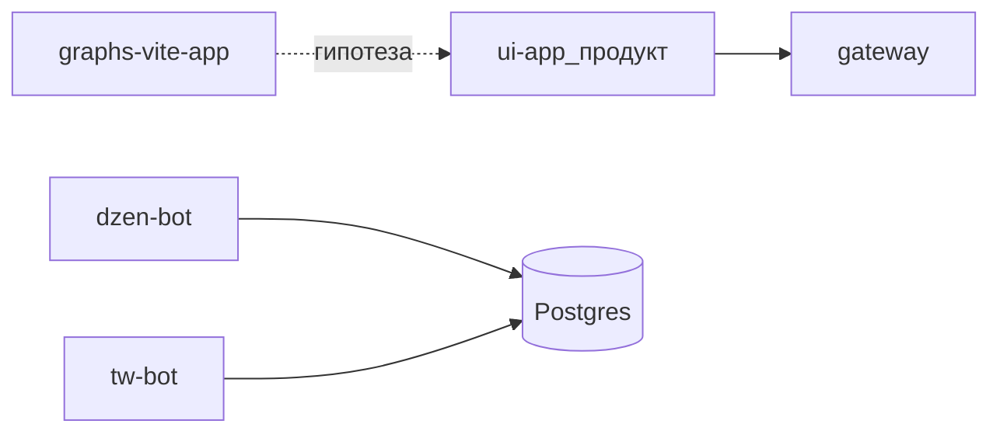

# H07 · 18 марта – 5 апреля · Побочный UI и ещё две сети

## Пост

H07 · История · гипотезу — в отдельное приложение

18 марта (`86a3f178`, «графики») появляется отдельный `graphs-vite-app` — не страницы внутри `ui-app`, а свой Vite-проект. Гипотеза про визуализацию живёт рядом, не ломая основной SPA кросспостинга.

5 апреля (`7813741e`, «tmi upd») — `dzen-bot` и `tw-bot`, доработки Instagram и url-bot. Набор площадок почти как в сегодняшнем README: Telegram, VK, Instagram, Threads, WordPress, Дзен, Twitter/X, Custom URL.

Зачем это в живом сервисе. Эксперимент с UI дешевле выносить в отдельный каталог, пока не ясно, останется ли он в продукте. К июню `graphs-vite-app` из корня публичного снимка уже уходит — гипотеза отработала и не обязана жить вечно.

Граница. Рисовать гипотезу отдельным приложением, пока она не доказана. Не вшивайте каждый график в основной UI «на всякий случай». Новые боты площадок подключайте к тому же пайплайну статусов, а не копируйте свой локальный `send()`.

Следующий выпуск: июнь — свой репозиторий, AI-клиент и край nginx.

## Лаба

25 минут. Сравните два коммита: https://github.com/AlexanderNY/py/commit/86a3f178 и https://github.com/AlexanderNY/py/commit/7813741e

Ответьте: (1) где живут графики — в ui-app или рядом, (2) какие два бота добавил апрельский коммит.

В группу: два коротких ответа.

Проверка: в ответе есть `graphs-vite-app` и имена `dzen-bot` / `tw-bot`.

## Ссылки

- Графики отдельным приложением: https://github.com/AlexanderNY/py/commit/86a3f178
- Dzen + Twitter bots: https://github.com/AlexanderNY/py/commit/7813741e
- CopyParse: https://www.copyparse.ru/sign-up?utm_source=tg&utm_campaign=h07
- Обзор сервисов: docs/SERVICES_OVERVIEW.md

## Схема

