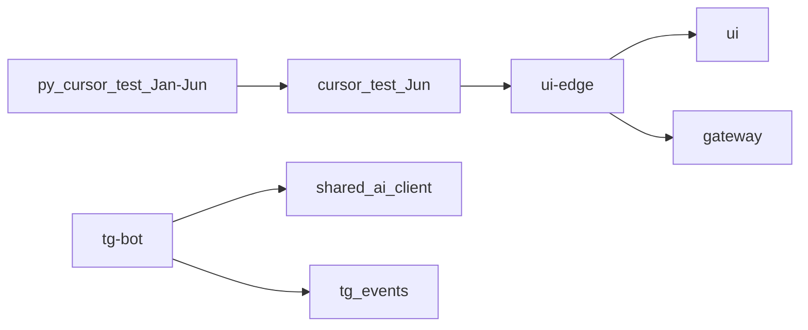

# H08 · 22–29 июня · Свой репозиторий и край сети

## Пост

H08 · История · день git ≠ день рождения продукта

22 июня на GitHub создаётся публичный репозиторий `AlexanderNY/cursor_test`. 23 июня — Initial commit: снимок уже зрелого кросспостера (gateway, auth, core, боты, k8s, ui-app). Это переезд из папки `py/cursor_test`, не старт с нуля. История января–июня остаётся в `AlexanderNY/py`.

24 июня (`b28dcb1d`) — `shared/ai_client.py`, `routing_engine` и `event_logger` в tg-bot, аналитика Telegram в core, отдельный `tg-game`. 29 июня — `deploy/ui-edge` (nginx на :80/:443) и заглушка сайта 9to18.ru.

Зачем это в живом сервисе. Свой репозиторий упрощает онбординг и деплой. Край сети (ui-edge) отделяет публичные Host’ы от внутренних портов. AI-клиент общий, но алертинг и сбор не должны ждать ответа модели.

Граница. День появления репозитория на GitHub не равен первому дню продукта. AI не блокирует сбор сообщений: таймаут и fallback без выжимки важнее «красивого» дайджеста.

Следующий выпуск: июль–август — второй продукт рядом, канон архитектуры и учебный сезон.

## Лаба

30 минут. Откройте https://github.com/AlexanderNY/cursor_test и https://github.com/AlexanderNY/py

Найдите дату создания `cursor_test` и коммит `cursor test` в `py` (1 января 2026). Запишите одной строкой: «CopyParse с января 2026, публичный репо с июня. До января — скрипты, ноутбуки и один бот, не продукт».

Дополнительно: в коммите https://github.com/AlexanderNY/cursor_test/commit/b28dcb1d отметьте файл AI-клиента.

В группу: одна строка про даты + путь к `ai_client`.

Проверка: даты января и июня не перепутаны.

## Ссылки

- Репозиторий CopyParse: https://github.com/AlexanderNY/cursor_test
- История до переезда: https://github.com/AlexanderNY/py
- AI + routing TG: https://github.com/AlexanderNY/cursor_test/commit/b28dcb1d
- ui-edge: https://github.com/AlexanderNY/cursor_test/commit/f0364908
- CopyParse: https://www.copyparse.ru/sign-up?utm_source=tg&utm_campaign=h08
- Дорожная карта TG: docs/TELEGRAM_ROADMAP.md

## Схема

