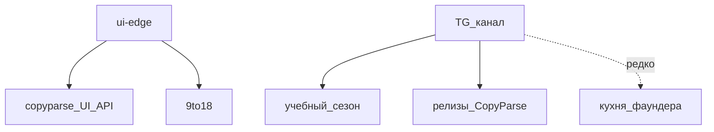

# H09 · Июль–август · Второй продукт рядом

## Пост

H09 · История · три голоса, один монорепо

Июль: развивается ui-9to18 и игра bowl (Pyodide), параллельно — tg-game и опросы в ui-app. Это уже не «ещё одна кнопка кросспостинга», а соседний продукт на общем крае сети.

7 августа — обновление дефектов и фич Telegram / SMM (`core/routers/smm.py` и вокруг). 14 августа в docs ложится канон: `ARCHITECTURE.md`, `POSTS_LIFECYCLE.md`, `INSTALLATION.md`, `USER_GUIDE.md`. 23 августа — стратегия личного бренда, черновики учебного сезона S01 и отдельный e2e-tester.

Зачем это в живом сервисе. Документация после того, как сервисов уже много, окупается: без канона студент и агент читают случайный коммит `up`. Второй продукт (9to18) может жить рядом на `edge_net`, но CTA и тон канала не должны смешиваться с релизом CopyParse.

Граница. 9to18, учебный сезон и релиз продукта — три голоса. Их не склеивать в одном посте (см. docs/PERSONAL_BRAND.md). Курс — в Telegram; SaaS — на copyparse.ru; 9to18 — отдельный сайт.

Следующий выпуск: сентябрь–октябрь — Learn, вынос resume-api, Postgres вместо Kafka.

## Лаба

25 минут. Откройте https://github.com/AlexanderNY/cursor_test/commit/a8c6d405 (14 августа) — какие файлы появились в `docs/`.

Составьте таблицу из трёх строк: голос | площадка | пример артефакта (S01 / copyparse.ru / 9to18).

В группу: скрин таблицы.

Проверка: в таблице три разные строки, не одна «всё в CopyParse».

## Ссылки

- Канон docs (14 авг.): https://github.com/AlexanderNY/cursor_test/commit/a8c6d405
- PERSONAL_BRAND + S01 (23 авг.): https://github.com/AlexanderNY/cursor_test/commit/4ddb627c
- Архитектура: docs/ARCHITECTURE.md
- CopyParse: https://www.copyparse.ru/sign-up?utm_source=tg&utm_campaign=h09

## Схема

