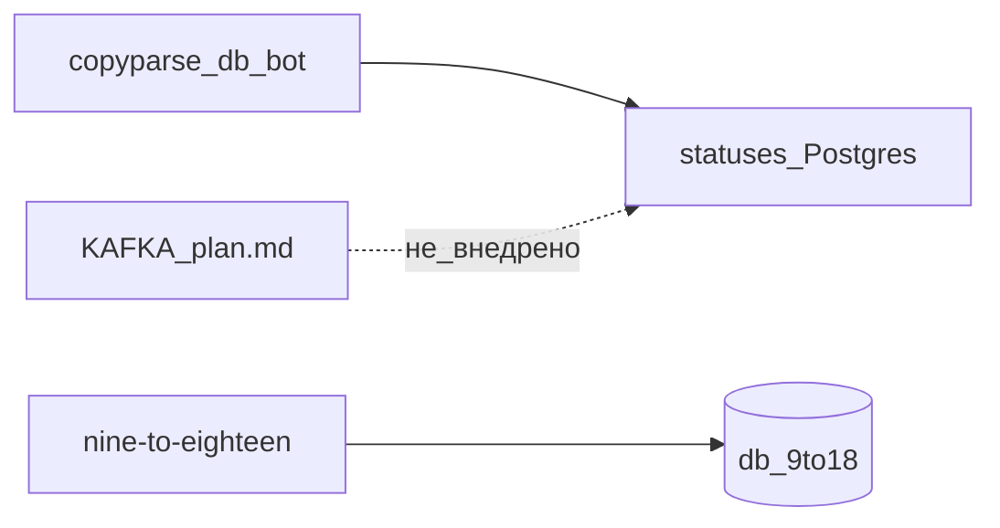

# H10 · Сентябрь–октябрь · Что оставить в Postgres

## Пост

H10 · История · новый сервис — когда своя БД и свой хост

Август–сентябрь: в core появляется Learn (`learn_seed.json`), на 9to18 растёт учебный контур. 22 сентября дерево `nine-to-eighteen/` оформляется как отдельный юнит: site-api, resume-api, своя БД `db_9to18`. Это уже не заглушка в папке ui-9to18.

27 сентября в docs ложится `KAFKA_MIGRATION_PLAN.md` — и очередь постов остаётся на статусах Postgres. 4 октября — `team_access` в core: доступ команды, не смена транспорта.

Зачем это в живом сервисе. Вынос resume/site в отдельный compose-юнит оправдан: другой домен, другая база, другой ритм релизов. Брокер сообщений «как в банке» для collect → process → publish не стал обязательным: poller и claim строк закрывают задачу.

Граница. Новый сервис заводим, когда у него своя БД и свой хост (или явная причина изоляции). «Энтерпрайз-очередь» для этого пайплайна уже лишняя, пока нет независимых потребителей и объёма, который ломает Postgres. План на бумаге ≠ смена архитектуры.

Серия H01–H10 закрывает дугу январь→октябрь. Дальше — либо учебный сезон S01 (слои с нуля), либо короткие релиз-посты продукта.

## Лаба

30 минут. Откройте https://github.com/AlexanderNY/cursor_test/commit/9673fed2 и файл docs/KAFKA_MIGRATION_PLAN.md в текущем дереве.

Ответьте двумя предложениями: (1) почему nine-to-eighteen вынесли, (2) стала ли Kafka очередью постов после появления плана.

В группу: два предложения + скрин оглавления плана Kafka (или `git log -- docs/KAFKA_MIGRATION_PLAN.md`).

Проверка: во втором предложении явно «нет» / «остались статусы в Postgres».

## Ссылки

- Вынос nine-to-eighteen: https://github.com/AlexanderNY/cursor_test/commit/9673fed2
- План Kafka: docs/KAFKA_MIGRATION_PLAN.md
- Жизненный цикл постов: docs/POSTS_LIFECYCLE.md
- Team access (окт.): https://github.com/AlexanderNY/cursor_test/commit/d5e2e099
- CopyParse: https://www.copyparse.ru/sign-up?utm_source=tg&utm_campaign=h10
- Учебный сезон слоёв: docs/telegram-s01/

## Схема

