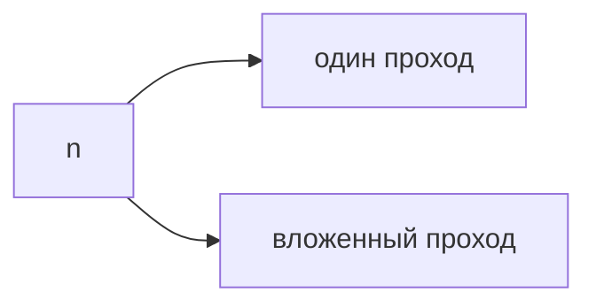
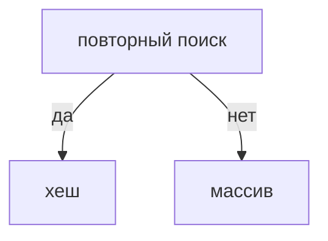
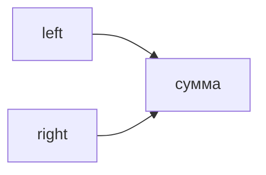
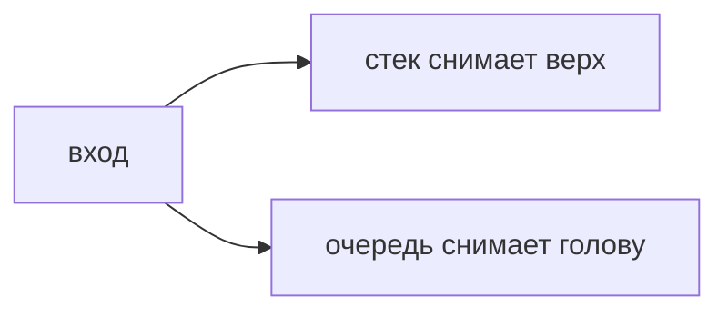
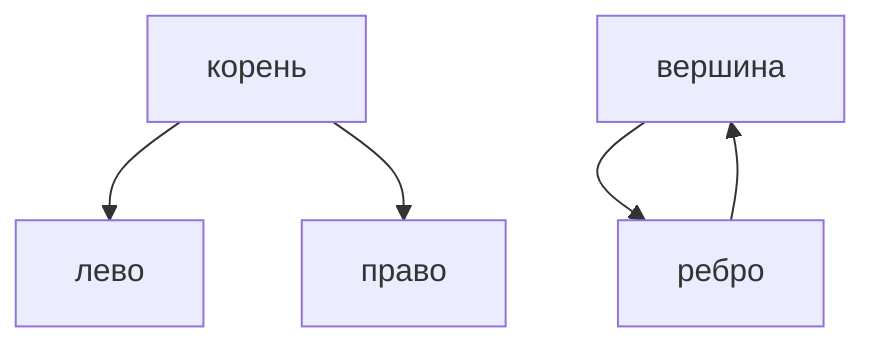
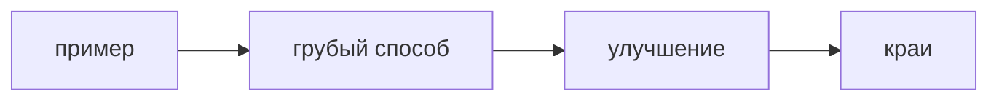

## Введение

На собесе сложность — это обещание, как растёт работа, когда данных станет больше. Не просят формулу из учебника. Просят сказать, что будет с циклом в цикле и где прячется лишний проход.

**Массив и хеш.** Массив хорош, когда данные лежат подряд и вы идёте по ним один раз. Хеш-таблица хороша, когда один и тот же поиск повторяется. На собесе это первый выбор почти в каждой задаче на дубли и пары.

**Два указателя.** Два указателя снимают вложенный цикл, когда массив упорядочен или когда окно имеет смысл расширять и сжимать. Это частый ход после того, как квадрат уже назван вслух.

**Стек и очередь.** Стек помнит последнее: скобки, откат, обход в глубину. Очередь помнит первое: обход в ширину, справедливый порядок задач. Путаница «взял не тот конец» — обычная ошибка на доске.

**Деревья и графы.** Дерево — граф без цикла, где из корня есть один путь к узлу. Граф может зациклиться, поэтому обход помечает посещённое. На собесе достаточно BFS, DFS и фразы, зачем метка.

**Разбор задачи.** Задачу на доске проваливают не из-за синтаксиса. Её проваливают, потому что сразу пишут код. Нормальный порядок: пример, тупой способ, улучшение, сложность, пустой вход.

## Раздел: Как отвечать одним блоком

Этот выпуск собрал соседние короткие темы трека: «Сложность», «Массив и хеш», «Два указателя», «Стек и очередь», «Деревья и графы», «Разбор задачи». Раньше каждая занимала отдельную карточку на несколько минут, а на собеседовании их спрашивают одним блоком. Ниже у каждой темы свой раздел, затем общие лабы, один тест и одна колода карточек. В ответе сначала назовите, какую тему спросили, потом определение и один пример. Не проговаривайте все разделы, если спросили один. Лабы можно пройти по порядку исходного трека. Если времени мало, сделайте первую и последнюю: первая ставит язык, последняя проверяет, что соседние темы вы не перепутали.

## Раздел: Сложность: Как считать

Один проход по массиву — O(n). Вложенный проход по тем же данным — O(n²). Хеш-таблица в среднем даёт O(1) на поиск, но в худшем случае цепочка может выродиться. Память называют отдельно: «время O(n), дополнительная память O(n)».

## Раздел: Сложность: Ответ вслух

Я смотрю на циклы и на структуры. Один проход — линейно. Два вложенных по n — квадрат. Если я построил множество ради поиска, время поиска падает, память растёт. Говорю худший случай, если не оговорили средний.

## Раздел: Сложность: Плохой ответ

Плохой ответ: «это быстро, я проверял на десяти элементах». Десять не показывает рост.

## Раздел: Сложность: Термины

Сложность — time complexity. Худший случай — worst case. Память — space complexity. Линейный — O(n).

## Раздел: Массив и хеш: Выбор

Дубли: множество хранит уже виденное, второй раз — ответ. Пара с суммой: для каждого числа смотрим, есть ли дополнение. Цена — память O(n). Если память нельзя, остаётся сортировка и два указателя.

## Раздел: Массив и хеш: Ответ вслух

Если поиск одного и того же повторяется, я беру хеш и честно говорю про память. Если нужно только пройти один раз и порядок важен, оставляю массив. Дубль ловлю множеством.

## Раздел: Массив и хеш: Плохой ответ

Плохой ответ: «всегда словарь, он O(1)». Без памяти и без худшего случая это реклама.

## Раздел: Массив и хеш: Термины

Массив — array. Хеш-таблица — hash map. Множество — set. Дополнение до суммы — complement.

## Раздел: Два указателя: Когда сработает

Сумма пары в отсортированном массиве: левый и правый край. Слишком мало — сдвигаем левый, слишком много — правый. Окно: правый расширяет, левый сужает, пока условие не выполнено. Без порядка два указателя легко врут.

## Раздел: Два указателя: Ответ вслух

Если массив отсортирован, я не строю хеш сразу. Ставлю два края и сдвигаю тот, который чинит сумму. Окно двигаю, пока внутри держится условие. Квадрат остаётся запасным, если порядка нет.

## Раздел: Два указателя: Плохой ответ

Плохой ответ: «два указателя всегда быстрее вложенного цикла». На неотсортированных данных они смотрят не туда.

## Раздел: Два указателя: Термины

Два указателя — two pointers. Скользящее окно — sliding window. Края — left and right.

## Раздел: Стек и очередь: Задачи

Скобки: открывающую кладём, закрывающая должна снять ту же пару. Не снялось или стек не пуст в конце — строка кривая. Обход графа в ширину — очередь. В глубину — стек или рекурсия, это тот же стек вызовов.

## Раздел: Стек и очередь: Ответ вслух

Если важен последний элемент, я беру стек. Скобки — классика: открыл, положил, закрыл, снял. Если важен порядок прихода, очередь. Обход соседей по кругам — очередь, не стек.

## Раздел: Стек и очередь: Плохой ответ

Плохой ответ: «стек и очередь — это просто списки». Важен конец, с которого забирают.

## Раздел: Стек и очередь: Термины

Стек — stack, LIFO. Очередь — queue, FIFO. Обход в ширину — BFS. В глубину — DFS.

## Раздел: Деревья и графы: Что говорят

Корень, левый и правый — бинарное дерево. Высота — самое длинное ребро вниз. Граф: вершины и рёбра. Без множества посещённых DFS по циклу не кончится. Кратчайший путь в невзвешенном графе — BFS, не DFS.

## Раздел: Деревья и графы: Ответ вслух

Дерево я обхожу, не боясь цикла. В графе сначала помечаю вершину. Кратчайший путь без весов — обход в ширину, потому что первый раз я прихожу минимальным числом рёбер. С весами BFS уже врёт.

## Раздел: Деревья и графы: Плохой ответ

Плохой ответ: «граф — это дерево с несколькими корнями». Цикл и несколько путей ломают это определение.

## Раздел: Деревья и графы: Термины

Дерево — tree. Граф — graph. Посещённое — visited. Кратчайший путь — shortest path.

## Раздел: Разбор задачи: Порядок

1. Повторить задачу на своём примере. 2. Назвать квадрат, если он очевиден. 3. Сказать, чем платите за лучшее. 4. Написать код. 5. Пустой массив, один элемент, дубли. Молчание у доски хуже медленного квадрата.

## Раздел: Разбор задачи: Ответ вслух

Сначала я проговариваю пример вслух. Потом честный медленный способ и его сложность. Если вижу повторный поиск, предлагаю хеш и называю память. Код пишу после этого. В конце проверяю пустой вход.

## Раздел: Разбор задачи: Плохой ответ

Плохой ответ: сразу цикл, ни примера, ни сложности. Интервьюер не понимает, знаете ли вы, что написали.

## Раздел: Разбор задачи: Термины

Грубое решение — brute force. Крайний случай — edge case. Подход — approach.

## Лаба

**Сложность.**

**20 минут.** В [/game/code](/game/code) напишите поиск дубля двумя циклами и через множество. Вслух назовите сложность обоих.

**Массив и хеш.**

**25 минут.** В [/game/code](/game/code) найдите дубль и пару с заданной суммой. Скажите сложность.

**Два указателя.**

**25 минут.** В [/game/code](/game/code) найдите пару с суммой в уже отсортированном списке двумя указателями.

**Стек и очередь.**

**20 минут.** В [/game/code](/game/code) проверьте строку скобок стеком. Пустой стек в конце и ни одной лишней закрывающей.

**Деревья и графы.**

**25 минут.** На бумаге или в [/game/code](/game/code) обойдите маленький граф с циклом. Покажите, где без visited вы зациклитесь.

**Разбор задачи.**

**30 минут.** Возьмите дубль в [/game/code](/game/code). Вслух: пример, O(n²), затем множество, пустой список.

## Схема: Сложность: Рост

## Схема: Массив и хеш: Выбор структуры

## Схема: Два указателя: Края

## Схема: Стек и очередь: Концы

## Схема: Деревья и графы: Обход

## Схема: Разбор задачи: Порядок ответа

## Тест

### Данных стало в 10 раз, вложенные циклы. Во сколько грубее раз растёт работа?

**Ответ:** примерно в сто раз

**Пояснение:** Квадрат: 10².

### Памяти почти нет, нужен дубль. Что остаётся?

**Ответ:** сортировка или квадрат

**Пояснение:** Хеш нельзя обещать без памяти.

### Массив не отсортирован. Два края для суммы пары честны?

**Ответ:** нет, нужен порядок или хеш

**Пояснение:** Иначе пропустите пару.

### Строка `([)]`. Стек примет?

**Ответ:** нет, пары перекрещены

**Пояснение:** Закрывать надо ту, что открыта последней.

### В графе есть цикл. DFS без visited. Чем кончится?

**Ответ:** бесконечным обходом

**Пояснение:** Вершина зовёт саму себя через ребро.

## Шпаргалка

<ul><li>Смотрите циклы и структуры</li><li>Называйте время и память</li><li>Худший случай по умолчанию</li><li>Хеш покупает поиск ценой памяти</li><li>Дубль — множество</li><li>Пара — complement</li><li>Нужен порядок или монотонное окно</li><li>Края чинят сумму</li><li>Память меньше, чем у хеша</li><li>Стек — последнее</li><li>Очередь — первое</li><li>Скобки и обход — разные концы</li></ul>

## Anki

### Front: O(n) — это что?

Back: Один проход: работа растёт пропорционально числу элементов.

### Front: Когда массив, а не хеш?

Back: Один проход и важен порядок, поиск не повторяется.

### Front: Когда два указателя?

Back: Данные упорядочены или окно расширяется и сжимается.

### Front: LIFO?

Back: Кто пришёл последним, тот вышел первым. Стек.

### Front: Чем дерево отличается от графа?

Back: В дереве нет цикла и один путь от корня.

### Front: Первый шаг у доски?

Back: Свой пример, не код.

## Мнемоника

### acronym: Оценка

**Задание:** Четыре шага ответа про сложность.

**Элементы:**
- Операция
- Худший случай
- Память
- Когда хватает

**Подсказка:** O(n) по времени и O(n) по памяти — два разных предложения.

**Ответ:** op, time, space, enough

## Итоги

- Смотрите циклы и структуры
- Называйте время и память
- Худший случай по умолчанию
- Хеш покупает поиск ценой памяти
- Дубль — множество
- Пара — complement
- Нужен порядок или монотонное окно
- Края чинят сумму

## Ссылки

- [Песочница](/game/code)
