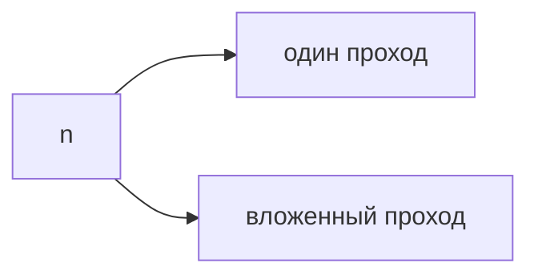

## Введение

На собесе сложность — это обещание, как растёт работа, когда данных станет больше. Не просят формулу из учебника. Просят сказать, что будет с циклом в цикле и где прячется лишний проход.

## Раздел: Как считать

Один проход по массиву — O(n). Вложенный проход по тем же данным — O(n²). Хеш-таблица в среднем даёт O(1) на поиск, но в худшем случае цепочка может выродиться. Память называют отдельно: «время O(n), дополнительная память O(n)».

## Раздел: Ответ вслух

Я смотрю на циклы и на структуры. Один проход — линейно. Два вложенных по n — квадрат. Если я построил множество ради поиска, время поиска падает, память растёт. Говорю худший случай, если не оговорили средний.

## Раздел: Плохой ответ

Плохой ответ: «это быстро, я проверял на десяти элементах». Десять не показывает рост.

## Раздел: Термины

Сложность — time complexity. Худший случай — worst case. Память — space complexity. Линейный — O(n).

## Лаба

**20 минут.** В [/game/code](/game/code) напишите поиск дубля двумя циклами и через множество. Вслух назовите сложность обоих.

## Схема: Рост

## Тест

### Данных стало в 10 раз, вложенные циклы. Во сколько грубее раз растёт работа?

**Ответ:** примерно в сто раз

**Пояснение:** Квадрат: 10².

### Поиск в хеше в среднем и в худшем. Что назвать, если не уточнили?

**Ответ:** худший, если не оговорили

**Пояснение:** Средний надо проговаривать отдельно.

### Сортировка заняла O(n log n), потом один проход. Что доминирует?

**Ответ:** n log n

**Пояснение:** Линейный член меньше при большом n.

### Алгоритм O(1) по времени, но копирует весь массив. Это бесплатно?

**Ответ:** нет, память O(n)

**Пояснение:** Время и память называют отдельно.

### Можно ли выбрать O(n²), если n всегда меньше 20?

**Ответ:** да, если граница честная

**Пояснение:** Константа и ограничение n меняют выбор.

## Шпаргалка

<ul><li>Смотрите циклы и структуры</li><li>Называйте время и память</li><li>Худший случай по умолчанию</li></ul>

## Anki

### Front: O(n) — это что?

Back: Один проход: работа растёт пропорционально числу элементов.

### Front: O(n²) откуда берётся?

Back: Вложенный проход по тем же данным.

### Front: Почему «на десяти быстро» не ответ?

Back: Не видно, как растёт работа.

### Front: Time и space — одно и то же?

Back: Нет. Быстрый алгоритм может съесть память.

### Front: Worst case зачем?

Back: Чтобы не обещать среднее, когда данные плохие.

### Front: Хеш-поиск какой ценой?

Back: Память на таблицу взамен повторных проходов.

## Итоги

- Смотрите циклы и структуры
- Называйте время и память
- Худший случай по умолчанию

## Ссылки

- [Песочница](/game/code)
- [Хеш и массив](/game/learn/algo-hash-array)
