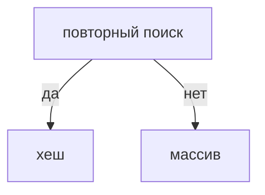

## Введение

Массив хорош, когда данные лежат подряд и вы идёте по ним один раз. Хеш-таблица хороша, когда один и тот же поиск повторяется. На собесе это первый выбор почти в каждой задаче на дубли и пары.

## Раздел: Выбор

Дубли: множество хранит уже виденное, второй раз — ответ. Пара с суммой: для каждого числа смотрим, есть ли дополнение. Цена — память O(n). Если память нельзя, остаётся сортировка и два указателя.

## Раздел: Ответ вслух

Если поиск одного и того же повторяется, я беру хеш и честно говорю про память. Если нужно только пройти один раз и порядок важен, оставляю массив. Дубль ловлю множеством.

## Раздел: Плохой ответ

Плохой ответ: «всегда словарь, он O(1)». Без памяти и без худшего случая это реклама.

## Раздел: Термины

Массив — array. Хеш-таблица — hash map. Множество — set. Дополнение до суммы — complement.

## Лаба

**25 минут.** В [/game/code](/game/code) найдите дубль и пару с заданной суммой. Скажите сложность.

## Схема: Выбор структуры

## Тест

### Памяти почти нет, нужен дубль. Что остаётся?

**Ответ:** сортировка или квадрат

**Пояснение:** Хеш нельзя обещать без памяти.

### Числа уже в множестве. Второй такой же. Это дубль?

**Ответ:** да

**Пояснение:** Повторный add или проверка membership.

### Пара с суммой через хеш. Память?

**Ответ:** O(n)

**Пояснение:** Храним уже виденные числа.

### Индекс в массиве нужен вместе со значением. Хватит множества?

**Ответ:** нет, нужен словарь

**Пояснение:** Множество не помнит позицию.

### Порядок обхода важен, поиск один. Брать хеш?

**Ответ:** не обязательно

**Пояснение:** Один проход по массиву проще.

## Шпаргалка

<ul><li>Хеш покупает поиск ценой памяти</li><li>Дубль — множество</li><li>Пара — complement</li></ul>

## Anki

### Front: Когда массив, а не хеш?

Back: Один проход и важен порядок, поиск не повторяется.

### Front: Когда хеш?

Back: Один и тот же поиск много раз, память можно.

### Front: Как поймать дубль?

Back: Множество уже виденного.

### Front: Пара с суммой?

Back: Для числа ищем complement в уже виденных.

### Front: Чем set отличается от map?

Back: Set хранит факт, map — значение по ключу.

### Front: Цена хеша?

Back: Память O(n) и худший случай цепочки.

## Итоги

- Хеш покупает поиск ценой памяти
- Дубль — множество
- Пара — complement

## Ссылки

- [Песочница](/game/code)
- [Два указателя](/game/learn/algo-two-pointers)
