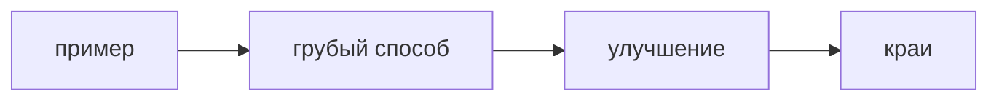

## Введение

Задачу на доске проваливают не из-за синтаксиса. Её проваливают, потому что сразу пишут код. Нормальный порядок: пример, тупой способ, улучшение, сложность, пустой вход.

## Раздел: Порядок

1. Повторить задачу на своём примере. 2. Назвать квадрат, если он очевиден. 3. Сказать, чем платите за лучшее. 4. Написать код. 5. Пустой массив, один элемент, дубли. Молчание у доски хуже медленного квадрата.

## Раздел: Ответ вслух

Сначала я проговариваю пример вслух. Потом честный медленный способ и его сложность. Если вижу повторный поиск, предлагаю хеш и называю память. Код пишу после этого. В конце проверяю пустой вход.

## Раздел: Плохой ответ

Плохой ответ: сразу цикл, ни примера, ни сложности. Интервьюер не понимает, знаете ли вы, что написали.

## Раздел: Термины

Грубое решение — brute force. Крайний случай — edge case. Подход — approach.

## Лаба

**30 минут.** Возьмите дубль в [/game/code](/game/code). Вслух: пример, O(n²), затем множество, пустой список.

## Схема: Порядок ответа

## Тест

### Код написан, сложность не названа. Ответ полный?

**Ответ:** нет

**Пояснение:** Без роста неясно, выдержите ли данные.

### Пустой вход не проверен. Что может упасть?

**Ответ:** обращение к первому элементу

**Пояснение:** Край называют отдельно.

### Вы сразу назвали оптимальный способ и застряли. Что было безопаснее?

**Ответ:** сначала грубый

**Пояснение:** Грубый показывает, что задача понята.

### Память кончилась из-за хеша. Это вы сказали заранее?

**Ответ:** должны были

**Пояснение:** Улучшение времени покупают памятью.

### Интервьюер молчит. Дописывать код или спросить пример?

**Ответ:** уточнить пример

**Пояснение:** Молчаливый код часто решает не ту задачу.

## Шпаргалка

<ul><li>Пример раньше кода</li><li>Грубый способ тоже ответ</li><li>Назовите цену улучшения</li></ul>

## Anki

### Front: Первый шаг у доски?

Back: Свой пример, не код.

### Front: Зачем называть brute force?

Back: Показать, что задача понята, даже если дальше будет лучше.

### Front: Что сказать про хеш?

Back: Быстрее поиск, больше память.

### Front: Какие краи минимум?

Back: Пусто, один элемент, дубли.

### Front: Почему не молчать?

Back: Интервьюер оценивает ход мысли.

### Front: Когда писать код?

Back: После подхода и сложности.

## Итоги

- Пример раньше кода
- Грубый способ тоже ответ
- Назовите цену улучшения

## Ссылки

- [Песочница](/game/code)
- [Сложность](/game/learn/algo-complexity)
