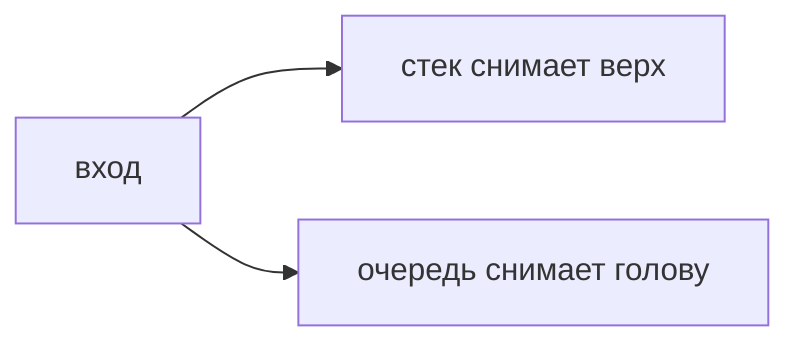

## Введение

Стек помнит последнее: скобки, откат, обход в глубину. Очередь помнит первое: обход в ширину, справедливый порядок задач. Путаница «взял не тот конец» — обычная ошибка на доске.

## Раздел: Задачи

Скобки: открывающую кладём, закрывающая должна снять ту же пару. Не снялось или стек не пуст в конце — строка кривая. Обход графа в ширину — очередь. В глубину — стек или рекурсия, это тот же стек вызовов.

## Раздел: Ответ вслух

Если важен последний элемент, я беру стек. Скобки — классика: открыл, положил, закрыл, снял. Если важен порядок прихода, очередь. Обход соседей по кругам — очередь, не стек.

## Раздел: Плохой ответ

Плохой ответ: «стек и очередь — это просто списки». Важен конец, с которого забирают.

## Раздел: Термины

Стек — stack, LIFO. Очередь — queue, FIFO. Обход в ширину — BFS. В глубину — DFS.

## Лаба

**20 минут.** В [/game/code](/game/code) проверьте строку скобок стеком. Пустой стек в конце и ни одной лишней закрывающей.

## Схема: Концы

## Тест

### Строка `([)]`. Стек примет?

**Ответ:** нет, пары перекрещены

**Пояснение:** Закрывать надо ту, что открыта последней.

### Нужен обход соседей по слоям. Стек или очередь?

**Ответ:** очередь

**Пояснение:** Иначе уйдёте в глубину одной ветки.

### Рекурсия кончилась переполнением. Какой структуры не хватило явно?

**Ответ:** стека вызовов

**Пояснение:** Рекурсия и есть стек.

### Очередь задач, забираем с того же конца, куда кладём. Это ещё очередь?

**Ответ:** нет, это стек

**Пояснение:** FIFO забирает с другого конца.

### Стек пуст, а закрывающая скобка пришла. Вердикт?

**Ответ:** строка неверна

**Пояснение:** Снимать нечего.

## Шпаргалка

<ul><li>Стек — последнее</li><li>Очередь — первое</li><li>Скобки и обход — разные концы</li></ul>

## Anki

### Front: LIFO?

Back: Кто пришёл последним, тот вышел первым. Стек.

### Front: FIFO?

Back: Кто пришёл первым, тот вышел первым. Очередь.

### Front: Скобки какой структурой?

Back: Стек открывающих.

### Front: BFS какой структурой?

Back: Очередь.

### Front: DFS какой структурой?

Back: Стек или рекурсия.

### Front: Пустой стек и закрывающая скобка?

Back: Ошибка в строке.

## Итоги

- Стек — последнее
- Очередь — первое
- Скобки и обход — разные концы

## Ссылки

- [Песочница](/game/code)
- [Деревья](/game/learn/algo-trees-graphs)
