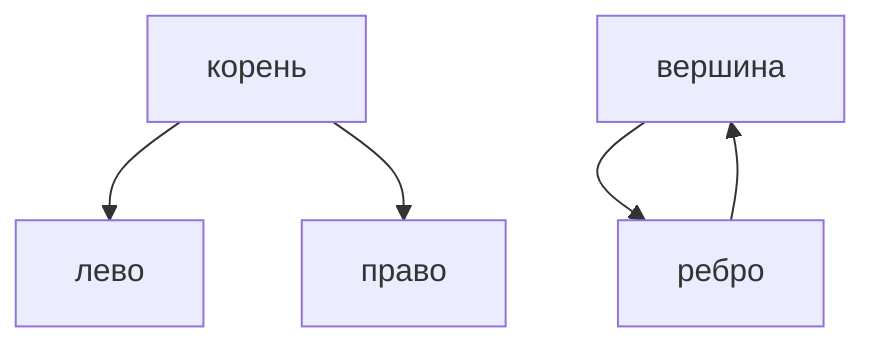

## Введение

Дерево — граф без цикла, где из корня есть один путь к узлу. Граф может зациклиться, поэтому обход помечает посещённое. На собесе достаточно BFS, DFS и фразы, зачем метка.

## Раздел: Что говорят

Корень, левый и правый — бинарное дерево. Высота — самое длинное ребро вниз. Граф: вершины и рёбра. Без множества посещённых DFS по циклу не кончится. Кратчайший путь в невзвешенном графе — BFS, не DFS.

## Раздел: Ответ вслух

Дерево я обхожу, не боясь цикла. В графе сначала помечаю вершину. Кратчайший путь без весов — обход в ширину, потому что первый раз я прихожу минимальным числом рёбер. С весами BFS уже врёт.

## Раздел: Плохой ответ

Плохой ответ: «граф — это дерево с несколькими корнями». Цикл и несколько путей ломают это определение.

## Раздел: Термины

Дерево — tree. Граф — graph. Посещённое — visited. Кратчайший путь — shortest path.

## Лаба

**25 минут.** На бумаге или в [/game/code](/game/code) обойдите маленький граф с циклом. Покажите, где без visited вы зациклитесь.

## Схема: Обход

## Тест

### В графе есть цикл. DFS без visited. Чем кончится?

**Ответ:** бесконечным обходом

**Пояснение:** Вершина зовёт саму себя через ребро.

### Невзвешенный кратчайший путь. BFS или DFS?

**Ответ:** BFS

**Пояснение:** Первый приход — минимум рёбер.

### У ребра есть длина. Хватит BFS?

**Ответ:** нет, нужен учёт веса

**Пояснение:** Меньше рёбер не значит короче.

### В дереве два пути к одному узлу. Это ещё дерево?

**Ответ:** нет, это граф

**Пояснение:** В дереве путь от корня один.

### Рекурсивный обход дерева упёрся в глубину. Запасной ход?

**Ответ:** явный стек

**Пояснение:** Тот же DFS без стека вызовов.

## Шпаргалка

<ul><li>Дерево без цикла</li><li>Граф помечают</li><li>Кратчайший без весов — BFS</li></ul>

## Anki

### Front: Чем дерево отличается от графа?

Back: В дереве нет цикла и один путь от корня.

### Front: Зачем visited?

Back: Чтобы не ходить по циклу бесконечно.

### Front: Кратчайший путь без весов?

Back: BFS.

### Front: Почему не DFS для кратчайшего?

Back: DFS уходит в глубину, не в ближайший слой.

### Front: Высота дерева?

Back: Самый длинный путь от корня вниз.

### Front: Стек вызовов кончился?

Back: Явный стек для того же обхода.

## Итоги

- Дерево без цикла
- Граф помечают
- Кратчайший без весов — BFS

## Ссылки

- [Песочница](/game/code)
- [Сводка](/game/learn/algo-interview-drill)
