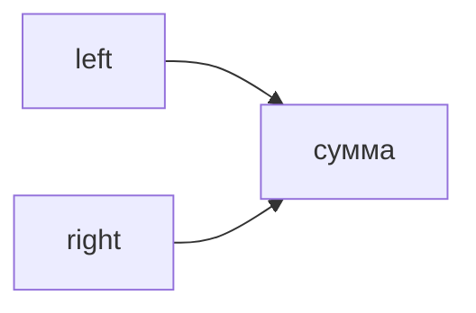

## Введение

Два указателя снимают вложенный цикл, когда массив упорядочен или когда окно имеет смысл расширять и сжимать. Это частый ход после того, как квадрат уже назван вслух.

## Раздел: Когда сработает

Сумма пары в отсортированном массиве: левый и правый край. Слишком мало — сдвигаем левый, слишком много — правый. Окно: правый расширяет, левый сужает, пока условие не выполнено. Без порядка два указателя легко врут.

## Раздел: Ответ вслух

Если массив отсортирован, я не строю хеш сразу. Ставлю два края и сдвигаю тот, который чинит сумму. Окно двигаю, пока внутри держится условие. Квадрат остаётся запасным, если порядка нет.

## Раздел: Плохой ответ

Плохой ответ: «два указателя всегда быстрее вложенного цикла». На неотсортированных данных они смотрят не туда.

## Раздел: Термины

Два указателя — two pointers. Скользящее окно — sliding window. Края — left and right.

## Лаба

**25 минут.** В [/game/code](/game/code) найдите пару с суммой в уже отсортированном списке двумя указателями.

## Схема: Края

## Тест

### Массив не отсортирован. Два края для суммы пары честны?

**Ответ:** нет, нужен порядок или хеш

**Пояснение:** Иначе пропустите пару.

### Сумма больше цели. Какой край двигать в отсортированном массиве?

**Ответ:** правый влево

**Пояснение:** Уменьшаем сумму.

### Окно расширили и условие сломалось. Что дальше?

**Ответ:** сжать левым

**Пояснение:** Правый уже добавил лишнее.

### Хеш и два указателя оба O(n). Чем они отличаются?

**Ответ:** памятью и требованием порядка

**Пояснение:** Указатели почти без дополнительной памяти.

### Окно на строке из одинаковых букв. Можно двигать по одному?

**Ответ:** да, если условие монотонно

**Пояснение:** Иначе окно придётся пересчитывать.

## Шпаргалка

<ul><li>Нужен порядок или монотонное окно</li><li>Края чинят сумму</li><li>Память меньше, чем у хеша</li></ul>

## Anki

### Front: Когда два указателя?

Back: Данные упорядочены или окно расширяется и сжимается.

### Front: Сумма мала — какой край?

Back: Левый вправо, в отсортированном массиве.

### Front: Сумма велика — какой край?

Back: Правый влево.

### Front: Что такое sliding window?

Back: Отрезок, который двигают, не пересчитывая всё заново.

### Front: Память двух указателей?

Back: Обычно O(1) сверх входа.

### Front: Если порядка нет?

Back: Хеш или сортировка сначала.

## Итоги

- Нужен порядок или монотонное окно
- Края чинят сумму
- Память меньше, чем у хеша

## Ссылки

- [Песочница](/game/code)
- [Стек](/game/learn/algo-stack-queue)
