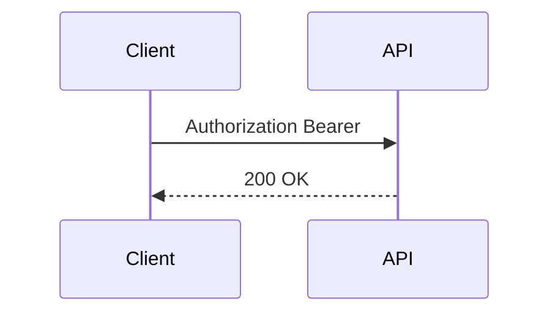

## Введение

Кратко опишите тему выпуска и зачем она нужна на собеседовании или в работе. Минимум ~40 символов. Что спросят и какое решение выбрать.

## Раздел: Access vs refresh

Текст теории с рабочим примером и одной типичной ошибкой. Можно несколько разделов — каждый начинается с `## Раздел: …`.

## Лаба

**Цель.** …

**Шаги.**
1. …

**В группу:** …

**Готово, если…**
- [ ] …

## Схема: Поток токена

## Тест

Пять вопросов: определение, два применения, ловушка, сравнение. `**Ответ:**` — короткая фраза (2–8 слов), рассуждение в пояснении.

### Что лежит в payload JWT?

**Ответ:** claims

**Пояснение:** не секреты, а утверждения (sub, exp, роли). Payload читается без ключа.

### Зачем нужен refresh-токен?

**Ответ:** обновить access без логина

**Пояснение:** access живёт коротко; refresh дольше и хранится осторожнее.

### Можно ли хранить JWT в localStorage?

**Ответ:** риск XSS

**Пояснение:** скрипт страницы прочитает токен. Часто безопаснее httpOnly cookie при контроле CSRF.

### Что будет, если положить пароль в payload?

**Ответ:** утечка без ключа

**Пояснение:** подпись не шифрует payload; Base64 читается кем угодно.

### Чем JWT отличается от opaque session id?

**Ответ:** самодостаточные claims

**Пояснение:** сервер может проверить подпись без lookup сессии; opaque id всегда требует стор.

## Шпаргалка

<h3>Суть</h3>
<ul>
<li>header.payload.signature</li>
<li>подписываем, не шифруем</li>
</ul>
<h3>Команды / формулы</h3>
<pre><code>Authorization: Bearer &lt;token&gt;</code></pre>

## Anki

Шесть атомарных карточек (минимум информации, самодостаточный вопрос). Не дублируйте тест один в один.

### Front: Из каких трёх частей состоит JWT?

Back: header, payload, signature

### Front: Чем access-токен отличается от refresh по сроку жизни?

Back: access короткий для API; refresh длиннее для обновления сессии

### Front: Почему в payload JWT нельзя класть пароли?

Back: payload читается без ключа — это Base64, не шифр

### Front: Какой риск у хранения JWT в localStorage?

Back: XSS — скрипт страницы может украсть токен

### Front: Что означает «JWT подписывают, а не шифруют»?

Back: целостность и авторство да, содержимое payload видно всем

### Front: Зачем короткий срок жизни у access-токена?

Back: уменьшить окно злоупотребления при утечке

## Мнемоника

### acronym: JWT части
**Задание:** Запомните три части JWT.
**Элементы:**
- header
- payload
- signature
**Подсказка:** слово из первых букв.
**Ответ:** HPS

## Итоги

- Подписываем, не шифруем
- Короткий access + осторожный refresh
- XSS и storage — частый вопрос на собесе

## Ссылки

- [RFC 7519](https://datatracker.ietf.org/doc/html/rfc7519)
- Learn | /game/learn
