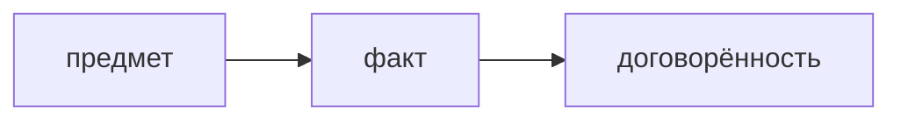

## Введение

Вопрос «расскажите о конфликте» ловит тех, кто либо отрицает конфликты, либо назначает злодея. Нужен предмет спора и ваше действие, не характер коллеги.

## Раздел: Сюжет

Предмет: срок, качество, граница задачи. Что вы сделали: собрали факт, предложили вариант, эскалировали по правилу, а не в чат. Чем кончилось для работы. Обида без изменения работы — слабый итог.

## Раздел: Ответ вслух

Я называю предмет, не человека. Говорю, какой факт принёс в спор и какой вариант предложил. Если эскалировал, говорю куда и зачем. Итог — что изменилось в решении или в сроке, не «я победил».

## Раздел: Плохой ответ

Плохой ответ: «конфликтов не было, я со всеми лажу». Это отказ от вопроса.

## Раздел: Термины

Конфликт — disagreement. Эскалация — escalation. Предмет спора — issue, не personality.

## Лаба

**20 минут.** Перепишите историю так, чтобы в ней не было оценки характера. Только факт, действие, договорённость.

## Схема: Спор

## Тест

### История состоит из «он токсичный». Есть предмет?

**Ответ:** нет

**Пояснение:** Нет рабочего вопроса.

### Вы промолчали и сделали по-своему. Это action для собеса?

**Ответ:** слабый

**Пояснение:** Не видно, как решали разногласие.

### Эскалация сразу к директору мимо договорённости. Как звучит?

**Ответ:** как обход

**Пояснение:** Сначала правило команды.

### Итог «меня похвалили». Хватает?

**Ответ:** слабо

**Пояснение:** Нужен эффект для работы.

### Конфликтов правда не вспомнили. Что делать?

**Ответ:** взять жёсткий срок или отказ

**Пояснение:** Нулевых команд не бывает.

## Шпаргалка

<ul><li>Предмет вместо злодея</li><li>Ваш ход в споре</li><li>Итог для работы</li></ul>

## Anki

### Front: О ком история конфликта?

Back: О предмете, не о характере.

### Front: Какое действие ждут?

Back: Факт, вариант, договорённость.

### Front: Чем плоха фраза «конфликтов не было»?

Back: Вопрос остаётся без ответа.

### Front: Куда эскалировать?

Back: По правилу, не в обход с первой минуты.

### Front: Какой итог слабый?

Back: Победа в споре без изменения работы.

### Front: Что вычеркнуть?

Back: Оценки личности.

## Итоги

- Предмет вместо злодея
- Ваш ход в споре
- Итог для работы

## Ссылки

- [STAR](/game/learn/beh-star)
- [Провал](/game/learn/beh-failure)
