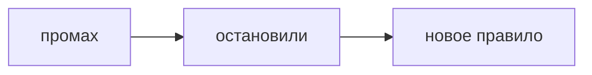

## Введение

Вопрос про ошибку проверяет, умеете ли вы назвать свою долю. История, где виноваты все вокруг, и история, где вы героически всё спасли без цены, обе слабые.

## Раздел: Доля

Что сломалось. Что сделали вы, включая промах. Что починили сразу. Какое правило или проверка появилась после. Без последнего пункта это оправдание, не вывод.

## Раздел: Ответ вслух

Я называю промах своим глаголом: не проверил, не спросил, не написал тест. Потом — как остановили ущерб. В конце — что теперь делаю иначе, желательно проверка, которую можно повторить, а не «стал внимательнее».

## Раздел: Плохой ответ

Плохой ответ: «ошибок не помню» или «просто не повезло с требованиями». Нет доли и нет изменения.

## Раздел: Термины

Провал — failure. Доля — ownership. Вывод — lesson. Проверка — check, не «буду аккуратнее».

## Лаба

**20 минут.** Напишите провал на полстраницы. Последнее предложение должно быть правилом, которое вы реально можете показать.

## Схема: Вывод

## Тест

### Вывод «стал внимательнее». Его можно проверить?

**Ответ:** нет

**Пояснение:** Нужна конкретная проверка.

### Виноват только заказчик. История годится?

**Ответ:** слабо

**Пояснение:** Нет вашей доли.

### Ущерб остановили, правило не изменили. Чего не хватает?

**Ответ:** урока в работе

**Пояснение:** Иначе ошибка повторима.

### Мелкий провал лучше выдуманного подвига?

**Ответ:** да

**Пояснение:** Мелкий честный сильнее красивого.

### Можно ли взять ту же историю, что и про конфликт?

**Ответ:** если это правда провал

**Пояснение:** Не переклеивать ярлык на чужой сюжет.

## Шпаргалка

<ul><li>Назовите свой глагол</li><li>Остановите ущерб</li><li>Оставьте правило, не настроение</li></ul>

## Anki

### Front: Что обязательно в истории провала?

Back: Ваш промах и новое правило.

### Front: Чем плох «стал внимательнее»?

Back: Это нельзя проверить.

### Front: Чем плох «виноваты требования»?

Back: Нет вашей доли.

### Front: Что такое ownership здесь?

Back: Назвать, что сделали или не сделали вы.

### Front: Какой урок сильный?

Back: Проверка или шаг, который повторяется.

### Front: Героическое спасение без цены?

Back: Слабый провал: нет ошибки.

## Итоги

- Назовите свой глагол
- Остановите ущерб
- Оставьте правило, не настроение

## Ссылки

- [STAR](/game/learn/beh-star)
- [Сводка](/game/learn/beh-interview-drill)
