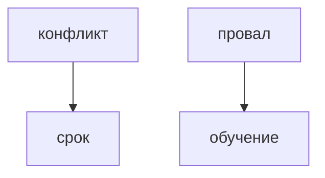

## Введение

Не пишите двадцать текстов. Держите четыре истории: конфликт, провал, жёсткий срок, когда вы кого-то научили или вас научили. На каждую — STAR на полторы минуты.

## Раздел: Вопросы

«Не согласны с коллегой», «ошибка», «не успевали», «влияние без должности». Одна и та же история срока может ответить и про приоритет, и про давление, если действие было про отказ от лишнего, а не про героизм ночи.

## Раздел: Ответ вслух

У меня четыре карточки. Перед собеседованием я проговариваю их вслух, не читаю. Если вопрос не совпал дословно, беру ближайший каркас и не выдумываю компанию. Если истории нет, так и говорю и беру соседнюю честную.

## Раздел: Плохой ответ

Плохой ответ: заученная речь на три минуты, которая не отвечает на заданный вопрос.

## Раздел: Термины

Каркас — story. Влияние без роли — influence without authority. Срок — deadline.

## Лаба

**30 минут.** Заполните четыре заголовка историй и по одному result. Проговорите одну вслух по таймеру на 90 секунд.

## Схема: Четыре карточки

## Тест

### Двадцать заученных текстов лучше четырёх?

**Ответ:** нет

**Пояснение:** На вопросе вы не найдёте нужный.

### Вопрос про срок, а история про ночь без отказа от объёма. Сильно?

**Ответ:** слабо

**Пояснение:** Не видно выбора.

### Истории нет. Выдумать?

**Ответ:** нет

**Пояснение:** Возьмите соседний честный случай.

### Читать с листа на собесе. Нормально?

**Ответ:** хуже вслух

**Пояснение:** Речь проверяют ушами.

### Одна история на два вопроса. Можно?

**Ответ:** да

**Пояснение:** Если действие отвечает на оба.

## Шпаргалка

<ul><li>Четыре каркаса</li><li>Вслух, не с листа</li><li>Не врать сюжет</li></ul>

## Anki

### Front: Сколько историй готовить?

Back: Около четырёх, не двадцать.

### Front: Какие четыре?

Back: Конфликт, провал, срок, обучение.

### Front: Как тренировать?

Back: Вслух по таймеру.

### Front: Нет точной истории?

Back: Честная соседняя, не выдумка.

### Front: Заученная речь?

Back: Плохо, если не попадает в вопрос.

### Front: Что такое influence without authority?

Back: Сдвинуть работу без должности начальника.

## Итоги

- Четыре каркаса
- Вслух, не с листа
- Не врать сюжет

## Ссылки

- [STAR](/game/learn/beh-star)
- [Провал](/game/learn/beh-failure)
