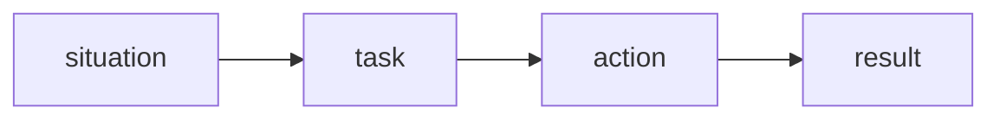
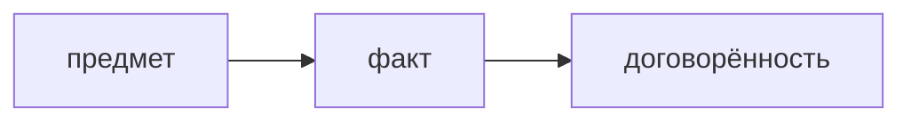
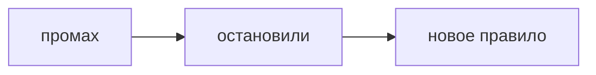
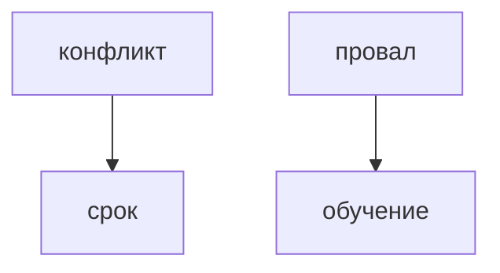

## Введение

Поведенческий вопрос проверяет не сюжет, а ваш глагол. Каркас STAR удерживает ответ, чтобы не уйти в биографию компании.

**Конфликт.** Вопрос «расскажите о конфликте» ловит тех, кто либо отрицает конфликты, либо назначает злодея. Нужен предмет спора и ваше действие, не характер коллеги.

**Провал.** Вопрос про ошибку проверяет, умеете ли вы назвать свою долю. История, где виноваты все вокруг, и история, где вы героически всё спасли без цены, обе слабые.

**Набор историй.** Не пишите двадцать текстов. Держите четыре истории: конфликт, провал, жёсткий срок, когда вы кого-то научили или вас научили. На каждую — STAR на полторы минуты.

## Раздел: Как отвечать одним блоком

Этот выпуск собрал соседние короткие темы трека: «STAR», «Конфликт», «Провал», «Набор историй». Раньше каждая занимала отдельную карточку на несколько минут, а на собеседовании их спрашивают одним блоком. Ниже у каждой темы свой раздел, затем общие лабы, один тест и одна колода карточек. В ответе сначала назовите, какую тему спросили, потом определение и один пример. Не проговаривайте все разделы, если спросили один. Лабы можно пройти по порядку исходного трека. Если времени мало, сделайте первую и последнюю: первая ставит язык, последняя проверяет, что соседние темы вы не перепутали.

## Раздел: STAR: Каркас

Situation — одна фраза контекста. Task — что было на вас. Action — два-три глагола от первого лица. Result — факт: срок, число или изменённый процесс. Всё вместе короче двух минут.

## Раздел: STAR: Ответ вслух

Я беру одну историю и раскладываю: где был, что лежало на мне, что сделал лично, чем кончилось. Если ловлю себя на «мы», возвращаюсь к своему глаголу. Итог без факта договариваю хотя бы уроком и тем, что изменил в работе.

## Раздел: STAR: Плохой ответ

Плохой ответ: пять минут про компанию и ни одного вашего действия.

## Раздел: STAR: Термины

Поведенческий вопрос — behavioral question. Каркас — STAR. Итог — result.

## Раздел: Конфликт: Сюжет

Предмет: срок, качество, граница задачи. Что вы сделали: собрали факт, предложили вариант, эскалировали по правилу, а не в чат. Чем кончилось для работы. Обида без изменения работы — слабый итог.

## Раздел: Конфликт: Ответ вслух

Я называю предмет, не человека. Говорю, какой факт принёс в спор и какой вариант предложил. Если эскалировал, говорю куда и зачем. Итог — что изменилось в решении или в сроке, не «я победил».

## Раздел: Конфликт: Плохой ответ

Плохой ответ: «конфликтов не было, я со всеми лажу». Это отказ от вопроса.

## Раздел: Конфликт: Термины

Конфликт — disagreement. Эскалация — escalation. Предмет спора — issue, не personality.

## Раздел: Провал: Доля

Что сломалось. Что сделали вы, включая промах. Что починили сразу. Какое правило или проверка появилась после. Без последнего пункта это оправдание, не вывод.

## Раздел: Провал: Ответ вслух

Я называю промах своим глаголом: не проверил, не спросил, не написал тест. Потом — как остановили ущерб. В конце — что теперь делаю иначе, желательно проверка, которую можно повторить, а не «стал внимательнее».

## Раздел: Провал: Плохой ответ

Плохой ответ: «ошибок не помню» или «просто не повезло с требованиями». Нет доли и нет изменения.

## Раздел: Провал: Термины

Провал — failure. Доля — ownership. Вывод — lesson. Проверка — check, не «буду аккуратнее».

## Раздел: Набор историй: Вопросы

«Не согласны с коллегой», «ошибка», «не успевали», «влияние без должности». Одна и та же история срока может ответить и про приоритет, и про давление, если действие было про отказ от лишнего, а не про героизм ночи.

## Раздел: Набор историй: Ответ вслух

У меня четыре карточки. Перед собеседованием я проговариваю их вслух, не читаю. Если вопрос не совпал дословно, беру ближайший каркас и не выдумываю компанию. Если истории нет, так и говорю и беру соседнюю честную.

## Раздел: Набор историй: Плохой ответ

Плохой ответ: заученная речь на три минуты, которая не отвечает на заданный вопрос.

## Раздел: Набор историй: Термины

Каркас — story. Влияние без роли — influence without authority. Срок — deadline.

## Раздел: Формулировки из исходных выпусков

STAR. Вопрос «История без цифры и без урока. Result есть?»: нет. «Стало лучше» не итог.

STAR. Вопрос «Контекст на четыре минуты. Что резать?»: situation. Оставляют действие.

STAR. Вопрос «Вопрос новый, история старая. Можно повернуть?»: да, если действие честное. Не выдумывать другой сюжет на ходу.

STAR. Вопрос «В action только «организовал процесс». Достаточно?»: слабо, нужен шаг. Что именно сказали, написали, отрезали.

STAR. Вопрос «Ответ от третьего лица про команду. Примут?»: хуже, чем от первого. Спрашивают вас.

STAR. Карточка «Четыре буквы STAR?» — Situation, Task, Action, Result..

STAR. Карточка «Что резать первым?» — Длинный контекст..

STAR. Карточка «Каким лицом говорить?» — Первым: я сделал..

STAR. Карточка «Что такое result?» — Факт или устойчивый урок..

STAR. Карточка «Сколько длится ответ?» — Около минуты–полутора..

STAR. Карточка «Можно ли одну историю на разные вопросы?» — Да, если не врать про действие..

Конфликт. Вопрос «История состоит из «он токсичный». Есть предмет?»: нет. Нет рабочего вопроса.

Конфликт. Вопрос «Вы промолчали и сделали по-своему. Это action для собеса?»: слабый. Не видно, как решали разногласие.

Конфликт. Вопрос «Эскалация сразу к директору мимо договорённости. Как звучит?»: как обход. Сначала правило команды.

Конфликт. Вопрос «Итог «меня похвалили». Хватает?»: слабо. Нужен эффект для работы.

Конфликт. Вопрос «Конфликтов правда не вспомнили. Что делать?»: взять жёсткий срок или отказ. Нулевых команд не бывает.

Конфликт. Карточка «О ком история конфликта?» — О предмете, не о характере..

Конфликт. Карточка «Какое действие ждут?» — Факт, вариант, договорённость..

Конфликт. Карточка «Чем плоха фраза «конфликтов не было»?» — Вопрос остаётся без ответа..

Конфликт. Карточка «Куда эскалировать?» — По правилу, не в обход с первой минуты..

Конфликт. Карточка «Какой итог слабый?» — Победа в споре без изменения работы..

Конфликт. Карточка «Что вычеркнуть?» — Оценки личности..

Провал. Вопрос «Вывод «стал внимательнее». Его можно проверить?»: нет. Нужна конкретная проверка.

Провал. Вопрос «Виноват только заказчик. История годится?»: слабо. Нет вашей доли.

Провал. Вопрос «Ущерб остановили, правило не изменили. Чего не хватает?»: урока в работе. Иначе ошибка повторима.

Провал. Вопрос «Мелкий провал лучше выдуманного подвига?»: да. Мелкий честный сильнее красивого.

Провал. Вопрос «Можно ли взять ту же историю, что и про конфликт?»: если это правда провал. Не переклеивать ярлык на чужой сюжет.

Провал. Карточка «Что обязательно в истории провала?» — Ваш промах и новое правило..

Провал. Карточка «Чем плох «стал внимательнее»?» — Это нельзя проверить..

Провал. Карточка «Чем плох «виноваты требования»?» — Нет вашей доли..

Провал. Карточка «Что такое ownership здесь?» — Назвать, что сделали или не сделали вы..

Провал. Карточка «Какой урок сильный?» — Проверка или шаг, который повторяется..

Провал. Карточка «Героическое спасение без цены?» — Слабый провал: нет ошибки..

Набор историй. Вопрос «Двадцать заученных текстов лучше четырёх?»: нет. На вопросе вы не найдёте нужный.

Набор историй. Вопрос «Вопрос про срок, а история про ночь без отказа от объёма. Сильно?»: слабо. Не видно выбора.

Набор историй. Вопрос «Истории нет. Выдумать?»: нет. Возьмите соседний честный случай.

Набор историй. Вопрос «Читать с листа на собесе. Нормально?»: хуже вслух. Речь проверяют ушами.

Набор историй. Вопрос «Одна история на два вопроса. Можно?»: да. Если действие отвечает на оба.

Набор историй. Карточка «Сколько историй готовить?» — Около четырёх, не двадцать..

Набор историй. Карточка «Какие четыре?» — Конфликт, провал, срок, обучение..

Набор историй. Карточка «Как тренировать?» — Вслух по таймеру..

Набор историй. Карточка «Нет точной истории?» — Честная соседняя, не выдумка..

Набор историй. Карточка «Заученная речь?» — Плохо, если не попадает в вопрос..

Набор историй. Карточка «Что такое influence without authority?» — Сдвинуть работу без должности начальника..

## Лаба

**STAR.**

**20 минут.** Напишите одну историю на 8–10 предложений строго по четырём меткам. Вычеркните каждое «мы», которое можно заменить на «я».

**Конфликт.**

**20 минут.** Перепишите историю так, чтобы в ней не было оценки характера. Только факт, действие, договорённость.

**Провал.**

**20 минут.** Напишите провал на полстраницы. Последнее предложение должно быть правилом, которое вы реально можете показать.

**Набор историй.**

**30 минут.** Заполните четыре заголовка историй и по одному result. Проговорите одну вслух по таймеру на 90 секунд.

## Схема: STAR: Каркас

## Схема: Конфликт: Спор

## Схема: Провал: Вывод

## Схема: Набор историй: Четыре карточки

## Тест

### История без цифры и без урока. Result есть?

**Ответ:** нет

**Пояснение:** «Стало лучше» не итог.

### История состоит из «он токсичный». Есть предмет?

**Ответ:** нет

**Пояснение:** Нет рабочего вопроса.

### Вывод «стал внимательнее». Его можно проверить?

**Ответ:** нет

**Пояснение:** Нужна конкретная проверка.

### Двадцать заученных текстов лучше четырёх?

**Ответ:** нет

**Пояснение:** На вопросе вы не найдёте нужный.

### Контекст на четыре минуты. Что резать?

**Ответ:** situation

**Пояснение:** Оставляют действие.

## Шпаргалка

<ul><li>Короткий контекст</li><li>Глагол от первого лица</li><li>Итог, который можно повторить</li><li>Предмет вместо злодея</li><li>Ваш ход в споре</li><li>Итог для работы</li><li>Назовите свой глагол</li><li>Остановите ущерб</li><li>Оставьте правило, не настроение</li><li>Четыре каркаса</li><li>Вслух, не с листа</li><li>Не врать сюжет</li></ul>

## Anki

### Front: Четыре буквы STAR?

Back: Situation, Task, Action, Result.

### Front: О ком история конфликта?

Back: О предмете, не о характере.

### Front: Что обязательно в истории провала?

Back: Ваш промах и новое правило.

### Front: Сколько историй готовить?

Back: Около четырёх, не двадцать.

### Front: Что резать первым?

Back: Длинный контекст.

### Front: Какое действие ждут?

Back: Факт, вариант, договорённость.

## Мнемоника

### acronym: STAR

**Задание:** Четыре части истории. Действие — самая длинная.

**Элементы:**
- Situation
- Task
- Action
- Result

**Подсказка:** Ситуация длиннее действия — рассказ про обстоятельства, не про вас.

**Ответ:** S T A R

## Итоги

- Короткий контекст
- Глагол от первого лица
- Итог, который можно повторить
- Предмет вместо злодея
- Ваш ход в споре
- Итог для работы
- Назовите свой глагол
- Остановите ущерб
