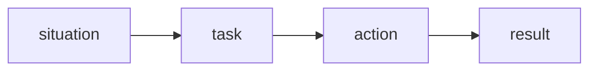

## Введение

Поведенческий вопрос проверяет не сюжет, а ваш глагол. Каркас STAR удерживает ответ, чтобы не уйти в биографию компании.

## Раздел: Каркас

Situation — одна фраза контекста. Task — что было на вас. Action — два-три глагола от первого лица. Result — факт: срок, число или изменённый процесс. Всё вместе короче двух минут.

## Раздел: Ответ вслух

Я беру одну историю и раскладываю: где был, что лежало на мне, что сделал лично, чем кончилось. Если ловлю себя на «мы», возвращаюсь к своему глаголу. Итог без факта договариваю хотя бы уроком и тем, что изменил в работе.

## Раздел: Плохой ответ

Плохой ответ: пять минут про компанию и ни одного вашего действия.

## Раздел: Термины

Поведенческий вопрос — behavioral question. Каркас — STAR. Итог — result.

## Лаба

**20 минут.** Напишите одну историю на 8–10 предложений строго по четырём меткам. Вычеркните каждое «мы», которое можно заменить на «я».

## Схема: Каркас

## Тест

### История без цифры и без урока. Result есть?

**Ответ:** нет

**Пояснение:** «Стало лучше» не итог.

### Контекст на четыре минуты. Что резать?

**Ответ:** situation

**Пояснение:** Оставляют действие.

### Вопрос новый, история старая. Можно повернуть?

**Ответ:** да, если действие честное

**Пояснение:** Не выдумывать другой сюжет на ходу.

### В action только «организовал процесс». Достаточно?

**Ответ:** слабо, нужен шаг

**Пояснение:** Что именно сказали, написали, отрезали.

### Ответ от третьего лица про команду. Примут?

**Ответ:** хуже, чем от первого

**Пояснение:** Спрашивают вас.

## Шпаргалка

<ul><li>Короткий контекст</li><li>Глагол от первого лица</li><li>Итог, который можно повторить</li></ul>

## Anki

### Front: Четыре буквы STAR?

Back: Situation, Task, Action, Result.

### Front: Что резать первым?

Back: Длинный контекст.

### Front: Каким лицом говорить?

Back: Первым: я сделал.

### Front: Что такое result?

Back: Факт или устойчивый урок.

### Front: Сколько длится ответ?

Back: Около минуты–полутора.

### Front: Можно ли одну историю на разные вопросы?

Back: Да, если не врать про действие.

## Итоги

- Короткий контекст
- Глагол от первого лица
- Итог, который можно повторить

## Ссылки

- [Конфликт](/game/learn/beh-conflict)
