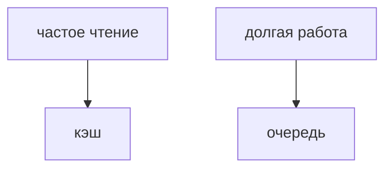

## Введение

Кэш уменьшает повторное чтение. Очередь снимает работу с запроса пользователя. Это разные коробки. На рисунке их ставят только вместе с фразой, что будет, если коробка пустая или лежит.

## Раздел: Боль

Один и тот же заказ читают сто раз — кэш, источник всё равно база. Письмо и отчёт не должны держать HTTP — очередь, пользователь получает «принято». Если воркер лежит, сообщение не должно исчезнуть. Redis pub/sub для этого слаб.

## Раздел: Ответ вслух

Кэш я ставлю на чтение, которое повторяется, и говорю TTL и что база главная. Очередь — когда работу нельзя делать внутри запроса. Отдельно говорю, что будет при промахе кэша и при мёртвом воркере.

## Раздел: Плохой ответ

Плохой ответ: «поставим Redis на всё». Не сказано, чтение это или фон, и где источник правды.

## Раздел: Термины

Кэш — cache. Промах — cache miss. Очередь — queue. Воркер — worker. Принято — accepted.

## Лаба

**20 минут.** Для «лента заказов» и «отправить чек» решите, где кэш, а где очередь. Напишите одну фразу про отказ каждой коробки.

## Схема: Две боли

## Тест

### Чек уходит минуту. Держать HTTP открытым?

**Ответ:** нет, очередь

**Пояснение:** Пользователь получает принятие, воркер доделывает.

### Кэш пуст после рестарта. Откуда заказ?

**Ответ:** из базы

**Пояснение:** Кэш не источник правды.

### Pub/sub вместо очереди на чек. В чём дыра?

**Ответ:** нет хранения

**Пояснение:** Подписчик был выключен — чек пропал.

### TTL нет, цену товара поменяли. Что увидит клиент?

**Ответ:** старую цену

**Пояснение:** Кэш надо гасить или ограничивать по времени.

### Очередь растёт, воркеров не добавляют. Это норма?

**Ответ:** нет, копится отставание

**Пояснение:** Либо больше воркеров, либо меньше работы.

## Шпаргалка

<ul><li>Кэш — чтение</li><li>Очередь — фон</li><li>У каждой коробки есть отказ</li></ul>

## Anki

### Front: Когда кэш?

Back: Повторное чтение, база остаётся главной.

### Front: Когда очередь?

Back: Работу нельзя держать внутри запроса.

### Front: Что такое cache miss?

Back: В кэше нет значения, читаем источник.

### Front: Почему не pub/sub для чека?

Back: Нет полки для сообщения, если воркер спит.

### Front: Зачем TTL?

Back: Чтобы устаревшее значение само умерло.

### Front: Что сказать про отказ?

Back: Промах кэша и мёртвый воркер — разные планы.

## Итоги

- Кэш — чтение
- Очередь — фон
- У каждой коробки есть отказ

## Ссылки

- [Redis](/game/learn/rd-kv-model)
- [Один сервис](/game/learn/sd-one-service)
