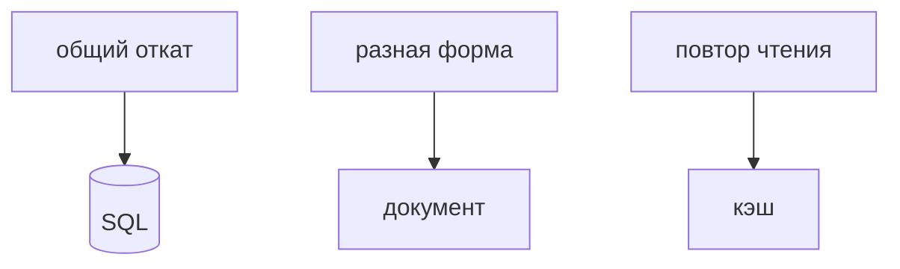

## Введение

Хранилище выбирают по вопросу «как читаем и какой инвариант нельзя потерять». Транзакция заказа и платежа — реляционная база. Лента событий разной формы — документ или журнал. Кэш — рядом, не вместо.

## Раздел: Вопросы

Нужен ли откат двух записей вместе? Нужны ли связи в запросе? Какой размер и какой доступ: по ключу или по отчёту? Отчёт по связям на куче документов без модели потом всё равно станет витриной.

## Раздел: Ответ вслух

Если две записи должны сойтись или откатиться, я беру транзакцию в реляционной базе. Если форма скачет и связи не ядро, документ. Redis называю кэшем. Шард не предлагаю, пока не сказал, по какому ключу режу.

## Раздел: Плохой ответ

Плохой ответ: «Mongo, потому что все так делают». Нет доступа и нет инварианта.

## Раздел: Термины

Инвариант — invariant. Транзакция — transaction. Шардирование — sharding. Витрина — read model.

## Лаба

**15 минут.** Заказ+оплата и лента кликов. Для каждого напишите хранилище и одну фразу, почему не другое.

## Схема: Выбор

## Тест

### Заказ и платёж в одной операции. Документ без транзакции?

**Ответ:** слаб выбор

**Пояснение:** Инвариант денег хочет общий откат.

### Клики разной формы, без отчёта в том же запросе. Таблица на каждое поле?

**Ответ:** обычно хуже документа

**Пояснение:** Схема будет врать разнообразию.

### Шард «потому что данных много». Чего не хватает?

**Ответ:** ключа разреза

**Пояснение:** Без ключа шард не спроектирован.

### Отчёт по десяти связям на документной базе. Что появится следом?

**Ответ:** витрина или выгрузка

**Пояснение:** Связи никуда не делись.

### Кэш вместо базы заказов. Принять?

**Ответ:** нет

**Пояснение:** Выселение потеряет заказ.

## Шпаргалка

<ul><li>Сначала инвариант</li><li>Потом доступ</li><li>Шард только с ключом</li></ul>

## Anki

### Front: Первый вопрос про хранилище?

Back: Какой инвариант и как читаем.

### Front: Когда SQL?

Back: Связи и общая транзакция.

### Front: Когда документ?

Back: Форма гуляет, JOIN не ядро.

### Front: Куда Redis?

Back: Рядом с источником, не вместо него.

### Front: Что назвать до шарда?

Back: Ключ, по которому режете.

### Front: Что такое read model?

Back: Отдельное представление ради чтения, не источник заказа.

## Итоги

- Сначала инвариант
- Потом доступ
- Шард только с ключом

## Ссылки

- [Отказ](/game/learn/sd-failure)
