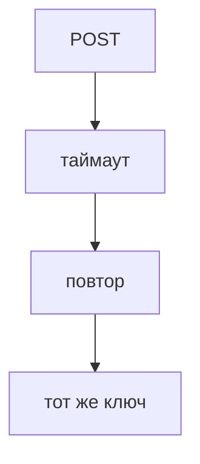

## Введение

Рисунок без отказа — реклама. На собесе достаточно одного вопроса: что будет, если эта коробка не ответит, и можно ли повторить запрос безопасно.

## Раздел: Повторы

Чтение можно повторять. Создание заказа с тем же ключом идемпотентности не задвоит деньги. Без ключа повтор POST создаст второй заказ. Таймаут — это «не знаю», не «точно не прошло».

## Раздел: Ответ вслух

Я выбираю одну коробку и говорю отказ. База лежит — API отдаёт ошибку, а не пустой успех. Кэш лежит — иду в базу и терплю медленнее. Повтор создания закрываю ключом идемпотентности, потому что таймаут не значит, что заказ не создан.

## Раздел: Плохой ответ

Плохой ответ: «у нас всё в трёх копиях, не упадёт». Копии тоже опаздывают, а повтор запроса никуда не делся.

## Раздел: Термины

Отказ — failure. Повтор — retry. Идемпотентность — idempotency. Таймаут — timeout.

## Лаба

**20 минут.** На рисунке заказа подпишите: база недоступна, кэш недоступен, клиент повторил POST. По одному предложению на случай.

## Схема: Повтор

## Тест

### Таймаут на создании заказа. Заказ точно не создан?

**Ответ:** неизвестно

**Пояснение:** Ответ мог не дойти уже после записи.

### Повтор POST без ключа. Чем рискуете?

**Ответ:** вторым заказом

**Пояснение:** Сервер не отличает повтор от нового.

### Кэш недоступен. Отдать 500 на чтение цены?

**Ответ:** лучше пойти в базу

**Пояснение:** Кэш не на критическом пути записи истины.

### База недоступна. Вернуть пустой список заказов как успех?

**Ответ:** нет, это ложь

**Пояснение:** Пустой успех прячет отказ.

### Три реплики базы. Повтор платежа можно не думать?

**Ответ:** нет

**Пояснение:** Реплики не заменяют идемпотентность.

## Шпаргалка

<ul><li>Таймаут — неизвестность</li><li>Повтор требует ключа</li><li>Пустой успех хуже ошибки</li></ul>

## Anki

### Front: Что такое timeout?

Back: Не знаем, успело ли действие. Не доказательство отказа.

### Front: Зачем ключ идемпотентности?

Back: Повтор того же запроса не делает второе действие.

### Front: Кэш лежит. Что с чтением?

Back: Читаем источник, будет медленнее.

### Front: База лежит. Что ответить?

Back: Ошибку, не пустой успех.

### Front: Почему «три копии» не закрывают вопрос?

Back: Повтор клиента остаётся отдельной дырой.

### Front: Сколько отказов разобрать минимум?

Back: Один конкретный, до конца.

## Итоги

- Таймаут — неизвестность
- Повтор требует ключа
- Пустой успех хуже ошибки

## Ссылки

- [Один сервис](/game/learn/sd-one-service)
- [Идемпотентность](/game/learn/sa-rest-advanced)
