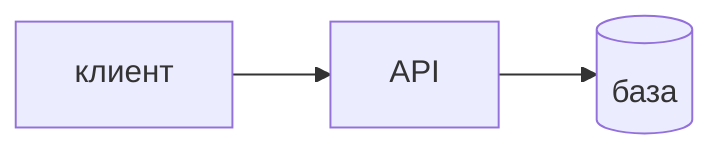
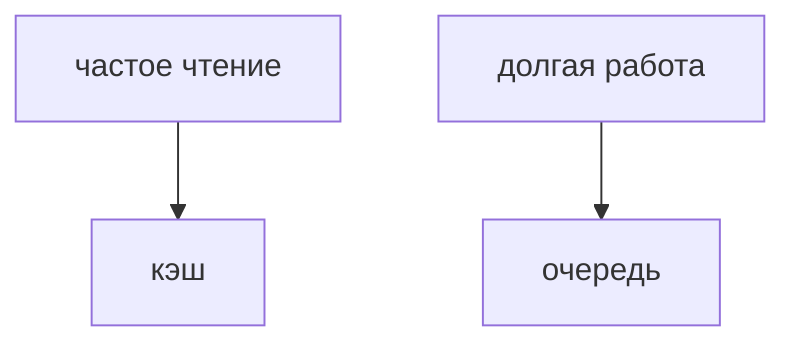
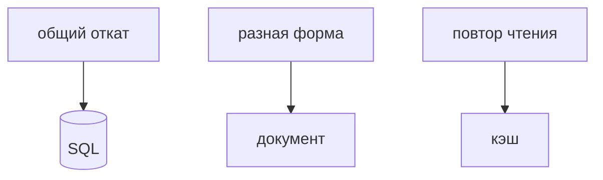
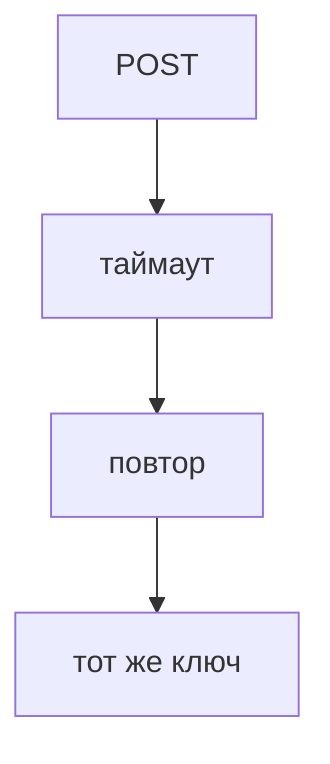

## Введение

System design на middle — не «нарисуйте Twitter целиком». Это умение начать с одного пути: кто вызывает, какой контракт, где факт, что сознательно не строим.

**Кэш и очередь.** Кэш уменьшает повторное чтение. Очередь снимает работу с запроса пользователя. Это разные коробки. На рисунке их ставят только вместе с фразой, что будет, если коробка пустая или лежит.

**Выбор данных.** Хранилище выбирают по вопросу «как читаем и какой инвариант нельзя потерять». Транзакция заказа и платежа — реляционная база. Лента событий разной формы — документ или журнал. Кэш — рядом, не вместо.

**Отказ.** Рисунок без отказа — реклама. На собесе достаточно одного вопроса: что будет, если эта коробка не ответит, и можно ли повторить запрос безопасно.

## Раздел: Как отвечать одним блоком

Этот выпуск собрал соседние короткие темы трека: «Один сервис», «Кэш и очередь», «Выбор данных», «Отказ». Раньше каждая занимала отдельную карточку на несколько минут, а на собеседовании их спрашивают одним блоком. Ниже у каждой темы свой раздел, затем общие лабы, один тест и одна колода карточек. В ответе сначала назовите, какую тему спросили, потом определение и один пример. Не проговаривайте все разделы, если спросили один. Лабы можно пройти по порядку исходного трека. Если времени мало, сделайте первую и последнюю: первая ставит язык, последняя проверяет, что соседние темы вы не перепутали.

## Раздел: Один сервис: Каркас

Клиент не ходит в базу. API проверяет вход. База хранит факт после рестарта. Рядом говорите, чего нет в первой версии: своей очереди, своего поиска, десяти сервисов. Масштаб спрашивают числом: сколько запросов и какой размер записи.

## Раздел: Один сервис: Ответ вслух

Я рисую клиент, API и базу. Называю один сценарий, например создать заказ. Говорю, сколько запросов жду, и что в первой версии нет отдельного поиска и очереди. Масштаб без числа не обсуждаю.

## Раздел: Один сервис: Плохой ответ

Плохой ответ: сразу Kafka и пять микросервисов. Нет пути «создать заказ» и нет цифры.

## Раздел: Один сервис: Термины

Проектирование — system design. Контракт — API. Факт — source of truth. Запросы в секунду — RPS.

## Раздел: Кэш и очередь: Боль

Один и тот же заказ читают сто раз — кэш, источник всё равно база. Письмо и отчёт не должны держать HTTP — очередь, пользователь получает «принято». Если воркер лежит, сообщение не должно исчезнуть. Redis pub/sub для этого слаб.

## Раздел: Кэш и очередь: Ответ вслух

Кэш я ставлю на чтение, которое повторяется, и говорю TTL и что база главная. Очередь — когда работу нельзя делать внутри запроса. Отдельно говорю, что будет при промахе кэша и при мёртвом воркере.

## Раздел: Кэш и очередь: Плохой ответ

Плохой ответ: «поставим Redis на всё». Не сказано, чтение это или фон, и где источник правды.

## Раздел: Кэш и очередь: Термины

Кэш — cache. Промах — cache miss. Очередь — queue. Воркер — worker. Принято — accepted.

## Раздел: Выбор данных: Вопросы

Нужен ли откат двух записей вместе? Нужны ли связи в запросе? Какой размер и какой доступ: по ключу или по отчёту? Отчёт по связям на куче документов без модели потом всё равно станет витриной.

## Раздел: Выбор данных: Ответ вслух

Если две записи должны сойтись или откатиться, я беру транзакцию в реляционной базе. Если форма скачет и связи не ядро, документ. Redis называю кэшем. Шард не предлагаю, пока не сказал, по какому ключу режу.

## Раздел: Выбор данных: Плохой ответ

Плохой ответ: «Mongo, потому что все так делают». Нет доступа и нет инварианта.

## Раздел: Выбор данных: Термины

Инвариант — invariant. Транзакция — transaction. Шардирование — sharding. Витрина — read model.

## Раздел: Отказ: Повторы

Чтение можно повторять. Создание заказа с тем же ключом идемпотентности не задвоит деньги. Без ключа повтор POST создаст второй заказ. Таймаут — это «не знаю», не «точно не прошло».

## Раздел: Отказ: Ответ вслух

Я выбираю одну коробку и говорю отказ. База лежит — API отдаёт ошибку, а не пустой успех. Кэш лежит — иду в базу и терплю медленнее. Повтор создания закрываю ключом идемпотентности, потому что таймаут не значит, что заказ не создан.

## Раздел: Отказ: Плохой ответ

Плохой ответ: «у нас всё в трёх копиях, не упадёт». Копии тоже опаздывают, а повтор запроса никуда не делся.

## Раздел: Отказ: Термины

Отказ — failure. Повтор — retry. Идемпотентность — idempotency. Таймаут — timeout.

## Раздел: Формулировки из исходных выпусков

Один сервис. Вопрос «Клиент пишет в базу напрямую. Принять такой рисунок?»: нет. Нет контракта и проверки.

Один сервис. Вопрос «Цифры нагрузки нет. Можно выбирать шардирование?»: рано. Сначала порядок величины.

Один сервис. Вопрос «В первой версии сразу поиск кластером. Обязательно?»: нет, если поиска нет в сценарии. Лишний ящик надо обосновать.

Один сервис. Вопрос «Где живёт факт после рестарта API?»: в базе. Память процесса — не источник правды.

Один сервис. Вопрос «Сколько сценариев разобрать в начале?»: один главный. Остальные после пути создания.

Один сервис. Карточка «С чего начать system design?» — Один сценарий: клиент, API, база..

Один сервис. Карточка «Почему не микросервисы сразу?» — Нет границы, которую уже больно держать в одном процессе..

Один сервис. Карточка «Что такое source of truth?» — Место, где факт переживёт рестарт..

Один сервис. Карточка «Зачем число RPS?» — Без него масштаб — прилагательное..

Один сервис. Карточка «Что сознательно отложить?» — Очередь, поиск, лишние сервисы, если сценарий проще..

Один сервис. Карточка «Куда клиент не ходит?» — В базу напрямую..

Кэш и очередь. Вопрос «Чек уходит минуту. Держать HTTP открытым?»: нет, очередь. Пользователь получает принятие, воркер доделывает.

Кэш и очередь. Вопрос «Кэш пуст после рестарта. Откуда заказ?»: из базы. Кэш не источник правды.

Кэш и очередь. Вопрос «Pub/sub вместо очереди на чек. В чём дыра?»: нет хранения. Подписчик был выключен — чек пропал.

Кэш и очередь. Вопрос «TTL нет, цену товара поменяли. Что увидит клиент?»: старую цену. Кэш надо гасить или ограничивать по времени.

Кэш и очередь. Вопрос «Очередь растёт, воркеров не добавляют. Это норма?»: нет, копится отставание. Либо больше воркеров, либо меньше работы.

Кэш и очередь. Карточка «Когда кэш?» — Повторное чтение, база остаётся главной..

Кэш и очередь. Карточка «Когда очередь?» — Работу нельзя держать внутри запроса..

Кэш и очередь. Карточка «Что такое cache miss?» — В кэше нет значения, читаем источник..

Кэш и очередь. Карточка «Почему не pub/sub для чека?» — Нет полки для сообщения, если воркер спит..

Кэш и очередь. Карточка «Зачем TTL?» — Чтобы устаревшее значение само умерло..

Кэш и очередь. Карточка «Что сказать про отказ?» — Промах кэша и мёртвый воркер — разные планы..

Выбор данных. Вопрос «Заказ и платёж в одной операции. Документ без транзакции?»: слаб выбор. Инвариант денег хочет общий откат.

Выбор данных. Вопрос «Клики разной формы, без отчёта в том же запросе. Таблица на каждое поле?»: обычно хуже документа. Схема будет врать разнообразию.

Выбор данных. Вопрос «Шард «потому что данных много». Чего не хватает?»: ключа разреза. Без ключа шард не спроектирован.

Выбор данных. Вопрос «Отчёт по десяти связям на документной базе. Что появится следом?»: витрина или выгрузка. Связи никуда не делись.

Выбор данных. Вопрос «Кэш вместо базы заказов. Принять?»: нет. Выселение потеряет заказ.

Выбор данных. Карточка «Первый вопрос про хранилище?» — Какой инвариант и как читаем..

Выбор данных. Карточка «Когда SQL?» — Связи и общая транзакция..

Выбор данных. Карточка «Когда документ?» — Форма гуляет, JOIN не ядро..

Выбор данных. Карточка «Куда Redis?» — Рядом с источником, не вместо него..

Выбор данных. Карточка «Что назвать до шарда?» — Ключ, по которому режете..

Выбор данных. Карточка «Что такое read model?» — Отдельное представление ради чтения, не источник заказа..

Отказ. Вопрос «Таймаут на создании заказа. Заказ точно не создан?»: неизвестно. Ответ мог не дойти уже после записи.

Отказ. Вопрос «Повтор POST без ключа. Чем рискуете?»: вторым заказом. Сервер не отличает повтор от нового.

Отказ. Вопрос «Кэш недоступен. Отдать 500 на чтение цены?»: лучше пойти в базу. Кэш не на критическом пути записи истины.

Отказ. Вопрос «База недоступна. Вернуть пустой список заказов как успех?»: нет, это ложь. Пустой успех прячет отказ.

Отказ. Вопрос «Три реплики базы. Повтор платежа можно не думать?»: нет. Реплики не заменяют идемпотентность.

Отказ. Карточка «Что такое timeout?» — Не знаем, успело ли действие. Не доказательство отказа..

Отказ. Карточка «Зачем ключ идемпотентности?» — Повтор того же запроса не делает второе действие..

Отказ. Карточка «Кэш лежит. Что с чтением?» — Читаем источник, будет медленнее..

Отказ. Карточка «База лежит. Что ответить?» — Ошибку, не пустой успех..

Отказ. Карточка «Почему «три копии» не закрывают вопрос?» — Повтор клиента остаётся отдельной дырой..

Отказ. Карточка «Сколько отказов разобрать минимум?» — Один конкретный, до конца..

## Лаба

**Один сервис.**

**20 минут.** На бумаге нарисуйте «создать заказ»: клиент, API, таблица. Подпишите одну цифру RPS, даже оценочную, и одну вещь, которую не делаете.

**Кэш и очередь.**

**20 минут.** Для «лента заказов» и «отправить чек» решите, где кэш, а где очередь. Напишите одну фразу про отказ каждой коробки.

**Выбор данных.**

**15 минут.** Заказ+оплата и лента кликов. Для каждого напишите хранилище и одну фразу, почему не другое.

**Отказ.**

**20 минут.** На рисунке заказа подпишите: база недоступна, кэш недоступен, клиент повторил POST. По одному предложению на случай.

## Схема: Один сервис: Каркас

## Схема: Кэш и очередь: Две боли

## Схема: Выбор данных: Выбор

## Схема: Отказ: Повтор

## Тест

### Клиент пишет в базу напрямую. Принять такой рисунок?

**Ответ:** нет

**Пояснение:** Нет контракта и проверки.

### Чек уходит минуту. Держать HTTP открытым?

**Ответ:** нет, очередь

**Пояснение:** Пользователь получает принятие, воркер доделывает.

### Заказ и платёж в одной операции. Документ без транзакции?

**Ответ:** слаб выбор

**Пояснение:** Инвариант денег хочет общий откат.

### Таймаут на создании заказа. Заказ точно не создан?

**Ответ:** неизвестно

**Пояснение:** Ответ мог не дойти уже после записи.

### Цифры нагрузки нет. Можно выбирать шардирование?

**Ответ:** рано

**Пояснение:** Сначала порядок величины.

## Шпаргалка

<ul><li>Один сценарий</li><li>Клиент, API, база</li><li>Цифра и список «не делаем»</li><li>Кэш — чтение</li><li>Очередь — фон</li><li>У каждой коробки есть отказ</li><li>Сначала инвариант</li><li>Потом доступ</li><li>Шард только с ключом</li><li>Таймаут — неизвестность</li><li>Повтор требует ключа</li><li>Пустой успех хуже ошибки</li></ul>

## Anki

### Front: С чего начать system design?

Back: Один сценарий: клиент, API, база.

### Front: Когда кэш?

Back: Повторное чтение, база остаётся главной.

### Front: Первый вопрос про хранилище?

Back: Какой инвариант и как читаем.

### Front: Что такое timeout?

Back: Не знаем, успело ли действие. Не доказательство отказа.

### Front: Почему не микросервисы сразу?

Back: Нет границы, которую уже больно держать в одном процессе.

### Front: Когда очередь?

Back: Работу нельзя держать внутри запроса.

## Мнемоника

### loci: Один сервис

**Задание:** Комнаты рисунка на доске.

**Элементы:**
- клиент
- API
- данные
- отказ

**Подсказка:** Кэш и очередь добавляют, когда назвали, что болит без них.

**Ответ:** клиент → API → данные → отказ

## Итоги

- Один сценарий
- Клиент, API, база
- Цифра и список «не делаем»
- Кэш — чтение
- Очередь — фон
- У каждой коробки есть отказ
- Сначала инвариант
- Потом доступ

## Ссылки

- [Слои](/game/learn/s01e01-sloi)
- [Redis](/game/learn/rd-kv-model)
- [Идемпотентность](/game/learn/sa-sync-async-queues)
