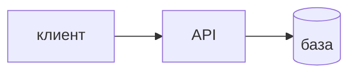

## Введение

System design на middle — не «нарисуйте Twitter целиком». Это умение начать с одного пути: кто вызывает, какой контракт, где факт, что сознательно не строим.

## Раздел: Каркас

Клиент не ходит в базу. API проверяет вход. База хранит факт после рестарта. Рядом говорите, чего нет в первой версии: своей очереди, своего поиска, десяти сервисов. Масштаб спрашивают числом: сколько запросов и какой размер записи.

## Раздел: Ответ вслух

Я рисую клиент, API и базу. Называю один сценарий, например создать заказ. Говорю, сколько запросов жду, и что в первой версии нет отдельного поиска и очереди. Масштаб без числа не обсуждаю.

## Раздел: Плохой ответ

Плохой ответ: сразу Kafka и пять микросервисов. Нет пути «создать заказ» и нет цифры.

## Раздел: Термины

Проектирование — system design. Контракт — API. Факт — source of truth. Запросы в секунду — RPS.

## Лаба

**20 минут.** На бумаге нарисуйте «создать заказ»: клиент, API, таблица. Подпишите одну цифру RPS, даже оценочную, и одну вещь, которую не делаете.

## Схема: Каркас

## Тест

### Клиент пишет в базу напрямую. Принять такой рисунок?

**Ответ:** нет

**Пояснение:** Нет контракта и проверки.

### Цифры нагрузки нет. Можно выбирать шардирование?

**Ответ:** рано

**Пояснение:** Сначала порядок величины.

### В первой версии сразу поиск кластером. Обязательно?

**Ответ:** нет, если поиска нет в сценарии

**Пояснение:** Лишний ящик надо обосновать.

### Где живёт факт после рестарта API?

**Ответ:** в базе

**Пояснение:** Память процесса — не источник правды.

### Сколько сценариев разобрать в начале?

**Ответ:** один главный

**Пояснение:** Остальные после пути создания.

## Шпаргалка

<ul><li>Один сценарий</li><li>Клиент, API, база</li><li>Цифра и список «не делаем»</li></ul>

## Anki

### Front: С чего начать system design?

Back: Один сценарий: клиент, API, база.

### Front: Почему не микросервисы сразу?

Back: Нет границы, которую уже больно держать в одном процессе.

### Front: Что такое source of truth?

Back: Место, где факт переживёт рестарт.

### Front: Зачем число RPS?

Back: Без него масштаб — прилагательное.

### Front: Что сознательно отложить?

Back: Очередь, поиск, лишние сервисы, если сценарий проще.

### Front: Куда клиент не ходит?

Back: В базу напрямую.

## Итоги

- Один сценарий
- Клиент, API, база
- Цифра и список «не делаем»

## Ссылки

- [Кэш и очередь](/game/learn/sd-cache-queue)
- [Слои](/game/learn/s01e01-sloi)
