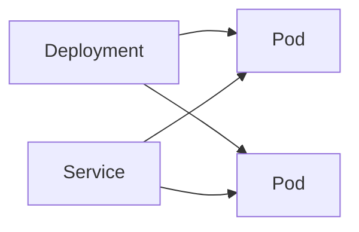

## Введение

Лист карты даёт определения. Здесь их надо уметь связать: Deployment держит Pod, Service прячет их сменяемые адреса, пробы решают, пускать ли трафик и жить ли контейнеру.

## Раздел: Связка

Pod умирает вместе с процессом. Deployment создаёт новый. Service выбирает живые Pod по метке. Readiness ложная — трафик всё равно придёт и получит ошибку. Liveness слишком злая — контейнер перезапускают по кругу, хотя он ещё стартует.

## Раздел: Ответ вслух

Я говорю: Pod — единица запуска, Deployment — желаемое число и выкатка, Service — стабильный адрес. Проба готовности отдельна от живости. Если трафик приходит в неготовый Pod, я смотрю readiness, а не добавляю реплики вслепую.

## Раздел: Плохой ответ

Плохой ответ: «Pod сам перезапустится». Без контроллера его никто не держит.

## Раздел: Термины

Под — Pod. Контроллер выкатки — Deployment. Служба — Service. Метка — label. Проба — probe.

## Лаба

**20 минут.** Нарисуйте Deployment, два Pod и Service. Стрелкой покажите, куда денется трафик, если readiness одного Pod красная.

## Схема: Связка

## Тест

### Pod без Deployment удалили. Кто создаст новый?

**Ответ:** никто

**Пояснение:** Нет контроллера.

### Клиент запомнил IP Pod. После выкатки он жив?

**Ответ:** часто нет

**Пояснение:** Адрес Pod меняется. Ходят в Service.

### Readiness красная, liveness зелёная. Перезапускать?

**Ответ:** не из-за readiness

**Пояснение:** Readiness снимает трафик, не убивает.

### Liveness падает на старте 40 секунд. Что поправить сначала?

**Ответ:** пробу и время старта

**Пояснение:** Не число реплик.

### Service без совпадающих меток. Куда уйдёт трафик?

**Ответ:** в пустоту

**Пояснение:** Некого выбрать.

## Шпаргалка

<ul><li>Три объекта связаны</li><li>IP Pod не адрес клиента</li><li>Пробы не взаимозаменяемы</li></ul>

## Anki

### Front: Pod?

Back: Контейнеры, которые живут и умирают вместе.

### Front: Deployment?

Back: Держит число Pod и выкатывает версию.

### Front: Service?

Back: Стабильный адрес поверх сменяемых Pod.

### Front: Readiness?

Back: Можно ли слать трафик.

### Front: Liveness?

Back: Нужно ли перезапустить контейнер.

### Front: Зачем label?

Back: Service находит свои Pod.

## Итоги

- Три объекта связаны
- IP Pod не адрес клиента
- Пробы не взаимозаменяемы

## Ссылки

- [Пайплайн](/game/learn/ops-ci-pipeline)
