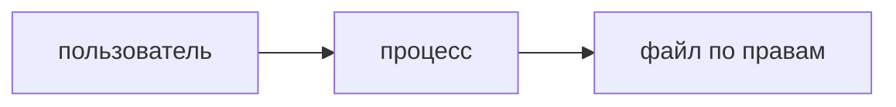

## Введение

DevOps-собес начинается не с кластера, а с процесса: кто его запустил, каким пользователем, какой порт слушает и почему «permission denied» не лечится перезапуском.

## Раздел: Минимум

Процесс имеет пользователя и родителя. Порт ниже 1024 часто требует отдельных прав. Файл 644 читают многие, пишут хозяин. Каталог без execute не даёт войти внутрь, даже если файл внутри вроде читаемый. Секрет в командной строке процесса виден соседям по хосту.

## Раздел: Ответ вслух

Я смотрю пользователя процесса и права на файл и каталог. Permission denied не лечу sudo на всё. Порт и пользователь называю явно. Секрет в аргументах процесса считаю утечкой.

## Раздел: Плохой ответ

Плохой ответ: «поставил chmod 777». Это сняло симптом и открыло файл всем.

## Раздел: Термины

Процесс — process. Права — permissions. Владелец — owner. Запрет — permission denied.

## Лаба

**15 минут.** Для файла ключа напишите права уже, чем 777, и пользователя, от которого должен читаться процесс. Объясните, почему каталогу нужен execute.

## Схема: Кто запускает

## Тест

### chmod 777 починил запуск. Оставить так?

**Ответ:** нет

**Пояснение:** Файл стал общим.

### В каталог нет execute. Файл внутри 644. Зайдёте?

**Ответ:** нет

**Пояснение:** В каталог надо войти.

### Секрет в argv процесса. Кто его видит?

**Ответ:** кто видит список процессов

**Пояснение:** Аргументы не тайник.

### Сервис слушает 80 от обычного пользователя и не стартует. Куда смотреть?

**Ответ:** на право низкого порта

**Пояснение:** Не сразу на код приложения.

### Перезапуск лечит неверного пользователя файла?

**Ответ:** нет

**Пояснение:** Процесс снова упрётся в права.

## Шпаргалка

<ul><li>Смотрите пользователя</li><li>777 не починка</li><li>Каталог требует входа</li></ul>

## Anki

### Front: Что у процесса есть всегда?

Back: Пользователь и родитель.

### Front: Чем плох 777?

Back: Писать и читать могут все.

### Front: Зачем execute на каталоге?

Back: Чтобы в него войти.

### Front: Секрет в командной строке?

Back: Виден в списке процессов.

### Front: permission denied лечится перезапуском?

Back: Нет.

### Front: Низкий порт?

Back: Часто нужны отдельные права.

## Итоги

- Смотрите пользователя
- 777 не починка
- Каталог требует входа

## Ссылки

- [Объекты Kubernetes](/game/learn/ops-k8s-objects)
- [QA про shell](/game/learn/qa-infra-linux-containers)
