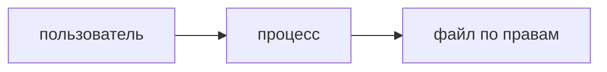
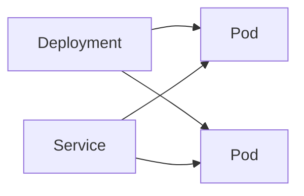
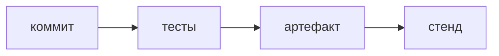

## Введение

DevOps-собес начинается не с кластера, а с процесса: кто его запустил, каким пользователем, какой порт слушает и почему «permission denied» не лечится перезапуском.

**Объекты Kubernetes.** Лист карты даёт определения. Здесь их надо уметь связать: Deployment держит Pod, Service прячет их сменяемые адреса, пробы решают, пускать ли трафик и жить ли контейнеру.

**Пайплайн.** Пайплайн нужен, чтобы прод получал то, что уже прошло проверку. Отдельная сборка «ещё раз на сервере» это обещание ломает.

## Раздел: Как отвечать одним блоком

Этот выпуск собрал соседние короткие темы трека: «Процесс», «Объекты Kubernetes», «Пайплайн». Раньше каждая занимала отдельную карточку на несколько минут, а на собеседовании их спрашивают одним блоком. Ниже у каждой темы свой раздел, затем общие лабы, один тест и одна колода карточек. В ответе сначала назовите, какую тему спросили, потом определение и один пример. Не проговаривайте все разделы, если спросили один. Лабы можно пройти по порядку исходного трека. Если времени мало, сделайте первую и последнюю: первая ставит язык, последняя проверяет, что соседние темы вы не перепутали.

## Раздел: Процесс: Минимум

Процесс имеет пользователя и родителя. Порт ниже 1024 часто требует отдельных прав. Файл 644 читают многие, пишут хозяин. Каталог без execute не даёт войти внутрь, даже если файл внутри вроде читаемый. Секрет в командной строке процесса виден соседям по хосту.

## Раздел: Процесс: Ответ вслух

Я смотрю пользователя процесса и права на файл и каталог. Permission denied не лечу sudo на всё. Порт и пользователь называю явно. Секрет в аргументах процесса считаю утечкой.

## Раздел: Процесс: Плохой ответ

Плохой ответ: «поставил chmod 777». Это сняло симптом и открыло файл всем.

## Раздел: Процесс: Термины

Процесс — process. Права — permissions. Владелец — owner. Запрет — permission denied.

## Раздел: Объекты Kubernetes: Связка

Pod умирает вместе с процессом. Deployment создаёт новый. Service выбирает живые Pod по метке. Readiness ложная — трафик всё равно придёт и получит ошибку. Liveness слишком злая — контейнер перезапускают по кругу, хотя он ещё стартует.

## Раздел: Объекты Kubernetes: Ответ вслух

Я говорю: Pod — единица запуска, Deployment — желаемое число и выкатка, Service — стабильный адрес. Проба готовности отдельна от живости. Если трафик приходит в неготовый Pod, я смотрю readiness, а не добавляю реплики вслепую.

## Раздел: Объекты Kubernetes: Плохой ответ

Плохой ответ: «Pod сам перезапустится». Без контроллера его никто не держит.

## Раздел: Объекты Kubernetes: Термины

Под — Pod. Контроллер выкатки — Deployment. Служба — Service. Метка — label. Проба — probe.

## Раздел: Пайплайн: Шаги

Взять коммит, собрать, прогнать тесты, сохранить артефакт, выложить его же. Секрет в логе — ротация. Красные тесты не обходят ручным копированием. Откат — снова выложить прошлый артефакт, не пересобрать из памяти.

## Раздел: Пайплайн: Ответ вслух

Я описываю путь: коммит, тесты, артефакт, тот же артефакт на стенд. Если тесты красные, выкладки нет. Откат — предыдущий артефакт. Секрет, засветившийся в логе, меняю.

## Раздел: Пайплайн: Плохой ответ

Плохой ответ: «CI — это значок в GitHub». Нет артефакта и нет запрета ручной дороги.

## Раздел: Пайплайн: Термины

Пайплайн — pipeline. Артефакт — artifact. Откат — rollback. Непрерывная поставка — continuous delivery.

## Раздел: Формулировки из исходных выпусков

Процесс. Вопрос «chmod 777 починил запуск. Оставить так?»: нет. Файл стал общим.

Процесс. Вопрос «В каталог нет execute. Файл внутри 644. Зайдёте?»: нет. В каталог надо войти.

Процесс. Вопрос «Секрет в argv процесса. Кто его видит?»: кто видит список процессов. Аргументы не тайник.

Процесс. Вопрос «Сервис слушает 80 от обычного пользователя и не стартует. Куда смотреть?»: на право низкого порта. Не сразу на код приложения.

Процесс. Вопрос «Перезапуск лечит неверного пользователя файла?»: нет. Процесс снова упрётся в права.

Процесс. Карточка «Что у процесса есть всегда?» — Пользователь и родитель..

Процесс. Карточка «Чем плох 777?» — Писать и читать могут все..

Процесс. Карточка «Зачем execute на каталоге?» — Чтобы в него войти..

Процесс. Карточка «Секрет в командной строке?» — Виден в списке процессов..

Процесс. Карточка «permission denied лечится перезапуском?» — Нет..

Процесс. Карточка «Низкий порт?» — Часто нужны отдельные права..

Объекты Kubernetes. Вопрос «Pod без Deployment удалили. Кто создаст новый?»: никто. Нет контроллера.

Объекты Kubernetes. Вопрос «Клиент запомнил IP Pod. После выкатки он жив?»: часто нет. Адрес Pod меняется. Ходят в Service.

Объекты Kubernetes. Вопрос «Readiness красная, liveness зелёная. Перезапускать?»: не из-за readiness. Readiness снимает трафик, не убивает.

Объекты Kubernetes. Вопрос «Liveness падает на старте 40 секунд. Что поправить сначала?»: пробу и время старта. Не число реплик.

Объекты Kubernetes. Вопрос «Service без совпадающих меток. Куда уйдёт трафик?»: в пустоту. Некого выбрать.

Объекты Kubernetes. Карточка «Pod?» — Контейнеры, которые живут и умирают вместе..

Объекты Kubernetes. Карточка «Deployment?» — Держит число Pod и выкатывает версию..

Объекты Kubernetes. Карточка «Service?» — Стабильный адрес поверх сменяемых Pod..

Объекты Kubernetes. Карточка «Readiness?» — Можно ли слать трафик..

Объекты Kubernetes. Карточка «Liveness?» — Нужно ли перезапустить контейнер..

Объекты Kubernetes. Карточка «Зачем label?» — Service находит свои Pod..

Пайплайн. Вопрос «Тесты красные, на сервер скопировали руками. Пайплайн жив?»: нет, его обошли. Проверка не была воротами.

Пайплайн. Вопрос «На проде собрали заново из той же ветки. Это тот же артефакт?»: не обязательно. Зависимости и время могли разойтись.

Пайплайн. Вопрос «Как откатить без новой сборки?»: выложить прошлый артефакт. Он уже был проверен.

Пайплайн. Вопрос «Секрет напечатался в логе шага. Достаточно скрыть лог?»: нет, секрет сменить. Он уже в хранилище логов.

Пайплайн. Вопрос «Один пайплайн на тест и прод с разными артефактами. В чём риск?»: прод не проверяли. Проверять надо то, что выкладываете.

Пайплайн. Карточка «Зачем пайплайн?» — Одинаковый путь от коммита до стенда..

Пайплайн. Карточка «Что выкладывать?» — Тот артефакт, который прошёл тесты..

Пайплайн. Карточка «Красные тесты и ручное копирование?» — Обход пайплайна..

Пайплайн. Карточка «Как откатывать?» — Прошлым артефактом..

Пайплайн. Карточка «Секрет в логе?» — Менять секрет..

Пайплайн. Карточка «Повторная сборка на проде?» — Уже другой артефакт..

## Раздел: Границы соседних тем

Блок «Как отвечать одним блоком» отвечает на отдельный вопрос билета. Сначала назовите границу: когда приём уместен и какой соседний приём берут вместо него. Потом дайте один пример из лабы этого выпуска, без пересказа всего раздела. Если пример не вспоминается, вернитесь к шпаргалке и закройте только этот блок, не весь трек.

Блок «Процесс: Минимум» отвечает на отдельный вопрос билета. Сначала назовите границу: когда приём уместен и какой соседний приём берут вместо него. Потом дайте один пример из лабы этого выпуска, без пересказа всего раздела. Если пример не вспоминается, вернитесь к шпаргалке и закройте только этот блок, не весь трек.

Блок «Процесс: Ответ вслух» отвечает на отдельный вопрос билета. Сначала назовите границу: когда приём уместен и какой соседний приём берут вместо него. Потом дайте один пример из лабы этого выпуска, без пересказа всего раздела. Если пример не вспоминается, вернитесь к шпаргалке и закройте только этот блок, не весь трек.

Блок «Процесс: Плохой ответ» отвечает на отдельный вопрос билета. Сначала назовите границу: когда приём уместен и какой соседний приём берут вместо него. Потом дайте один пример из лабы этого выпуска, без пересказа всего раздела. Если пример не вспоминается, вернитесь к шпаргалке и закройте только этот блок, не весь трек.

Блок «Процесс: Термины» отвечает на отдельный вопрос билета. Сначала назовите границу: когда приём уместен и какой соседний приём берут вместо него. Потом дайте один пример из лабы этого выпуска, без пересказа всего раздела. Если пример не вспоминается, вернитесь к шпаргалке и закройте только этот блок, не весь трек.

Блок «Объекты Kubernetes: Связка» отвечает на отдельный вопрос билета. Сначала назовите границу: когда приём уместен и какой соседний приём берут вместо него. Потом дайте один пример из лабы этого выпуска, без пересказа всего раздела. Если пример не вспоминается, вернитесь к шпаргалке и закройте только этот блок, не весь трек.

Блок «Объекты Kubernetes: Ответ вслух» отвечает на отдельный вопрос билета. Сначала назовите границу: когда приём уместен и какой соседний приём берут вместо него. Потом дайте один пример из лабы этого выпуска, без пересказа всего раздела. Если пример не вспоминается, вернитесь к шпаргалке и закройте только этот блок, не весь трек.

Блок «Объекты Kubernetes: Плохой ответ» отвечает на отдельный вопрос билета. Сначала назовите границу: когда приём уместен и какой соседний приём берут вместо него. Потом дайте один пример из лабы этого выпуска, без пересказа всего раздела. Если пример не вспоминается, вернитесь к шпаргалке и закройте только этот блок, не весь трек.

Блок «Объекты Kubernetes: Термины» отвечает на отдельный вопрос билета. Сначала назовите границу: когда приём уместен и какой соседний приём берут вместо него. Потом дайте один пример из лабы этого выпуска, без пересказа всего раздела. Если пример не вспоминается, вернитесь к шпаргалке и закройте только этот блок, не весь трек.

Блок «Пайплайн: Шаги» отвечает на отдельный вопрос билета. Сначала назовите границу: когда приём уместен и какой соседний приём берут вместо него. Потом дайте один пример из лабы этого выпуска, без пересказа всего раздела. Если пример не вспоминается, вернитесь к шпаргалке и закройте только этот блок, не весь трек.

Блок «Пайплайн: Ответ вслух» отвечает на отдельный вопрос билета. Сначала назовите границу: когда приём уместен и какой соседний приём берут вместо него. Потом дайте один пример из лабы этого выпуска, без пересказа всего раздела. Если пример не вспоминается, вернитесь к шпаргалке и закройте только этот блок, не весь трек.

Блок «Пайплайн: Плохой ответ» отвечает на отдельный вопрос билета. Сначала назовите границу: когда приём уместен и какой соседний приём берут вместо него. Потом дайте один пример из лабы этого выпуска, без пересказа всего раздела. Если пример не вспоминается, вернитесь к шпаргалке и закройте только этот блок, не весь трек.

Блок «Пайплайн: Термины» отвечает на отдельный вопрос билета. Сначала назовите границу: когда приём уместен и какой соседний приём берут вместо него. Потом дайте один пример из лабы этого выпуска, без пересказа всего раздела. Если пример не вспоминается, вернитесь к шпаргалке и закройте только этот блок, не весь трек.

Блок «Формулировки из исходных выпусков» отвечает на отдельный вопрос билета. Сначала назовите границу: когда приём уместен и какой соседний приём берут вместо него. Потом дайте один пример из лабы этого выпуска, без пересказа всего раздела. Если пример не вспоминается, вернитесь к шпаргалке и закройте только этот блок, не весь трек.

## Лаба

**Процесс.**

**15 минут.** Для файла ключа напишите права уже, чем 777, и пользователя, от которого должен читаться процесс. Объясните, почему каталогу нужен execute.

**Объекты Kubernetes.**

**20 минут.** Нарисуйте Deployment, два Pod и Service. Стрелкой покажите, куда денется трафик, если readiness одного Pod красная.

**Пайплайн.**

**20 минут.** Выпишите шаги своего учебного выклада. Отметьте, где артефакт мог бы пересобраться заново, и уберите этот шаг.

## Схема: Процесс: Кто запускает

## Схема: Объекты Kubernetes: Связка

## Схема: Пайплайн: Путь

## Тест

### chmod 777 починил запуск. Оставить так?

**Ответ:** нет

**Пояснение:** Файл стал общим.

### Pod без Deployment удалили. Кто создаст новый?

**Ответ:** никто

**Пояснение:** Нет контроллера.

### Тесты красные, на сервер скопировали руками. Пайплайн жив?

**Ответ:** нет, его обошли

**Пояснение:** Проверка не была воротами.

### В каталог нет execute. Файл внутри 644. Зайдёте?

**Ответ:** нет

**Пояснение:** В каталог надо войти.

### Клиент запомнил IP Pod. После выкатки он жив?

**Ответ:** часто нет

**Пояснение:** Адрес Pod меняется. Ходят в Service.

## Шпаргалка

<ul><li>Смотрите пользователя</li><li>777 не починка</li><li>Каталог требует входа</li><li>Три объекта связаны</li><li>IP Pod не адрес клиента</li><li>Пробы не взаимозаменяемы</li><li>Один артефакт на все стенды</li><li>Красное не выкладывают</li><li>Откат не новая сборка</li></ul>

## Anki

### Front: Что у процесса есть всегда?

Back: Пользователь и родитель.

### Front: Pod?

Back: Контейнеры, которые живут и умирают вместе.

### Front: Зачем пайплайн?

Back: Одинаковый путь от коммита до стенда.

### Front: Чем плох 777?

Back: Писать и читать могут все.

### Front: Deployment?

Back: Держит число Pod и выкатывает версию.

### Front: Что выкладывать?

Back: Тот артефакт, который прошёл тесты.

## Итоги

- Смотрите пользователя
- 777 не починка
- Каталог требует входа
- Три объекта связаны
- IP Pod не адрес клиента
- Пробы не взаимозаменяемы
- Один артефакт на все стенды
- Красное не выкладывают

## Ссылки

- [QA про shell](/game/learn/qa-infra-linux-containers)
- [Секреты](/game/learn/sec-authn-authz)
