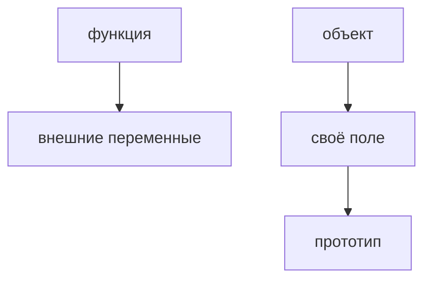

## Введение

Замыкание и прототип — два разных механизма, которые на собесе смешивают. Замыкание про область видимости функции. Прототип про поиск свойства у объекта.

## Раздел: Развести

Внутренняя функция держит переменные внешней, пока жива сама. Цикл с var и функциями на каждой итерации часто делит одну переменную. Прототип: нет своего поля — смотрят в прототип. Это не копия полей в каждый объект.

## Раздел: Ответ вслух

Замыкание я объясняю жизнью переменной: функция унесла её с собой. Прототип — запасной объект для поиска поля. Если поле своё, до прототипа дело не доходит. Цикл и var — пример, где все функции видят одно и то же позднее значение.

## Раздел: Плохой ответ

Плохой ответ: «замыкание — это когда функция внутри функции». Без того, какие переменные она унесла, определения нет.

## Раздел: Термины

Замыкание — closure. Область — scope. Прототип — prototype. Цепочка — prototype chain.

## Лаба

**20 минут.** В [/game/code](/game/code) сделайте три функции в цикле так, чтобы каждая помнила свой номер. Скажите, почему var этого не даёт.

## Схема: Два поиска

## Тест

### Все колбэки цикла на var печатают последнее i. Почему?

**Ответ:** одна переменная на всех

**Пояснение:** Замыкание унесло её, не копию на шаге.

### Своё поле есть. Пойдём в прототип?

**Ответ:** нет

**Пояснение:** Своё ближе.

### Прототип копирует поля в объект при создании?

**Ответ:** нет, это поиск

**Пояснение:** Поле одно на цепочке, пока своё не завели.

### Функция вернулась из внешней и внешняя закончилась. Переменная умерла?

**Ответ:** нет, если внутренняя жива

**Пояснение:** Это и есть замыкание.

### let в цикле вместо var для номера. Станет ли у каждой функции свой?

**Ответ:** да, на каждой итерации своя привязка

**Пояснение:** Это частый ремонт примера.

## Шпаргалка

<ul><li>Замыкание хранит переменные</li><li>var в цикле один на всех</li><li>Прототип — поиск, не копия</li></ul>

## Anki

### Front: Что такое closure?

Back: Функция помнит переменные, в которых была создана.

### Front: Почему var в цикле общий?

Back: Одна переменная, функции видят её конец.

### Front: Что такое prototype chain?

Back: Поиск поля: своё, потом прототип.

### Front: Своё поле перекрывает прототип?

Back: Да.

### Front: Прототип копирует поля?

Back: Нет.

### Front: Замыкание и прототип — одно?

Back: Нет. Область и поиск свойства.

## Итоги

- Замыкание хранит переменные
- var в цикле один на всех
- Прототип — поиск, не копия

## Ссылки

- [Цикл событий](/game/learn/fe-event-loop)
- [React](/game/learn/fe-react-state)
