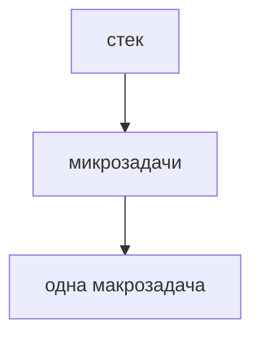
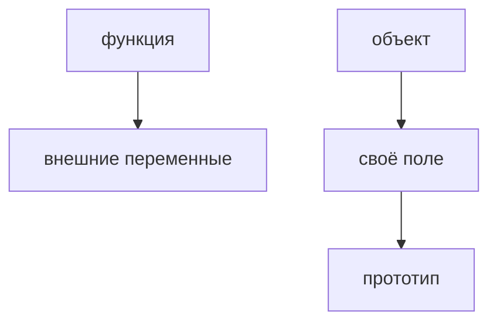
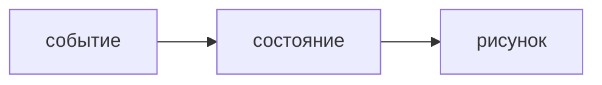
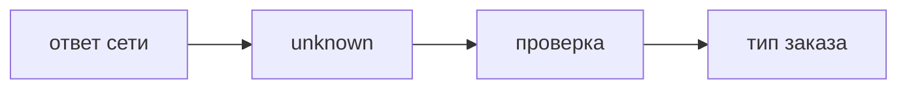

## Введение

JavaScript в браузере выполняет один стек вызовов. Очереди рядом решают, что попадёт в стек следующим. Это объясняет порядок логов лучше, чем фраза «оно асинхронное».

**Замыкание.** Замыкание и прототип — два разных механизма, которые на собесе смешивают. Замыкание про область видимости функции. Прототип про поиск свойства у объекта.

**Состояние React.** Сезон уже показывает список и форму. На собесе этого мало: нужно сказать, что рисуется состояние, зачем ключ и почему править объект состояния на месте нельзя.

**TypeScript.** TypeScript на собесе — не «я пишу двоеточия». Это где вы сужаете неизвестные данные с границы сети и где any протаскивает что угодно дальше.

## Раздел: Как отвечать одним блоком

Этот выпуск собрал соседние короткие темы трека: «Цикл событий», «Замыкание», «Состояние React», «TypeScript». Раньше каждая занимала отдельную карточку на несколько минут, а на собеседовании их спрашивают одним блоком. Ниже у каждой темы свой раздел, затем общие лабы, один тест и одна колода карточек. В ответе сначала назовите, какую тему спросили, потом определение и один пример. Не проговаривайте все разделы, если спросили один. Лабы можно пройти по порядку исходного трека. Если времени мало, сделайте первую и последнюю: первая ставит язык, последняя проверяет, что соседние темы вы не перепутали.

## Раздел: Цикл событий: Очереди

Синхронный код дорабатывает стек. Потом микрозадачи: колбэки Promise. Потом одна макрозадача вроде setTimeout, и снова микрозадачи. Поэтому resolve логируется раньше нулевого таймера, даже если таймер поставлен раньше.

## Раздел: Цикл событий: Ответ вслух

Я говорю: один стек. Сначала дочищаю синхронный код. Потом все микрозадачи промисов. Таймер — макрозадача, он ждёт эту очередь. Нулевая задержка не значит «прямо сейчас».

## Раздел: Цикл событий: Плохой ответ

Плохой ответ: «setTimeout(0) выполнится сразу после строки». Его поставят в очередь макрозадач.

## Раздел: Цикл событий: Термины

Цикл событий — event loop. Стек — call stack. Микрозадача — microtask. Макрозадача — macrotask.

## Раздел: Замыкание: Развести

Внутренняя функция держит переменные внешней, пока жива сама. Цикл с var и функциями на каждой итерации часто делит одну переменную. Прототип: нет своего поля — смотрят в прототип. Это не копия полей в каждый объект.

## Раздел: Замыкание: Ответ вслух

Замыкание я объясняю жизнью переменной: функция унесла её с собой. Прототип — запасной объект для поиска поля. Если поле своё, до прототипа дело не доходит. Цикл и var — пример, где все функции видят одно и то же позднее значение.

## Раздел: Замыкание: Плохой ответ

Плохой ответ: «замыкание — это когда функция внутри функции». Без того, какие переменные она унесла, определения нет.

## Раздел: Замыкание: Термины

Замыкание — closure. Область — scope. Прототип — prototype. Цепочка — prototype chain.

## Раздел: Состояние React: Модель

setState ставит следующее значение, рендер рисует его. Прямая мутация массива может не выглядеть изменением. Ключ помогает понять, тот ли это элемент списка. Индекс как ключ ломается, когда строки переставляют или удаляют из середины.

## Раздел: Состояние React: Ответ вслух

Я не рисую «как-нибудь DOM». Я меняю состояние, React рисует снова. Массив копирую, а не пушу в старый, если от этого зависит рендер. Ключ беру из id данных. Индекс — только если список не дышит.

## Раздел: Состояние React: Плохой ответ

Плохой ответ: «ключ — это чтобы не было warning». Ключ — личность элемента, не способ заткнуть консоль.

## Раздел: Состояние React: Термины

Состояние — state. Рендер — render. Ключ — key. Мутация — mutation.

## Раздел: TypeScript: Граница

Ответ fetch — unknown, пока не проверили поле. any позволяет вызвать что угодно и замолчать ошибку. Структурная совместимость: объекту достаточно нужных полей, имя типа не обязано совпасть. Утверждение as без проверки — дыра на границе.

## Раздел: TypeScript: Ответ вслух

На границе сети я ставлю unknown и проверяю поле до использования. any не возвращаю из функции, иначе типы вокруг врут. Приведение без проверки называю отказом от проверки, не «удобством».

## Раздел: TypeScript: Плохой ответ

Плохой ответ: «везде any, чтобы компилятор не мешал». Тогда TypeScript ничего не проверяет.

## Раздел: TypeScript: Термины

Неизвестное — unknown. Любое — any. Сужение — narrowing. Утверждение — type assertion. Структурная типизация — structural typing.

## Раздел: Формулировки из исходных выпусков

Цикл событий. Вопрос «Promise.then и setTimeout(0). Кто раньше после синхронного кода?»: then. Микрозадачи идут до макрозадач.

Цикл событий. Вопрос «setTimeout(0) выполнится немедленно?»: нет. Он ждёт очередь.

Цикл событий. Вопрос «Два then подряд. Между ними влезет таймер?»: нет, если стек пуст и микрозадачи не кончились. Очередь микрозадач дочищают.

Цикл событий. Вопрос «Бесконечный синхронный цикл. Когда сработает таймер?»: не сработает. Стек не отпускает.

Цикл событий. Вопрос «Можно ли считать JS многопоточным из-за async?»: нет, один стек. Параллельность здесь про очереди, не про второе ядро скрипта.

Цикл событий. Карточка «Сколько стеков у страничного JS?» — Один..

Цикл событий. Карточка «Что такое microtask?» — Очередь вроде колбэка Promise..

Цикл событий. Карточка «setTimeout — какая очередь?» — Макрозадача..

Цикл событий. Карточка «Почему then раньше таймера 0?» — Микрозадачи идут первыми..

Цикл событий. Карточка «Бесконечный цикл и таймер?» — Таймер не войдёт, стек занят..

Цикл событий. Карточка «async значит второй поток?» — Нет..

Замыкание. Вопрос «Все колбэки цикла на var печатают последнее i. Почему?»: одна переменная на всех. Замыкание унесло её, не копию на шаге.

Замыкание. Вопрос «Своё поле есть. Пойдём в прототип?»: нет. Своё ближе.

Замыкание. Вопрос «Прототип копирует поля в объект при создании?»: нет, это поиск. Поле одно на цепочке, пока своё не завели.

Замыкание. Вопрос «Функция вернулась из внешней и внешняя закончилась. Переменная умерла?»: нет, если внутренняя жива. Это и есть замыкание.

Замыкание. Вопрос «let в цикле вместо var для номера. Станет ли у каждой функции свой?»: да, на каждой итерации своя привязка. Это частый ремонт примера.

Замыкание. Карточка «Что такое closure?» — Функция помнит переменные, в которых была создана..

Замыкание. Карточка «Почему var в цикле общий?» — Одна переменная, функции видят её конец..

Замыкание. Карточка «Что такое prototype chain?» — Поиск поля: своё, потом прототип..

Замыкание. Карточка «Своё поле перекрывает прототип?» — Да..

Замыкание. Карточка «Прототип копирует поля?» — Нет..

Замыкание. Карточка «Замыкание и прототип — одно?» — Нет. Область и поиск свойства..

Состояние React. Вопрос «push в массив состояния без копии. На что рассчитываете?»: что рендер может не увидеть. Ссылка та же, изменение внутри.

Состояние React. Вопрос «Ключ — индекс, удалили первый ряд. Чем рискуете?»: состояние строк съедет. Индекс больше не личность.

Состояние React. Вопрос «Можно ли рисовать, минуя состояние, прямым DOM рядом?»: легко разъехаться. Два хозяина одного экрана.

Состояние React. Вопрос «Событие поменяло поле. Кто рисует заново?»: рендер от нового состояния. Не вы вручную каждый узел.

Состояние React. Вопрос «Один и тот же id у двух строк. Ключ честный?»: нет. Личность должна быть уникальной.

Состояние React. Карточка «Что рисует React?» — Состояние, не разовые правки DOM..

Состояние React. Карточка «Почему не мутировать массив?» — Можно не заметить изменение..

Состояние React. Карточка «Зачем key?» — Узнать тот же элемент списка..

Состояние React. Карточка «Чем плох индекс как key?» — При перестановке личность врёт..

Состояние React. Карточка «Кто меняет состояние?» — Событие через setState, не присваивание в объект React..

Состояние React. Карточка «Два хозяина DOM?» — React и ручные правки разъедутся..

TypeScript. Вопрос «Функция возвращает any. Вызывающий защищён типами?»: нет. any расползается.

TypeScript. Вопрос «as Order без проверки поля. Это сужение?»: нет, это утверждение. Компилятор вам верит на слово.

TypeScript. Вопрос «Два типа с одинаковыми полями. Их можно передать друг в друга?»: часто да. Типизация структурная.

TypeScript. Вопрос «unknown можно сразу вызвать как функцию?»: нет. Сначала сузить.

TypeScript. Вопрос «Где any ещё терпим на короткое время?»: на самом краю, не в возвращаемом типе. И то лучше unknown.

TypeScript. Карточка «Чем any опасен?» — Выключает проверку дальше по коду..

TypeScript. Карточка «Чем unknown лучше на границе?» — Пока не проверите, им нельзя пользоваться..

TypeScript. Карточка «Что такое narrowing?» — Проверка, после которой тип становится уже..

TypeScript. Карточка «Что такое as без проверки?» — Утверждение, не доказательство..

TypeScript. Карточка «Structural typing?» — Совместимы по полям, не по имени..

TypeScript. Карточка «Где проверять ответ API?» — На границе, до остального кода..

## Лаба

**Цикл событий.**

**20 минут.** В [/game/code](/game/code) или консоли расставьте console.log в синхронном коде, в Promise.then и в setTimeout(0). Предскажите порядок до запуска.

**Замыкание.**

**20 минут.** В [/game/code](/game/code) сделайте три функции в цикле так, чтобы каждая помнила свой номер. Скажите, почему var этого не даёт.

**Состояние React.**

**20 минут.** В форме из сезона найдите, где состояние заменяется новым значением, а где его могли бы испортить на месте. Для списка скажите, какое поле годится в key.

**TypeScript.**

**20 минут.** Возьмите кусок ответа API и выпишите, какие поля вы проверите, прежде чем считать его заказом. Не используйте any в этой записи.

## Схема: Цикл событий: Очереди

## Схема: Замыкание: Два поиска

## Схема: Состояние React: Рендер

## Схема: TypeScript: Граница

## Тест

### Promise.then и setTimeout(0). Кто раньше после синхронного кода?

**Ответ:** then

**Пояснение:** Микрозадачи идут до макрозадач.

### Все колбэки цикла на var печатают последнее i. Почему?

**Ответ:** одна переменная на всех

**Пояснение:** Замыкание унесло её, не копию на шаге.

### push в массив состояния без копии. На что рассчитываете?

**Ответ:** что рендер может не увидеть

**Пояснение:** Ссылка та же, изменение внутри.

### Функция возвращает any. Вызывающий защищён типами?

**Ответ:** нет

**Пояснение:** any расползается.

### setTimeout(0) выполнится немедленно?

**Ответ:** нет

**Пояснение:** Он ждёт очередь.

## Шпаргалка

<ul><li>Один стек</li><li>Микрозадачи до таймера</li><li>Ноль миллисекунд не значит сейчас</li><li>Замыкание хранит переменные</li><li>var в цикле один на всех</li><li>Прототип — поиск, не копия</li><li>Рендер от состояния</li><li>Не мутировать то, что сравнивают</li><li>Ключ — id, не индекс</li><li>Граница сети — unknown</li><li>any не возвращают</li><li>as без проверки — дыра</li></ul>

## Anki

### Front: Сколько стеков у страничного JS?

Back: Один.

### Front: Что такое closure?

Back: Функция помнит переменные, в которых была создана.

### Front: Что рисует React?

Back: Состояние, не разовые правки DOM.

### Front: Чем any опасен?

Back: Выключает проверку дальше по коду.

### Front: Что такое microtask?

Back: Очередь вроде колбэка Promise.

### Front: Почему var в цикле общий?

Back: Одна переменная, функции видят её конец.

## Итоги

- Один стек
- Микрозадачи до таймера
- Ноль миллисекунд не значит сейчас
- Замыкание хранит переменные
- var в цикле один на всех
- Прототип — поиск, не копия
- Рендер от состояния
- Не мутировать то, что сравнивают

## Ссылки

- [Promise в серии JS](/game/learn/js-types-coerce)
- [Список в сезоне](/game/learn/b05-api-check)
- [Типы JS](/game/learn/js-types-coerce)
