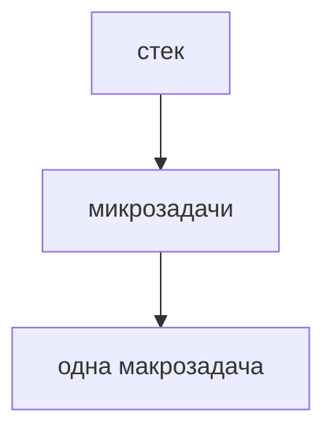

## Введение

JavaScript в браузере выполняет один стек вызовов. Очереди рядом решают, что попадёт в стек следующим. Это объясняет порядок логов лучше, чем фраза «оно асинхронное».

## Раздел: Очереди

Синхронный код дорабатывает стек. Потом микрозадачи: колбэки Promise. Потом одна макрозадача вроде setTimeout, и снова микрозадачи. Поэтому resolve логируется раньше нулевого таймера, даже если таймер поставлен раньше.

## Раздел: Ответ вслух

Я говорю: один стек. Сначала дочищаю синхронный код. Потом все микрозадачи промисов. Таймер — макрозадача, он ждёт эту очередь. Нулевая задержка не значит «прямо сейчас».

## Раздел: Плохой ответ

Плохой ответ: «setTimeout(0) выполнится сразу после строки». Его поставят в очередь макрозадач.

## Раздел: Термины

Цикл событий — event loop. Стек — call stack. Микрозадача — microtask. Макрозадача — macrotask.

## Лаба

**20 минут.** В [/game/code](/game/code) или консоли расставьте console.log в синхронном коде, в Promise.then и в setTimeout(0). Предскажите порядок до запуска.

## Схема: Очереди

## Тест

### Promise.then и setTimeout(0). Кто раньше после синхронного кода?

**Ответ:** then

**Пояснение:** Микрозадачи идут до макрозадач.

### setTimeout(0) выполнится немедленно?

**Ответ:** нет

**Пояснение:** Он ждёт очередь.

### Два then подряд. Между ними влезет таймер?

**Ответ:** нет, если стек пуст и микрозадачи не кончились

**Пояснение:** Очередь микрозадач дочищают.

### Бесконечный синхронный цикл. Когда сработает таймер?

**Ответ:** не сработает

**Пояснение:** Стек не отпускает.

### Можно ли считать JS многопоточным из-за async?

**Ответ:** нет, один стек

**Пояснение:** Параллельность здесь про очереди, не про второе ядро скрипта.

## Шпаргалка

<ul><li>Один стек</li><li>Микрозадачи до таймера</li><li>Ноль миллисекунд не значит сейчас</li></ul>

## Anki

### Front: Сколько стеков у страничного JS?

Back: Один.

### Front: Что такое microtask?

Back: Очередь вроде колбэка Promise.

### Front: setTimeout — какая очередь?

Back: Макрозадача.

### Front: Почему then раньше таймера 0?

Back: Микрозадачи идут первыми.

### Front: Бесконечный цикл и таймер?

Back: Таймер не войдёт, стек занят.

### Front: async значит второй поток?

Back: Нет.

## Итоги

- Один стек
- Микрозадачи до таймера
- Ноль миллисекунд не значит сейчас

## Ссылки

- [Promise в серии JS](/game/learn/js-async-fetch)
- [Замыкания](/game/learn/fe-closures-proto)
