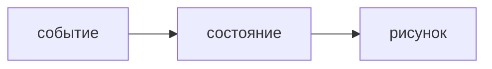

## Введение

Сезон уже показывает список и форму. На собесе этого мало: нужно сказать, что рисуется состояние, зачем ключ и почему править объект состояния на месте нельзя.

## Раздел: Модель

setState ставит следующее значение, рендер рисует его. Прямая мутация массива может не выглядеть изменением. Ключ помогает понять, тот ли это элемент списка. Индекс как ключ ломается, когда строки переставляют или удаляют из середины.

## Раздел: Ответ вслух

Я не рисую «как-нибудь DOM». Я меняю состояние, React рисует снова. Массив копирую, а не пушу в старый, если от этого зависит рендер. Ключ беру из id данных. Индекс — только если список не дышит.

## Раздел: Плохой ответ

Плохой ответ: «ключ — это чтобы не было warning». Ключ — личность элемента, не способ заткнуть консоль.

## Раздел: Термины

Состояние — state. Рендер — render. Ключ — key. Мутация — mutation.

## Лаба

**20 минут.** В форме из сезона найдите, где состояние заменяется новым значением, а где его могли бы испортить на месте. Для списка скажите, какое поле годится в key.

## Схема: Рендер

## Тест

### push в массив состояния без копии. На что рассчитываете?

**Ответ:** что рендер может не увидеть

**Пояснение:** Ссылка та же, изменение внутри.

### Ключ — индекс, удалили первый ряд. Чем рискуете?

**Ответ:** состояние строк съедет

**Пояснение:** Индекс больше не личность.

### Можно ли рисовать, минуя состояние, прямым DOM рядом?

**Ответ:** легко разъехаться

**Пояснение:** Два хозяина одного экрана.

### Событие поменяло поле. Кто рисует заново?

**Ответ:** рендер от нового состояния

**Пояснение:** Не вы вручную каждый узел.

### Один и тот же id у двух строк. Ключ честный?

**Ответ:** нет

**Пояснение:** Личность должна быть уникальной.

## Шпаргалка

<ul><li>Рендер от состояния</li><li>Не мутировать то, что сравнивают</li><li>Ключ — id, не индекс</li></ul>

## Anki

### Front: Что рисует React?

Back: Состояние, не разовые правки DOM.

### Front: Почему не мутировать массив?

Back: Можно не заметить изменение.

### Front: Зачем key?

Back: Узнать тот же элемент списка.

### Front: Чем плох индекс как key?

Back: При перестановке личность врёт.

### Front: Кто меняет состояние?

Back: Событие через setState, не присваивание в объект React.

### Front: Два хозяина DOM?

Back: React и ручные правки разъедутся.

## Итоги

- Рендер от состояния
- Не мутировать то, что сравнивают
- Ключ — id, не индекс

## Ссылки

- [Список в сезоне](/game/learn/b08-react-list)
- [TypeScript](/game/learn/fe-typescript)
