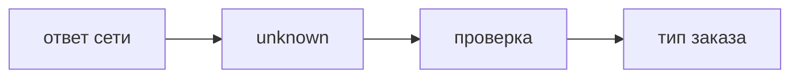

## Введение

TypeScript на собесе — не «я пишу двоеточия». Это где вы сужаете неизвестные данные с границы сети и где any протаскивает что угодно дальше.

## Раздел: Граница

Ответ fetch — unknown, пока не проверили поле. any позволяет вызвать что угодно и замолчать ошибку. Структурная совместимость: объекту достаточно нужных полей, имя типа не обязано совпасть. Утверждение as без проверки — дыра на границе.

## Раздел: Ответ вслух

На границе сети я ставлю unknown и проверяю поле до использования. any не возвращаю из функции, иначе типы вокруг врут. Приведение без проверки называю отказом от проверки, не «удобством».

## Раздел: Плохой ответ

Плохой ответ: «везде any, чтобы компилятор не мешал». Тогда TypeScript ничего не проверяет.

## Раздел: Термины

Неизвестное — unknown. Любое — any. Сужение — narrowing. Утверждение — type assertion. Структурная типизация — structural typing.

## Лаба

**20 минут.** Возьмите кусок ответа API и выпишите, какие поля вы проверите, прежде чем считать его заказом. Не используйте any в этой записи.

## Схема: Граница

## Тест

### Функция возвращает any. Вызывающий защищён типами?

**Ответ:** нет

**Пояснение:** any расползается.

### as Order без проверки поля. Это сужение?

**Ответ:** нет, это утверждение

**Пояснение:** Компилятор вам верит на слово.

### Два типа с одинаковыми полями. Их можно передать друг в друга?

**Ответ:** часто да

**Пояснение:** Типизация структурная.

### unknown можно сразу вызвать как функцию?

**Ответ:** нет

**Пояснение:** Сначала сузить.

### Где any ещё терпим на короткое время?

**Ответ:** на самом краю, не в возвращаемом типе

**Пояснение:** И то лучше unknown.

## Шпаргалка

<ul><li>Граница сети — unknown</li><li>any не возвращают</li><li>as без проверки — дыра</li></ul>

## Anki

### Front: Чем any опасен?

Back: Выключает проверку дальше по коду.

### Front: Чем unknown лучше на границе?

Back: Пока не проверите, им нельзя пользоваться.

### Front: Что такое narrowing?

Back: Проверка, после которой тип становится уже.

### Front: Что такое as без проверки?

Back: Утверждение, не доказательство.

### Front: Structural typing?

Back: Совместимы по полям, не по имени.

### Front: Где проверять ответ API?

Back: На границе, до остального кода.

## Итоги

- Граница сети — unknown
- any не возвращают
- as без проверки — дыра

## Ссылки

- [Состояние](/game/learn/fe-react-state)
- [Типы JS](/game/learn/js-types-coerce)
