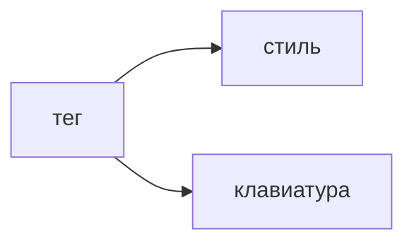

## Введение

Вакансии React начинают с HTML и CSS, потом спрашивают доступность. Это один навык: разметка называет смысл, стили задают место, клавиатура подтверждает, что смыслом можно пользоваться.

## Раздел: Разметка и раскладка

Кнопка — `button`, ссылка уводит на адрес, заголовок стоит в иерархии, а не потому что так крупнее шрифт. Поле связано с `label`. Картинка действия имеет текст, декоративная — пустой `alt`.

Flex выстраивает ряд и перенос. Grid — когда и строки, и колонки заданы. Позиция `absolute` не заменяет поток документа: при увеличении текста такой блок наезжает на соседний.

Контраст текста и видимый фокус обязательны. Спрятанный `outline` без своей обводки ломает клавиатуру. `div` с `onClick` без роли и tabindex с клавиатуры не нажимается.

## Раздел: Ответ вслух

Я выбираю тег по смыслу, не по виду. Поле подписываю через label. Раскладку собираю flex или grid. Фокус оставляю видимым. Клик только мышью я считаю недоделанным: то же действие доступно с клавиатуры.

## Раздел: Плохой ответ

Плохой ответ: «доступность — это атрибуты ARIA на каждом div». Сначала родной тег. ARIA добавляют, когда родного тега не хватает.

## Раздел: Термины

Доступность — accessibility, коротко a11y. Семантика — semantic HTML. Фокус — focus. Подпись поля — label. Контраст — contrast.

## Лаба

**25 минут.** Форма из одного поля и кнопки. Свяжите label с input. Пройдите её Tab и Enter, не трогая мышь. Увеличьте базовый шрифт и проверьте, что строка не вылезла из карточки.

## Схема: Смысл раньше вида

## Тест

### Чем кнопка отличается от ссылки?

**Ответ:** действие против перехода

**Пояснение:** Ссылка меняет адрес. Кнопка выполняет действие на странице.

### Как связать подпись и поле?

**Ответ:** label и id поля

**Пояснение:** Клик по тексту ставит фокус в поле, имя читается вместе с ним.

### Зачем видимый outline?

**Ответ:** показать место фокуса

**Пояснение:** Без него клавиатурный пользователь не видит, где он.

### Когда уместен Grid, а не Flex?

**Ответ:** когда важны и строки, и колонки

**Пояснение:** Flex силён в одном направлении и переносе.

### Пустой alt у иконки-кнопки. Что не так?

**Ответ:** у действия нет имени

**Пояснение:** Пустой alt годится декорации. У кнопки должно быть имя.

## Шпаргалка

<ul><li>Тег по смыслу</li><li>label у каждого поля</li><li>flex или grid, не абсолют на всё</li><li>фокус виден</li><li>ARIA после родного тега</li></ul>

## Anki

### Front: button или a?

Back: button — действие, a — переход по адресу.

### Front: Как подписать input?

Back: label с htmlFor на id поля.

### Front: Что даёт видимый focus?

Back: Клавиатура показывает текущий элемент.

### Front: Flex или Grid для таблицы-карточек в две оси?

Back: Grid, если заданы и ряды, и колонки.

### Front: Когда alt пустой?

Back: У декоративной картинки, не у элемента с действием.

### Front: Когда добавлять ARIA?

Back: Когда нативного тега не хватает для роли и имени.

## Итоги

- Сначала смысл тега, потом пиксели
- Форма без label не готова
- Клавиатура — такая же проверка, как клик

## Ссылки

- [Состояние React](/game/learn/fe-react-state)
- [TypeScript](/game/learn/fe-typescript)
