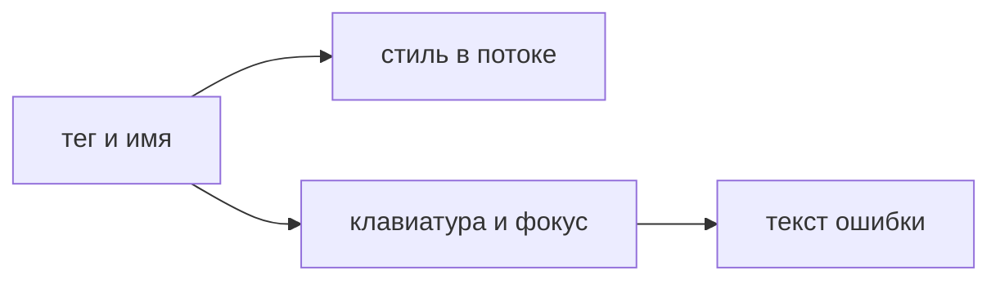

## Введение

Вакансии React начинают с HTML и CSS, даже если в стеке сразу назван фреймворк. Экран всё равно собирается из тегов, раскладки и состояний фокуса. Доступность здесь не отдельный курс «для галочки» и не набор атрибутов поверх готовой картинки. Это проверка, что смыслом элемента можно пользоваться: мышью, клавиатурой и программой чтения. Кнопка, которая выглядит кнопкой и не нажимается с клавиатуры, на собеседовании не проходит, даже если пиксели совпали с макетом.

Один навык состоит из трёх слоёв. Разметка называет смысл: это действие, переход, поле, заголовок. Стили задают место и вид, не подменяя смысл. Клавиатура и имя элемента подтверждают, что смыслом можно пользоваться без мыши. Если слой смысла выбран неверно, стили и ARIA только маскируют ошибку. Родной тег почти всегда дешевле самодельной роли.

Выпуск собирает форму из одного поля и кнопки и вокруг неё показывает раскладку, фокус, контраст и границу, после которой уже нужен ARIA. Этого хватает для junior и для начала middle: дальше спрашивают не определение accessibility, а «покажите, как подпишете поле и что будет по Tab».

## Раздел: Разметка и раскладка

Тег выбирают по действию, не по тому, как элемент нарисовали. `button` выполняет действие на странице: отправить, открыть панель, удалить. Ссылка `a` с адресом уводит на другой ресурс или на другой маршрут. Если у «кнопки» есть `href` и ожидается переход, это ссылка, даже когда дизайнер скруглил её как кнопку. Если у «ссылки» нет адреса и по клику только меняется состояние, это кнопка. Путаница ломает ожидание: средняя кнопка мыши, меню браузера «открыть в новой вкладке» и объявление программы чтения завязаны на тег, не на `border-radius`.

Заголовок стоит в иерархии документа. Крупный шрифт без `h1`–`h3` не создаёт структуру. Пропуск уровней и несколько конкурирующих `h1` на одном экране приложения путают навигацию по заголовкам. В компоненте React заголовок карточки — это заголовок секции, а не `div` с классом `title`.

Поле связано с подписью. `label` с `htmlFor` на `id` поля даёт две вещи: щелчок по тексту ставит фокус в поле, и имя поля читается вместе с ним. Подпись, которая просто лежит рядом `span`, визуально похожа, а для вспомогательной технологии поля нет. Placeholder не заменяет подпись: он исчезает при вводе, его плохо видно, и он не обязан быть именем.

Картинка действия имеет текст. Декоративная штриховка — пустой `alt`, чтобы её пропустили. Иконка без текста, которая и есть кнопка, обязана иметь имя: видимый текст, `aria-label` или текст для чтения, если иконка внутри настоящей `button`. Пустой `alt` у такой иконки стирает имя действия.

Flex выстраивает ряд, колонку и перенос. Им удобно собрать шапку, панель кнопок, карточку «текст и действие». Grid берёт, когда важны и строки, и колонки одновременно: набор полей в две колонки, календарная сетка, плитка с выравниванием по обеим осям. Абсолютное позиционирование не заменяет поток. Блок, вынутый из потока, не раздвигает соседей. При увеличении базового шрифта, на узком окне и при переводе на более длинный язык он наезжает на следующий абзац. Поток документа как раз для этого и нужен: текст растёт, соседи уступают место.

Контраст текста к фону и видимый фокус обязательны. Спрятанный `outline: none` без своей обводки делает клавиатурного пользователя слепым: фокус есть, места не видно. Своя обводка должна появляться на `:focus-visible`, а не только при щелчке мышью, и не должна пропадать на тёмной теме. `div` с `onClick` без роли и без участия в Tab с клавиатуры не нажимается. Если очень нужен не-кнопочный тег, ему добавят роль, имя и обработчик клавиш. Почти всегда проще поставить `button`.

## Раздел: Клавиатура, формы и ошибки

Порядок Tab совпадает с порядком чтения, а не с порядком, в котором удобно спозиционировали блоки. Положительный `tabIndex` переставляет порядок и почти всегда делает хуже. `tabIndex={0}` нужен редкому самостоятельному виджету. `tabIndex={-1}` — чтобы программно поставить фокус, не добавляя элемент в обычный обход. У настоящей кнопки и поля своя клавиатура уже есть: Enter и пробел на кнопке, ввод в поле. Их не переписывают, если нет своей причины.

Ошибка поля связана с самим полем. Текст «введите заголовок» имеет `id`, поле ссылается на него через `aria-describedby` или обёртка использует готовый примитив, который делает то же. Цвет красной рамки без текста не объясняет проблему и не виден всем. Сообщение не должно появляться только в тосте в углу, если фокус остался в поле и человек не знает, куда смотреть. После отправки с ошибкой фокус разумно вернуть к первому неверному полю.

Модальное окно, если оно есть, держит фокус внутри, пока открыто, и возвращает фокус на кнопку, которая его открыла. Это уже виджет, и здесь оправданы роли `dialog` и заголовок окна. Самодельный `div` на весь экран без этого оставляет фокус на странице под ним: человек «нажимает» невидимые кнопки подложки.

Увеличение шрифта до 200 процентов — практическая проверка, не теория. Строка не должна обрезаться `overflow: hidden` так, что пропадает смысл. Горизонтальный скролл всей страницы из-за одной длинной кнопки — дефект раскладки. Фиксированная высота в пикселях у текста чаще вредна, чем минимальная высота.

## Раздел: Где это ломается

ARIA на каждом `div`. Роль `button` на блоке без клавиатуры объявляет действие, которого нет. Правило простое: сначала родной тег. ARIA добавляют, когда родного тега не хватает — своя вкладка, своя сетка, диалог. Лишняя роль спорит с настоящим тегом и путает объявление.

Клик на строке таблицы, внутри которой ещё и кнопки. Получается вложенное действие: щелчок по внутренней кнопке всплывает и открывает карточку. Клавиатурой это ещё больнее. Строка-ссылка или явная кнопка «открыть» честнее, чем `onClick` на `tr`.

Невидимый текст «для читалок» при пустой видимой подписи и наоборот. Имя должно совпадать с тем, что видит зрячий пользователь, иначе подсказка и объявление расходятся. Если на кнопке написано «Сохранить», имя не должно быть «submit form click here».

Стили, которые убирают фокус «потому что некрасиво» в дизайн-системе. Это дефект набора, не мелочь экрана. Одна глобальная отмена `outline` ломает все страницы сразу. Замену рисуют в токене, не удалением.

Форма без связи label, собранная только гридами и отступами. Визуально макет сошёлся, проверку клавиатурой и именем никто не делал. На приёмке это уже переделка, не полировка.

## Раздел: Ответ вслух

Я выбираю тег по смыслу, не по виду. Действие — `button`, переход — ссылка, поле — с `label`. Раскладку собираю flex или grid и оставляю текст в потоке, чтобы увеличение шрифта не наезжало. Фокус оставляю видимым. Ошибку поля связываю с самим полем текстом, не только цветом. Клик только мышью я считаю недоделанным: то же действие доступно с клавиатуры. ARIA ставлю, когда родного тега не хватает, а не вместо него.

## Раздел: Плохой ответ

Плохой ответ: «доступность — это атрибуты ARIA на каждом div». Сначала родной тег и видимое имя. ARIA не добавляет кнопку в порядок Tab сама по себе и не создаёт обработчик Enter. Второй плохой ответ: «у нас внутренний кабинет, доступность не нужна». Клавиатурой пользуются не только из-за постоянных ограничений: сломанная рука, тачпад, привычка. И внутренний кабинет кто-то заполняет весь день.

## Раздел: Термины

Доступность — accessibility, коротко a11y. Семантика — выбор тега по роли в документе, semantic HTML. Фокус — focus, видимое кольцо — focus indicator. Подпись поля — label. Контраст — contrast, разница яркости текста и фона. Вспомогательная технология — программа чтения экрана и другие средства, которые опираются на имя и роль, а не на пиксели. ARIA — набор атрибутов, когда нативной семантики мало.

## Лаба

**Цель.** Собрать одну форму, которой можно пользоваться без мыши и при крупном шрифте.

**Шаги.**

1. Разметьте поле заголовка и кнопку «Сохранить». У поля есть `label`, связанный с `id`. Placeholder можете оставить подсказкой, но не вместо имени.
2. Пройдите форму Tab и отправьте Enter, не трогая мышь. Фокус на кнопке и в поле должен быть виден.
3. Отключите мышь мысленно для ошибки: пустой заголовок показывает текст ошибки, и этот текст связан с полем.
4. Увеличьте базовый шрифт. Строка не вылезает из карточки и не обрезается так, что пропадает слово «Сохранить».
5. Замените мысленно кнопку на `div` с `onClick` и запишите, что сломалось в Tab. Верните `button`.
6. Если есть иконка без текста, дайте ей имя. Если штрих декоративный — пустой `alt`.

**Готово, если…**

- [ ] Поле и подпись связаны
- [ ] Фокус виден
- [ ] Ошибка читается текстом у поля
- [ ] Крупный шрифт не ломает смысл
- [ ] Действие — настоящая кнопка

## Схема: Смысл раньше вида

## Тест

### Чем кнопка отличается от ссылки?

**Ответ:** действие против перехода

**Пояснение:** Ссылка меняет адрес. Кнопка выполняет действие на странице.

### Как связать подпись и поле?

**Ответ:** label и id поля

**Пояснение:** Клик по тексту ставит фокус в поле, имя читается вместе с ним.

### Зачем видимый outline?

**Ответ:** показать место фокуса

**Пояснение:** Без него клавиатурный пользователь не видит, где он.

### Когда уместен Grid, а не Flex?

**Ответ:** когда важны и строки, и колонки

**Пояснение:** Flex силён в одном направлении и переносе.

### Пустой alt у иконки-кнопки. Что не так?

**Ответ:** у действия нет имени

**Пояснение:** Пустой alt годится декорации. У кнопки должно быть имя.

## Шпаргалка

<ul><li>Тег по смыслу</li><li>label у каждого поля</li><li>flex или grid, не абсолют на всё</li><li>фокус виден</li><li>ошибка — текст у поля</li><li>ARIA после родного тега</li></ul>

## Anki

### Front: button или a?

Back: button — действие, a — переход по адресу.

### Front: Как подписать input?

Back: label с htmlFor на id поля.

### Front: Что даёт видимый focus?

Back: Клавиатура показывает текущий элемент.

### Front: Flex или Grid для плитки в две оси?

Back: Grid, если заданы и ряды, и колонки.

### Front: Когда alt пустой?

Back: У декоративной картинки, не у элемента с действием.

### Front: Когда добавлять ARIA?

Back: Когда нативного тега не хватает для роли и имени.

## Итоги

- Сначала смысл тега и имя, потом пиксели
- Форма без связанного label не готова
- Клавиатура и видимый фокус — такая же проверка, как клик
- Текст ошибки важнее красной рамки
- Поток документа переживает крупный шрифт, абсолют — нет

## Ссылки

- [Состояние React](/game/learn/fe-event-loop)
- [TypeScript](/game/learn/fe-event-loop)
