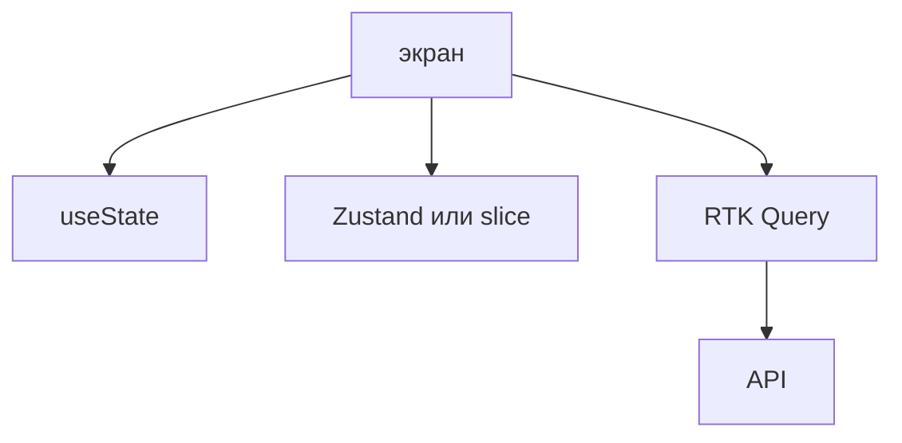

## Введение

Вакансии перечисляют Redux Toolkit, RTK Query и Zustand в одной строке. На собесе различают, что из этого состояние экрана, что общее клиентское, а что кэш ответа сервера.

## Раздел: Три полки

`useState` живёт в одном экране: поле формы, открыта ли панель. Поднимать его в склад рано.

Zustand — небольшой склад вне дерева: тема, черновик, флаги, которые читают далёкие компоненты. Меньше церемоний, чем у Redux. Легко превратить его во второй сервер, если начать копировать туда ответы API.

Redux Toolkit — когда изменений много, их надо проследить и разделить по слайсам. `createSlice` держит действия рядом с состоянием. RTK Query кладёт кэш запросов: ключ, статус загрузки, инвалидация после мутации. Это не замена слайсу «корзина», это полка серверных данных.

Сервер остаётся источником факта. Оптимистичное обновление откатывают, если мутация вернулась ошибкой.

## Раздел: Ответ вслух

Форму держу в компоненте. Общий клиентский флаг могу положить в Zustand. Если действий много и их разбирают несколько человек, беру Redux Toolkit. Списки и карточки с сервера отдаю RTK Query, чтобы не писать руками loading и повторный запрос. В склад не копирую то, что сервер может прислать снова.

## Раздел: Плохой ответ

Плохой ответ: «в проекте всегда Redux, иначе это несерьёзно». Маленький экран с Redux дольше читается и ничего не выигрывает.

## Раздел: Термины

Слайс — slice. Действие — action. Кэш запроса — query cache. Инвалидация — invalidation. Оптимистичное обновление — optimistic update.

## Лаба

**25 минут.** Разложите по полкам: текст поля, роль пользователя с сервера, открыт ли фильтр, список заявок. Для списка напишите, какой тег инвалидации сбросит кэш после создания заявки.

## Схема: Полки состояния

## Тест

### Текст одного поля формы. Куда его класть?

**Ответ:** в состояние компонента

**Пояснение:** Его не читает другой экран, склад не нужен.

### Чем RTK Query отличается от слайса корзины?

**Ответ:** это кэш сервера

**Пояснение:** У него статус запроса и инвалидация, а не только поля клиента.

### Зачем инвалидация после POST?

**Ответ:** список на экране устарел

**Пояснение:** Иначе пользователь видит данные до создания.

### Когда Zustand уместнее Redux Toolkit?

**Ответ:** мало общего клиентского состояния

**Пояснение:** Церемония слайсов не окупается на паре флагов.

### Оптимистично показали успех, сервер ответил 409. Что сделать?

**Ответ:** откатить кэш

**Пояснение:** Экран не должен оставлять факт, которого нет на сервере.

## Шпаргалка

<ul><li>Экран — useState</li><li>Общие флаги — Zustand или slice</li><li>Ответы API — RTK Query</li><li>Сервер остаётся источником факта</li></ul>

## Anki

### Front: Что хранит RTK Query?

Back: Кэш запросов, статус и инвалидацию.

### Front: Что хранит slice корзины?

Back: Клиентские данные до отправки, не копию всей базы.

### Front: Когда хватает useState?

Back: Когда значение читает один экран.

### Front: Зачем createSlice?

Back: Собрать состояние и действия одного куска в одном месте.

### Front: Что такое invalidation?

Back: Пометить кэш устаревшим после мутации.

### Front: Почему не копировать весь API в Zustand?

Back: Появляется второй источник факта, который расходится с сервером.

## Итоги

- Три полки не смешивают
- Redux окупается на сложном клиентском потоке
- Кэш сервера инвалидируют, а не правят руками навсегда

## Ссылки

- [Состояние React](/game/learn/fe-react-state)
- [Список с API](/game/learn/b08-react-list)
