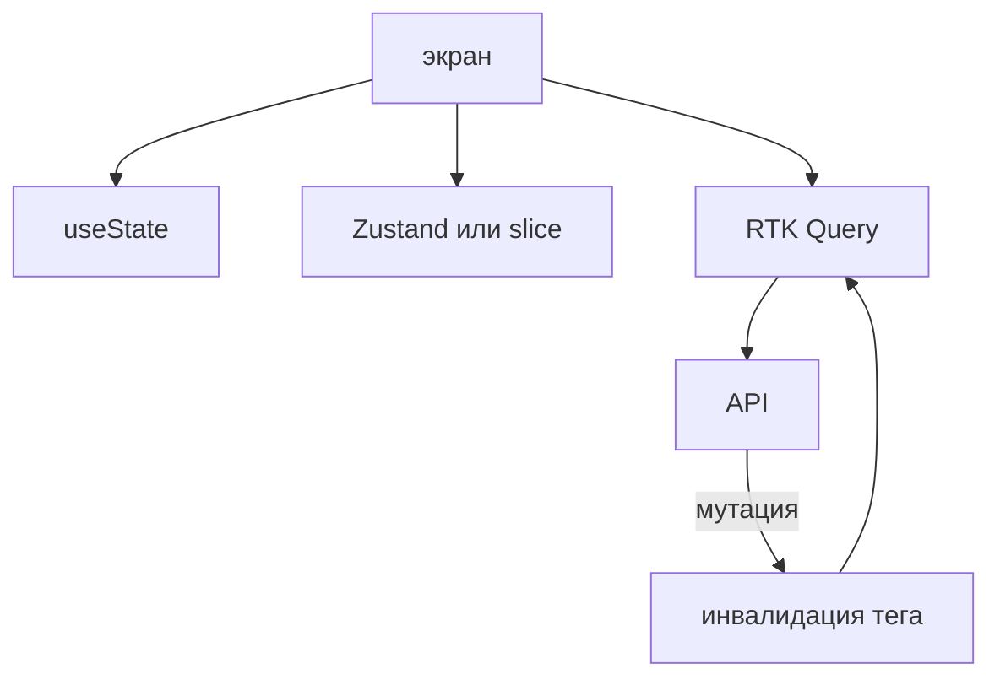

## Введение

Вакансии перечисляют Redux Toolkit, RTK Query и Zustand в одной строке, как будто это три вкуса одного и того же. На собеседовании их различают по полке. Есть состояние одного экрана. Есть общее клиентское состояние, которое не пришло с сервера. Есть кэш ответа сервера: то, что сервер может прислать снова и что устаревает после мутации. Библиотеку выбирают после того, как назвали полку. Начинать с «у нас в проекте Redux» — способ утащить текст поля формы в глобальный склад и потом удивляться, почему сброс экрана задевает соседа.

Сервер остаётся источником факта. Клиент может показать оптимистичный результат, но обязан откатить его, если мутация вернулась ошибкой. Вторая копия базы в Zustand, которую «синхронизируют руками», расходится в первую же неделю. Этот выпуск раскладывает поле ввода, роль, флаг фильтра и список заявок по полкам и показывает, какой тег кэша сбрасывается после создания заявки.

## Раздел: Три полки

`useState` и `useReducer` живут в дереве одного экрана. Текст поля, открыта ли панель, шаг мастера, черновик до отправки — их не читает соседний маршрут. Поднимать такое в склад рано: появляется неявная связь, экран трудно открыть второй раз, тест тащит провайдер ради одного инпута. Локальное состояние умирает вместе с размонтированием, и это часто желаемое поведение: ушли со страницы — черновик поля не торчит в памяти приложения. Если черновик как раз должен пережить уход, это уже осознанное общее состояние, а не повод поднимать всё подряд.

Zustand — небольшой склад вне дерева. Тема, свёрнута ли навигация, клиентский флаг «черновик панели», который читают далёкие компоненты. Церемоний меньше, чем у Redux: нет обязательных слайсов, экшенов и обвязки, если вам нужно два поля. Легко превратить его во второй сервер, если начать копировать туда списки с API «чтобы не дёргать сеть». Тогда у вас два источника одной заявки, и неизвестно, какой на экране.

Redux Toolkit окупается, когда клиентских изменений много, их надо проследить по истории действий и разделить между людьми. `createSlice` держит состояние куска и его действия рядом. Корзина до оформления, сложный мастер с правилами, которые читают несколько команд, журнал действий для отладки — типичные жители. Маленький экран с одним флагом в Redux дольше читается и ничего не выигрывает. На собесе честно сказать «здесь хватит Zustand или даже локального состояния» сильнее, чем защищать Redux как признак серьёзности.

RTK Query — полка серверных данных. У записи есть ключ запроса, статус загрузки, ошибка и время жизни. Мутация инвалидирует тег, и список запрашивается снова или обновляется по правилу кэша. Это не замена слайсу «корзина». Корзина может существовать до сервера. Список заявок без сервера не существует. Смешивать их в один редьюсер значит самим писать loading, гонки ответов и сброс после POST — то, что кэш запроса уже умеет.

Оптимистичное обновление показывает новый элемент сразу и откатывает кэш, если сервер ответил 409 или 422. Оставить «успех» на экране при ошибке — значит соврать. Пессимистичный путь проще: ждать ответ и затем инвалидировать список. Его выбирают, когда действие редкое и полсекунды ожидания дешевле логики отката.

## Раздел: Разбор на примере

Экран фильтра заявок. Строка поиска по мере ввода живёт в `useState` экрана. Её не кладут в Redux на каждый символ: подписчики всего склада будут думать о поле, которое им не нужно. Кнопка «только мои» может быть локальной, если она не переживает переход. Если тот же флаг читает шапка и список на другом маршруте, флаг переезжает в маленький zustand-стор или в слайс, но всё ещё остаётся клиентским: сервер про этот флаг не знает, пока его не послали параметром запроса.

Список заявок идёт через RTK Query: ключ включает фильтр и страницу, статус `isLoading` рисует скелет, ошибка рисует повтор. После `POST /tickets` мутация инвалидирует тег `Tickets`. Список на экране становится несвежим и перезапрашивается. Руками вырезать и вставлять элемент в кэш можно, но это второй путь: его пишут, когда мерцание списка заметно и откат продуман. По умолчанию хватает инвалидации.

Роль пользователя, пришедшая с `GET /me`, тоже серверные данные. Её не копируют навсегда в Zustand при логине «чтобы больше не спрашивать». Кэш запроса `me` как раз для этого. Копия в складе протухает, когда роль сменили на сервере, а шапка показывает старую.

Корзина, если это набор id до оформления, — клиентский слайс. В ней нет «правды сервера», пока кнопку «оформить» не нажали. После успеха корзину очищают, а кэш заказов инвалидируют. Две полки встретились в одном обработчике и не слились в одну.

## Раздел: Где это ломается

Весь ответ API вручную кладут в Redux и сами выставляют `loading`. Получается самодельный RTK Query без инвалидации. Следующий разработчик забывает сбросить список после создания, пользователь не видит свою заявку и обновляет страницу целиком.

Один глобальный стор на каждое поле каждой формы. Навигация между двумя карточками показывает чужой черновик. Лечение — вернуть поле в компонент или хранить черновик по id сущности, а не в одном `draftTitle`.

Инвалидация слишком широкая. Любая мутация сбрасывает вообще все запросы, экран мигает, сеть забита. Тег ставят на ресурс, который реально устарел: список заявок, а не справочник стран.

Инвалидация слишком узкая. Создали заявку, тег не сбросили, кэш живёт пять минут, человек думает, что сохранение пропало. Тег — часть контракта мутации, его пишут в том же изменении, что и POST.

Оптимистично добавили строку и забыли откат на 409. В списке висит объект, которого нет на сервере, а повторная отправка создаёт дубль. Откат или отказ от оптимизма обязателен до включения.

Zustand без подписки точечно: компонент читает весь стор и перерисовывается на любую правку. Для маленького флага терпимо. Для стора, куда всё же сложили половину API, это лишние рендеры. Полка сервера этому стору не принадлежит.

## Раздел: Ответ вслух

Форму держу в компоненте. Общий клиентский флаг, который нужен далёким веткам, могу положить в Zustand. Если действий много и их разбирают несколько человек, беру слайс Redux Toolkit. Списки и карточки с сервера отдаю RTK Query, чтобы не писать руками загрузку и повтор после мутации. В склад не копирую то, что сервер пришлёт снова. Если показал оптимистичный успех и получил конфликт, откатываю кэш. Маленький экран в Redux не тащу: церемония не окупается.

## Раздел: Плохой ответ

Плохой ответ: «в проекте всегда Redux, иначе это несерьёзно». Серьёзность — в том, что полки не смешаны и сервер остаётся источником факта. Второй плохой ответ: «Zustand заменит и кэш, и формы, и Redux». Он заменит тонкий клиентский склад. Кэш запросов и локальный ввод у него не появляются автоматически от того, что библиотека маленькая.

## Раздел: Термины

Слайс — slice, кусок клиентского состояния и его действия. Действие — action. Кэш запроса — query cache. Инвалидация — invalidation, пометка «эти данные устарели». Тег — метка группы запросов, которую сбрасывает мутация. Оптимистичное обновление — optimistic update, показ результата до подтверждения сервера. Источник правды — server state против client state.

## Лаба

**Цель.** Разложить четыре значения по полкам и назвать тег инвалидации.

**Шаги.**

1. Выпишите: текст поля заголовка, открыт ли фильтр только на этом экране, роль пользователя с сервера, список заявок.
2. Назначьте полку каждому. Поле и локальный фильтр — состояние компонента. Роль и список — кэш сервера. Общий флаг темы, если добавите его пятым, — Zustand или слайс, не кэш.
3. Для списка напишите тег, который мутация создания обязана инвалидировать.
4. Опишите ответ 409 на создание: что видит пользователь, если вы уже успели оптимистично вставить строку.
5. Одной фразой объясните, почему роль не копируют в Zustand при логине.

**Готово, если…**

- [ ] Поле не уехало в глобальный склад
- [ ] Список не хранится как вечная копия в клиентском слайсе
- [ ] У мутации назван тег
- [ ] Для конфликта есть откат или отказ от оптимизма

## Схема: Полки состояния

## Тест

### Текст одного поля формы. Куда его класть?

**Ответ:** в состояние компонента

**Пояснение:** Его не читает другой экран, склад не нужен.

### Чем RTK Query отличается от слайса корзины?

**Ответ:** это кэш сервера

**Пояснение:** У него статус запроса и инвалидация, а не только поля клиента.

### Зачем инвалидация после POST?

**Ответ:** список на экране устарел

**Пояснение:** Иначе пользователь видит данные до создания.

### Когда Zustand уместнее Redux Toolkit?

**Ответ:** мало общего клиентского состояния

**Пояснение:** Церемония слайсов не окупается на паре флагов.

### Оптимистично показали успех, сервер ответил 409. Что сделать?

**Ответ:** откатить кэш

**Пояснение:** Экран не должен оставлять факт, которого нет на сервере.

## Шпаргалка

<ul><li>Экран — useState</li><li>Общие флаги — Zustand или slice</li><li>Ответы API — RTK Query</li><li>Мутация сбрасывает тег списка</li><li>Сервер остаётся источником факта</li></ul>

## Anki

### Front: Что хранит RTK Query?

Back: Кэш запросов, статус и инвалидацию.

### Front: Что хранит slice корзины?

Back: Клиентские данные до отправки, не копию всей базы.

### Front: Когда хватает useState?

Back: Когда значение читает один экран и оно может умереть вместе с ним.

### Front: Зачем createSlice?

Back: Собрать состояние и действия одного куска в одном месте.

### Front: Что такое invalidation?

Back: Пометить кэш устаревшим после мутации.

### Front: Почему не копировать весь API в Zustand?

Back: Появляется второй источник факта, который расходится с сервером.

## Мнемоника

### peg: Где живёт состояние

**Задание:** Три полки и запрет класть всё на одну.

**Элементы:**
- сервер
- URL
- клиент

**Подсказка:** Кэш сервера в сторе без владельца разъезжается с экраном.

**Ответ:** 1 server · 2 url · 3 client

## Итоги

- Три полки не смешивают
- Redux окупается на сложном клиентском потоке, не на одном поле
- Кэш сервера инвалидируют тегом, а не правят руками навсегда
- Оптимистичный успех без отката врёт
- Роль и список остаются серверными данными

## Ссылки

- [Состояние React](/game/learn/fe-event-loop)
- [Список с API](/game/learn/b05-api-check)
