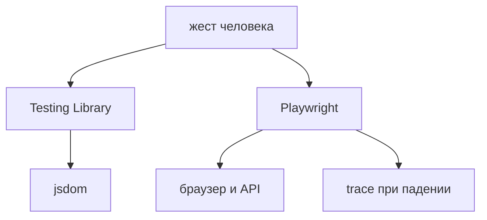

## Введение

В вакансиях React рядом стоят Jest или Vitest, React Testing Library и Playwright. Это не три названия одного прогона. Компонентный тест живёт в jsdom: быстро проверяет, что по роли и имени человек может нажать и увидеть результат. Сквозной тест открывает настоящий браузер и проходит маршрут вместе с сетью. Путать слои значит либо гонять сотни медленных браузерных кейсов на каждый проп, либо верить, что jsdom поймает сломанную сборку и прокси.

Спор «Jest или Vitest» на собесе слабее, чем один показанный тест. В новом проекте на Vite чаще берут Vitest: он стартует из той же сборки, что и приложение. Jest оставляют там, где он уже настроен, конфиг боли не окупает переписывание. Оба умеют гонять Testing Library. Выбор раннера не меняет правило поиска элемента.

Этот выпуск собирает один тест кнопки «Добавить» и один сквозной путь «создал заметку — увидел её в списке». Рядом — что сознательно не проверяют: внутренний `useState`, снимок всей вёрстки и полный дубль e2e на каждый компонент.

## Раздел: Что каким инструментом

Vitest и Jest исполняют функции и компоненты вне настоящего браузера. jsdom изображает документ достаточно, чтобы найти кнопку и кликнуть. Сеть, раскладка пикселей, несколько вкладок и настоящий фокус браузера туда не входят. Поэтому здесь проверяют логику экрана: по клику появился заголовок, пустое поле показало ошибку, запрос клиента ушёл с нужным телом, если клиент подменён.

Testing Library просит искать так, как ищет человек и доступность: роль и имя. `getByRole('button', { name: 'Добавить' })` переживёт смену класса и перестановку вложенных `div`. Селектор класса и проверка `useState` привязаны к реализации. Поведение может остаться тем же, хук переедет в соседний модуль, тест покраснеет зря. Или наоборот: внутренний флаг верен, а на экране текста нет, тест зелёный зря. Утверждение смотрит в документ.

Пользовательские события ставят через `userEvent`, не через прямой вызов обработчика. Прямой вызов обходит клавиатуру и форму. Клик по роли ближе к тому, что сломается у человека.

Playwright открывает Chromium, Firefox или WebKit, ждёт элемент сам и проходит сценарий по адресу. Автоожидание относится к действию: клик не нужно оборачивать в свой `sleep`. Таких сценариев мало. Они дороже по времени и по хрупкости стенда, зато ловят склейку, которую jsdom не видит: маршрут, настоящий ответ API, собранный бандл, прокси. Один главный путь на фичу и редкий путь ошибки достаточны. Пачка e2e «на каждый проп кнопки» дублирует дешёвый компонентный тест и тормозит пайплайн.

Мок сети в Playwright уместен, когда надо показать ошибку 500, которую учебный стенд не воспроизведёт стабильно. Счастливый путь честнее против учебного API: иначе вы проверяете свою заглушку. В компонентном тесте мок стоит на функции клиента: компонент получил данные или ошибку и что-то нарисовал. Мок не подменяет сам компонент.

Снимок всей разметки на каждый рендер шумит. Любой перевод строки в классах красит сборку, смысл не менялся. Точечное сравнение текста и роли спокойнее. Визуальные снимки пикселей — отдельный осознанный слой, не замена поведения, и их пересматривают глазами, не автоматом на каждый чих.

## Раздел: Разбор на примере

Компонент формы заметки. Поле и кнопка «Добавить». Если заголовок пустой, под полем текст ошибки. Если заголовок есть, колбэк получает строку, а в списке появляется пункт.

Компонентный тест не монтирует роутер и не поднимает сервер. Он рендерит форму, находит поле по роли `textbox` и имени, вводит «Молоко», жмёт кнопку по роли и имени «Добавить», проверяет, что в документе есть текст «Молоко». Второй тест оставляет поле пустым и ждёт текст ошибки. Третий, если клиент ходит в сеть, подменяет клиент функцией, которая возвращает отказ, и проверяет сообщение. Всё это секунды, без браузера.

Сквозной сценарий один: открыть страницу заметок, ввести заголовок, сохранить, увидеть пункт в списке, обновить страницу и увидеть его снова, если это и есть обещание продукта. Обновление как раз ловит «сохранили только в памяти». Его не копируют в jsdom, потому что там нет настоящего ответа сервера и настоящей перезагрузки.

Падение e2e открывают в трассировке: шаг, снимок, запрос. Часто упал API, а локатор ни при чём. Переписывать локатор до просмотра сети — способ закопать настоящую причину.

Что не пишут. Тест «useState стал true». Тест на класс `.btn-primary`. Десять Playwright-кейсов на длину строки. Снимок всего JSX формы в каждом прогоне.

## Раздел: Где это ломается

Ищут элемент по классу из CSS-модуля. Смена сетки ломает тест при том же имени кнопки. Лечение — роль и имя. `data-testid` оставляют элементу без устойчивого имени: иконка, ячейка, холст. Кнопке с видимым текстом тестовый id не нужен и даже вреден: он позволяет переименовать кнопку для человека и не заметить это в тесте.

Копируют весь пользовательский путь в компонентные тесты через мок всего на свете. Тест долго собирает провайдеры и всё равно не видит бандл. Дорогой путь отдают Playwright, дешёвые ветки — Testing Library.

Забывают негативный ввод. Кнопка «Добавить» зелёная только на счастье, пустой заголовок в проде молчит. Один тест на отказ обязателен, если отказ обещан интерфейсом.

`sleep` в e2e. Короткий мигает на медленном CI, длинный растягивает набор. Ждут условие: текст появился, запрос завершился. У Playwright это встроено в локатор и `expect`.

Общий порядок тестов. Один тест зависит от того, что предыдущий «уже создал заметку» в общем браузере. По одиночке он красный, пачкой зелёный или наоборот. Каждый сценарий готовит свои данные.

Зелёный CI без упавшего локально теста на новое поведение. Ревью не заменяет отсутствие утверждения. Новая ветка ошибки без теста — дыра, даже если линтер доволен.

## Раздел: Ответ вслух

Компонент тестирую как пользователь: роль, имя, текст результата. Состояние изнутри не читаю. Vitest беру в новом Vite-проекте, Jest не переписываю без повода. Playwright оставляет один сквозной путь и отдельный кейс на падение сети. Счастливый e2e хожу против учебного API, мок сети оставляю для ошибки, которую стенд не отдаст. Снимок всей вёрстки в каждый тест не кладу. Если локатор приходится вешать на класс, я сначала ищу имя. Если имени нет, ставлю тестовый id точечно и говорю об этом в ревью.

## Раздел: Плохой ответ

Плохой ответ: «покроем каждый компонент e2e». Это медленно и дублирует то, что дешевле проверить в jsdom. Второй плохой ответ: «тесты хрупкие, потому что фронт постоянно меняется, проще без них». Хрупкость чаще от селектора класса и сна, а не от самого факта проверки текста на экране.

## Раздел: Термины

Модульный и компонентный прогон — unit и component test, у нас это Vitest или Jest плюс Testing Library. Сквозной тест — end-to-end, браузер и маршрут. Роль — role из дерева доступности. Имя — доступное имя кнопки или поля. Автоожидание — auto-wait. jsdom — реализация документа в процессе теста, не окно браузера. Трассировка — trace упавшего шага.

## Лаба

**Цель.** Развести дешёвую проверку жеста и дорогую проверку склейки.

**Шаги.**

1. Опишите форму: поле «Заголовок», кнопка «Добавить», ошибка «Введите заголовок», список пунктов.
2. Напишите словами два теста Testing Library: пустой ввод показывает ошибку; ввод «Молоко» и клик показывают пункт. Укажите роль и имя, не класс.
3. Опишите один сценарий Playwright, который эти тесты не дублируют: после перезагрузки пункт на месте, значит его отдал сервер.
4. Опишите один мок сети в e2e: ответ 500 на сохранение и текст, который должен увидеть человек.
5. Вычеркните проверку, которую делать не будете: чтение `useState` и снимок всего дерева.

**Готово, если…**

- [ ] Утверждения смотрят в текст и роль
- [ ] Сквозной путь один и включает настоящую склейку
- [ ] Ошибка сервера не смешана со счастливым путём
- [ ] Назван селектор, от которого отказались

## Схема: Два слоя

## Тест

### Чем искать кнопку в Testing Library?

**Ответ:** по роли и имени

**Пояснение:** Так тест совпадает с тем, как элемент видят человек и доступность.

### Почему не проверять useState напрямую?

**Ответ:** тест привязан к реализации

**Пояснение:** Поведение может сохраниться, а хук переедет.

### Jest или Vitest в новом Vite-проекте?

**Ответ:** чаще Vitest

**Пояснение:** Он стартует из той же сборки. Jest оставляют, где он уже есть.

### Что отдавать Playwright, а не jsdom?

**Ответ:** сквозной путь с API

**Пояснение:** Компонентные тесты не видят настоящую склейку страницы и сервера.

### Зачем мок сети в e2e?

**Ответ:** показать ошибку сервера

**Пояснение:** Счастливый путь честнее без мока. Ошибку 500 стенд может не воспроизвести.

## Шпаргалка

<ul><li>Роль и имя, не класс</li><li>Vitest рядом с Vite</li><li>Мало сценариев Playwright</li><li>Счастливый e2e без мока</li><li>Снимок всей страницы — шум</li></ul>

## Anki

### Front: Что утверждает тест Testing Library?

Back: Что пользователь видит и может нажать.

### Front: getByRole зачем?

Back: Находит элемент так же, как его имя и роль для доступности.

### Front: Чем Playwright отличается от Vitest?

Back: Настоящий браузер и маршрут, не jsdom.

### Front: Сколько e2e на фичу?

Back: Один главный путь и редкий аварийный, не пачка на каждый проп.

### Front: Что ломает тест на CSS-класс?

Back: Смена вёрстки без смены поведения.

### Front: Куда класть мок API в компонентном тесте?

Back: На вызов клиента, чтобы компонент показал ошибку или данные.

## Итоги

- Слой выбирают по цене проверки
- Имя на экране важнее внутреннего хука
- E2E подтверждают склейку и перезагрузку, а не каждый компонент
- Ожидание встроено в действие, sleep не связан с готовностью
- Новый отказ без теста — дыра, даже при зелёном старом наборе

## Ссылки

- [Форма заметки](/game/learn/b05-api-check)
- [Playwright для QA](/game/learn/qa-playwright)
