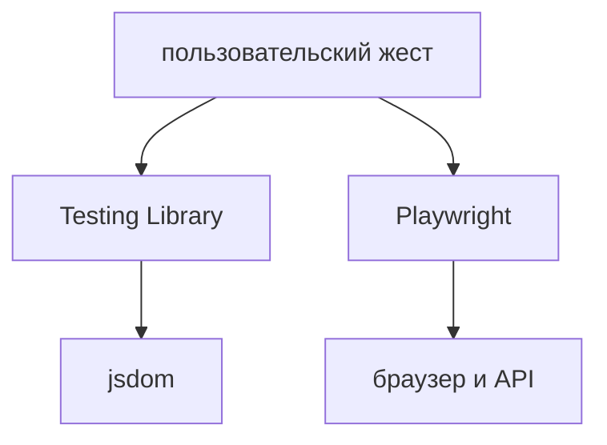

## Введение

В вакансиях React рядом стоят Jest или Vitest, React Testing Library и Playwright. Это два слоя: компонент без браузерного маршрута и один путь пользователя в настоящем браузере.

## Раздел: Что каким инструментом

Vitest и Jest гоняют функции и компоненты в jsdom. Для нового Vite-проекта чаще Vitest: он живёт рядом с конфигом сборки. Jest остаётся в уже настроенных репозиториях. Спор «какой лучше» на собесе слабее, чем пример теста.

Testing Library ищет кнопку по роли и имени, нажимает, смотрит текст. Селектор класса и проверка `useState` ломаются при рефакторинге, хотя поведение то же.

Playwright открывает страницу, ждёт элемент сам и гоняет сценарий «создал заметку — увидел её в списке». Таких сценариев мало: они дороже и ловят склейку UI с API. Мок сети в Playwright уместен для ошибки 500. Счастливый путь лучше гонять против учебного API.

## Раздел: Ответ вслух

Компонент тестирую как пользователь: роль, имя, текст результата. Состояние изнутри не читаю. Vitest беру в новом Vite-проекте, Jest не переписываю без повода. Playwright оставляет один сквозной путь и отдельный кейс на падение сети. Снимок вёрстки целиком я не кладу в каждый тест: он шумит.

## Раздел: Плохой ответ

Плохой ответ: «покроем каждый компонент e2e». Это медленно и дублирует то, что дешевле проверить Testing Library.

## Раздел: Термины

Модульный тест — unit. Тест компонента — component test. Сквозной тест — end-to-end. Роль — role. Автоожидание — auto-wait.

## Лаба

**30 минут.** Для кнопки «Добавить» напишите один тест Testing Library: клик показывает заголовок заметки. Рядом одной фразой опишите сценарий Playwright, который вы не будете дублировать этим тестом.

## Схема: Два слоя

## Тест

### Чем искать кнопку в Testing Library?

**Ответ:** по роли и имени

**Пояснение:** Так тест совпадает с тем, как элемент видят человек и доступность.

### Почему не проверять useState напрямую?

**Ответ:** тест привязан к реализации

**Пояснение:** Поведение может сохраниться, а хук переедет.

### Jest или Vitest в новом Vite-проекте?

**Ответ:** чаще Vitest

**Пояснение:** Он стартует из той же сборки. Jest оставляют, где он уже есть.

### Что отдавать Playwright, а не jsdom?

**Ответ:** сквозной путь с API

**Пояснение:** Компонентные тесты не видят настоящую склейку страницы и сервера.

### Зачем мок сети в e2e?

**Ответ:** показать ошибку сервера

**Пояснение:** Счастливый путь честнее без мока. Ошибку 500 стенд может не воспроизвести.

## Шпаргалка

<ul><li>Роль и имя, не класс</li><li>Vitest рядом с Vite</li><li>Мало сценариев Playwright</li><li>Снимок всей страницы — шум</li></ul>

## Anki

### Front: Что утверждает тест Testing Library?

Back: Что пользователь видит и может нажать.

### Front: getByRole зачем?

Back: Находит элемент так же, как его имя и роль для доступности.

### Front: Чем Playwright отличается от Vitest?

Back: Настоящий браузер и маршрут, не jsdom.

### Front: Сколько e2e на фичу?

Back: Один главный путь и редкий аварийный, не пачка на каждый проп.

### Front: Что ломает тест на CSS-класс?

Back: Смена вёрстки без смены поведения.

### Front: Куда класть мок API в компонентном тесте?

Back: На вызов клиента, чтобы компонент показал ошибку или данные.

## Итоги

- Слой выбирают по цене проверки
- Имя на экране важнее внутреннего хука
- E2E подтверждают склейку, а не каждый компонент

## Ссылки

- [Форма заметки](/game/learn/b09-react-form)
- [Playwright для QA](/game/learn/qa-playwright)
