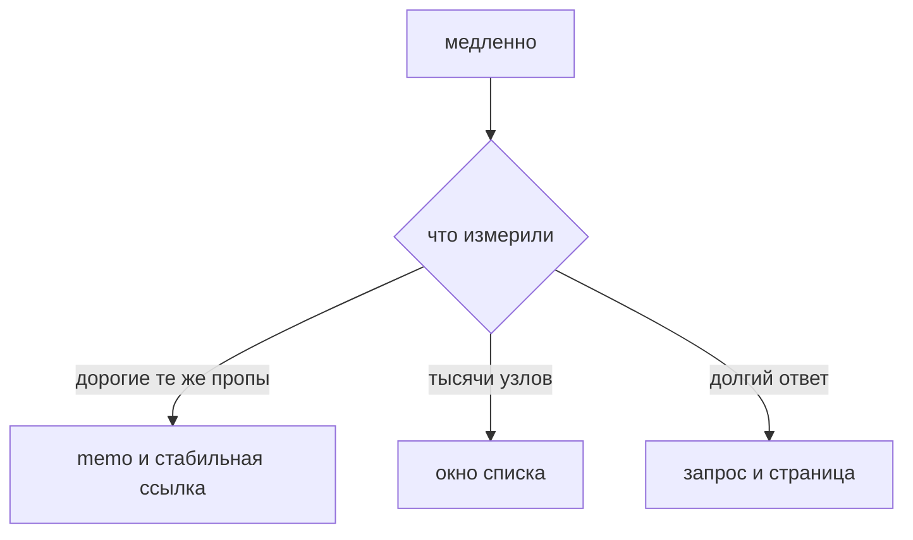

## Введение

Вакансии просят «оптимизацию рендера» и большие таблицы так, будто `React.memo` на каждый файл и есть эта оптимизация. На собеседовании достаточно другого правила. Сначала показать, что именно медленно: лишний рендер тяжёлого ребёнка или тысячи узлов в документе. Это две разные болезни. Мемоизация сокращает повторы работы, если пропы реально те же. Виртуализация сокращает число узлов: в документе только видимое окно и небольшой запас. Обёртка всего подряд в `memo` не лечит ни запрос, который приходит слишком часто, ни список, который монтирует пять тысяч строк.

Замер идёт раньше приёма. Профайлер React показывает, кто рисовался и почему. Вкладка производительности браузера показывает длинные задачи и раскладку. Ощущение «лагает при вводе» может быть и фильтром на главном потоке, и сетью, и одним тяжёлым ребёнком. Лекарство без причины добавляет сравнение пропов, которое само стоит времени, и код, который труднее читать.

Выпуск разбирает поле поиска над списком. На двадцати строках memo не нужен. На пяти тысячах, если они уже лежат на клиенте, нужно окно. Если сервер и так отдаёт страницу из тридцати строк, окно — второй шаг, не первый.

## Раздел: Две разные проблемы

Лишний рендер выглядит так. Родитель хранит текст поля и на каждый символ перерисовывается. Ребёнок — тяжёлая диаграмма или строка с дорогим подсчётом — получает те же данные, что и в прошлый раз, но всё равно считает заново, потому что родитель его вызвал. `React.memo` сравнивает пропы и пропускает рендер, если они равны по поверхностному сравнению. Это помогает только когда ссылки на пропы стабильны.

`useCallback` сохраняет функцию, `useMemo` сохраняет посчитанное значение или объект. Их ставят рядом с memo, если иначе родитель на каждом символе создаёт новый объект или новую функцию и сравнение в ребёнке всегда видит «проп изменился». Без memo эти хуки часто бесполезны: сохранить ссылку некому невыгодно. Без стабильной ссылки memo тоже бесполезен: он честно видит новый проп и рисует ребёнка.

Новый объект в JSX — классическая дыра. `style={{ color }}` и `onClick={() => ...}` рождаются заново каждый проход. Для дешёвой кнопки это нормально и даже предпочтительно: не надо обвешивать дерево хуками. Для ребёнка, которого вы уже измерили как дорогого, ссылку стабилизируют.

Длинный список — другая ось. Даже если каждая строка мелкая и мемоизирована, тысячи узлов означают тысячи подписок, раскладку и память. Виртуализация рисует только строки в видимой области плюс overscan, небольшой запас сверху и снизу, чтобы прокрутка не мигала. Высота строки либо фиксирована и окно считает позиции делением, либо её измеряют, что дороже и сложнее при разном числе строк текста. Ключ строки — стабильный id данных. Индекс массива ломает окно так же, как обычный список: при вставке и фильтре React путает, какая строка какая, и ввод в строке «переезжает» к соседу.

Фильтр и пагинация на сервере часто дешевле любого окна. Клиент не должен держать пять тысяч строк, если человеку нужна одна страница. Окно не заменяет нормальный запрос и не лечит тяжёлый JSON, который вы всё равно разобрали целиком. Его берут, когда длинный массив уже на клиенте по честной причине: офлайн-кэш, локальный поиск по выгруженному справочнику, лента без серверной страницы.

## Раздел: Разбор на примере

Экран справочника. Сверху поле поиска, ниже строки. Вариант А: двадцать записей пришли с сервера. Ввод в поле меняет локальный фильтр и перерисовывает родителя. Строка — простой текст. Профайлер покажет частые рендеры, но каждый дешёвый. `memo` на строке добавит сравнение пропов на каждый символ и почти не сэкономит. Здесь ничего не ставят. Если фильтрация вдруг станет тяжёлой на сотнях тысяч уже загруженных элементов, смотрят не memo, а серверный поиск.

Вариант Б: на клиенте пять тысяч строк фиксированной высоты, прокрутка заметно дёргается при первом монтировании. Лечение — окно. В документе одновременно около тридцати узлов, не пять тысяч. Позиция прокрутки переводится в индекс первой видимой строки. Ключ — `row.id`. Поиск по-прежнему может резать массив в памяти, а окно рисует уже отфильтрованный кусок. Мемоизация строки тут вторична: узлов мало, даже полный их рендер при новом фильтре дешевле, чем монтаж тысяч.

Вариант В: при вводе в шапке замирает боковая панель с графиком, хотя данные графика не меняются. Вот здесь memo на панели и стабильная ссылка на её данные уместны. Поле поиска не должно создавать новый объект настроек графика на каждый символ. Это точечный шов, его видно в профайлере как «почему график рисовался».

Порядок действий один. Воспроизвести жест. Посмотреть, кто рисовался. Если ребёнок дорогой и пропы те же — стабилизировать ссылки и memo. Если узлов слишком много — не монтировать невидимое. Если данные можно не привозить — не привозить. Кэш запроса и пагинация относятся к последнему и часто снимают задачу раньше обоих приёмов.

## Раздел: Где это ломается

Мемоизируют лист, а объект в пропе всё равно новый. Тест «я обернул» зелёный в ревью и пустой в профайлере. Сравнение ссылок надо проверить, а не предполагать.

`useMemo` вокруг сложения двух чисел и вокруг каждого стиля. Код шумный, выигрыша нет, зависимость забыли и значение устарело. Забытая зависимость — уже дефект логики, не микрооптимизация. Хук ставят на дорогой расчёт или на ссылку, которая ломает измеренный memo.

Виртуализация с ключом-индексом и полем ввода в строке. Прокрутка и фильтр переносят введённый текст на другую запись. Ключ — id. Локальный ввод лучше живёт в данных по id, не в состоянии «строка номер i».

Окно при переменной высоте без измерения. Строки наползают, скролл прыгает. Либо фиксируют высоту и обрезают текст предсказуемо, либо подключают измерение и принимают цену. Притворяться, что все карточки одной высоты, когда в них комментарии разной длины, нельзя.

Виртуализация списка из тридцати серверных строк «на будущее». Лишняя библиотека, сложнее фокус и доступность: программы чтения и клавиатура должны попадать в несмонтированные строки через прокрутку, это надо проверить. Пока узлов мало, обычный список проще и доступнее.

Оптимизация рендера при том, что тормозит запрос водопадом. Профайлер сети покажет это быстрее, чем обёртка компонента. Сначала число запросов, потом мемоизация.

## Раздел: Ответ вслух

Я смотрю, кто рендерится и сколько узлов в документе. Тяжёлый ребёнок с теми же пропами закрываю memo и стабильной ссылкой на колбэк или объект. Дешёвый список на двадцать строк не оборачиваю: сравнение дороже пользы. Тысячи строк не создаю в DOM, если они уже на клиенте: рисую видимое окно со стабильным id. Если данные и так приходят страницами, виртуализация не первый шаг. Пока нет замера, хуки ради хуков не ставлю.

## Раздел: Плохой ответ

Плохой ответ: «оберни всё в memo и будет быстро». Сравнение пропов тоже стоит денег, а причина может быть в запросе или в тысяче узлов, которые memo не убирает из документа. Второй плохой ответ: «виртуализация нужна любой таблице». Таблице на одну страницу API она чаще мешает, чем помогает.

## Раздел: Термины

Мемоизация — memoization, повторное использование результата, если вход тот же. `React.memo` сравнивает пропы компонента. Стабильная ссылка — тот же объект или та же функция между рендерами. Окно списка — windowing или virtualization. Запас узлов — overscan. Профайлер — React Profiler и панель производительности браузера. Поверхностное сравнение — shallow compare, вложенный объект без новой ссылки считается тем же, даже если поле внутри мутировали. Мутировать проп поэтому тоже нельзя.

## Лаба

**Цель.** Отличить случай «не трогать» от случая «окно» и от случая «memo».

**Шаги.**

1. Опишите список на 20 строк и поле поиска. Напишите, почему memo на строке вы не ставите.
2. Опишите боковую панель, которая считает график и перерисовывается на каждый символ поиска, хотя данные графика те же. Напишите, какую ссылку стабилизируете.
3. Для 5000 строк фиксированной высоты напишите: ключ, что храните в состоянии окна, сколько узлов примерно остаётся в DOM.
4. Добавьте оговорку: если API уже отдаёт 30 строк, окно не подключаете. Куда вместо этого смотрите.
5. Назовите один дефект ключа-индекса при фильтре.

**Готово, если…**

- [ ] Три случая разведены, а не закрыты одним приёмом
- [ ] У окна ключ — id
- [ ] Для короткой серверной страницы виртуализация отклонена
- [ ] memo связан с измеренным дорогим ребёнком, не со всем файлом

## Схема: Что лечить

## Тест

### Когда React.memo бесполезен?

**Ответ:** пропы всё равно новые

**Пояснение:** Новый объект или функция на каждом рендере ломает сравнение.

### Зачем useCallback рядом с memo?

**Ответ:** сохранить ссылку на функцию

**Пояснение:** Иначе memo видит новый проп и рендерит ребёнка снова.

### Что виртуализация убирает из DOM?

**Ответ:** строки вне окна

**Пояснение:** В документе остаются видимые строки и небольшой запас.

### Ключ строки окна — индекс. Чем риск?

**Ответ:** личность строки плывёт

**Пояснение:** При вставке и фильтре React перепутает узлы.

### Страница API уже отдаёт 30 строк. Нужно ли окно?

**Ответ:** обычно нет

**Пояснение:** Узлов мало. Окно окупается на длинном клиентском массиве.

## Шпаргалка

<ul><li>Сначала профайлер</li><li>memo при тех же пропах дорогого ребёнка</li><li>Новый объект ломает memo</li><li>Длинный список — окно, не тысяча узлов</li><li>Ключ строки — id</li></ul>

## Anki

### Front: Что сравнивает React.memo?

Back: Пропы. Равны — рендер ребёнка пропускается.

### Front: Почему inline-объект ломает memo?

Back: Каждый рендер создаёт новую ссылку.

### Front: Что такое окно списка?

Back: В DOM только видимые строки и запас.

### Front: Какой ключ у строки?

Back: Стабильный id данных, не индекс, если список меняется.

### Front: Чем memo отличается от виртуализации?

Back: Memo сокращает рендеры, окно сокращает число узлов.

### Front: Когда не ставить useMemo?

Back: Когда вычисление и так дешёвое: обёртка дороже пользы.

## Итоги

- Мемоизация после доказательства лишнего дорогого рендера
- Длинный DOM лечат окном и стабильным ключом
- Пагинация сервера часто снимает задачу раньше клиента
- Хук без измеренной пользы добавляет риск устаревшего значения
- Двадцать дешёвых строк не оптимизируют

## Ссылки

- [Состояние React](/game/learn/fe-react-state)
- [Стейт-библиотеки](/game/learn/fe-state-libraries)
