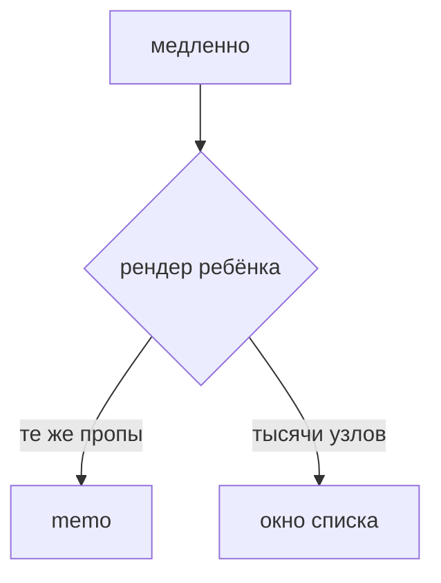

## Введение

Вакансии просят оптимизацию рендера и большие таблицы. На собесе достаточно правила: сначала показать лишний рендер, потом ставить memo, а тысячу строк не монтировать целиком.

## Раздел: Две разные проблемы

Лишний рендер: родитель меняется часто, тяжёлый ребёнок получает те же пропы. `React.memo` пропускает рендер, если пропы сравнились. `useMemo` и `useCallback` сохраняют значение и функцию, чтобы сравнение в ребёнке не ломалось на каждом проходе. Обёртка всего файла в memo без тяжёлой работы только тратит сравнение.

Длинный список: в DOM тысячи узлов. Виртуализация рисует окно плюс небольшой запас. Высота строки либо фиксирована, либо её измеряют. Ключ строки — id данных. Индекс ломает окно так же, как обычный список.

Фильтр и пагинация на сервере часто дешевле окна на клиенте. Окно не заменяет нормальный запрос.

## Раздел: Ответ вслух

Я смотрю, кто рендерится в профайлере. Тяжёлый ребёнок с теми же пропами закрываю memo и стабильной ссылкой на колбэк. Тысячу строк не создаю в DOM: рисую видимое окно. Если данные и так приходят страницами, виртуализация на клиенте — второй шаг, не первый.

## Раздел: Плохой ответ

Плохой ответ: «оберни всё в memo и будет быстро». Сравнение пропов тоже стоит денег, а причина может быть в запросе, который приходит слишком часто.

## Раздел: Термины

Мемоизация — memoization. Стабильная ссылка — stable reference. Окно списка — windowing, virtualization. Профайлер — profiler.

## Лаба

**20 минут.** Список на 20 строк оставьте как есть и напишите, почему memo здесь не нужен. Для 5 000 строк опишите, что храните: id, высоту строки и сколько узлов реально в DOM.

## Схема: Что лечить

## Тест

### Когда React.memo бесполезен?

**Ответ:** пропы всё равно новые

**Пояснение:** Новый объект или функция на каждом рендере ломает сравнение.

### Зачем useCallback рядом с memo?

**Ответ:** сохранить ссылку на функцию

**Пояснение:** Иначе memo видит новый проп и рендерит ребёнка снова.

### Что виртуализация убирает из DOM?

**Ответ:** строки вне окна

**Пояснение:** В документе остаются видимые строки и небольшой запас.

### Ключ строки окна — индекс. Чем риск?

**Ответ:** личность строки плывёт

**Пояснение:** При вставке и фильтре React перепутает узлы.

### Страница API уже отдаёт 30 строк. Нужно ли окно?

**Ответ:** обычно нет

**Пояснение:** Узлов мало. Окно окупается на длинном клиентском массиве.

## Шпаргалка

<ul><li>Сначала профайлер</li><li>memo при тех же пропах</li><li>Новый объект ломает memo</li><li>Длинный список — окно, не тысяча узлов</li></ul>

## Anki

### Front: Что сравнивает React.memo?

Back: Пропы. Равны — рендер ребёнка пропускается.

### Front: Почему inline-объект ломает memo?

Back: Каждый рендер создаёт новую ссылку.

### Front: Что такое окно списка?

Back: В DOM только видимые строки и запас.

### Front: Какой ключ у строки?

Back: Стабильный id данных, не индекс, если список меняется.

### Front: Чем memo отличается от виртуализации?

Back: Memo сокращает рендеры, окно сокращает число узлов.

### Front: Когда не ставить useMemo?

Back: Когда вычисление и так дешёвое: обёртка дороже пользы.

## Итоги

- Мемоизация после доказательства лишнего рендера
- Длинный DOM лечат окном
- Пагинация сервера часто снимает задачу раньше клиента

## Ссылки

- [Состояние React](/game/learn/fe-react-state)
- [Стейт-библиотеки](/game/learn/fe-state-libraries)
