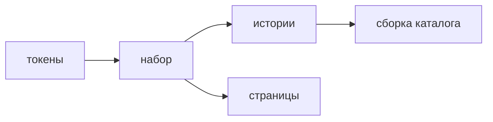

## Введение

На вакансиях, где уже есть несколько команд и общий интерфейс, UI-kit и Storybook идут рядом с вёрсткой. Смысл каталога не в том, чтобы «была документация». Смысл в том, что кнопку, поле и строку таблицы можно открыть без всего приложения и увидеть договорённые состояния: обычное, пустое, занятое, ошибочное, выключенное, с длинным текстом. Если состояния нет в историях, его нет и в договорённости. Экран тогда изобретает своё, и через квартал одинаковые по смыслу кнопки выглядят по-разному.

Дизайн-система — это не папка скриншотов и не запрет трогать CSS. Это токены и компоненты, которые этими токенами пользуются. Токен имени цвета и отступа меняется в одном месте. Hex, вписанный в модуль страницы, живёт своей жизнью: тёмная тема и контраст разъезжаются. Storybook показывает компоненты системы. Он не заменяет тест поведения и не заменяет собранную страницу. История фиксирует вид и состав пропов. Тест фиксирует действие. Страница собирает данные и маршрут.

Компонент попадает в набор со второго настоящего использования, не «на вырост». Один экран может держать локальную вёрстку. Общий API ради единственного места только мешает: пропы плодятся гипотезами.

## Раздел: История и набор

История — один компонент и конкретные аргументы. У кнопки отдельно: подпись по умолчанию, длинная подпись на узкой колонке, `disabled`, ожидание с блокировкой повторного нажатия. У строки списка отдельно: норма, пустой вторичный текст, ошибка загрузки, очень длинное имя без пробелов. Контролы в каталоге позволяют покрутить проп на ревью, но в репозитории всё равно лежат явные истории. Контрол, который никто не сохранил, не договорённость.

Имя истории говорит о состоянии, не о тикете. «Ошибка валидации» переживёт закрытие задачи. «Фикс 1842» через месяц ничего не объясняет.

Токены — именованные значения: цвет текста, цвет ошибки, шаг отступа, радиус, шрифт. Компонент набора не принимает случайный hex с экрана. Если экрану нужен новый смысл цвета, заводят токен или честно оставляют локальным, пока смысл не повторился. «Чуть темнее серого» в трёх файлах — уже распад системы.

Граница набора. Внутрь кладут то, что повторяется и имеет стабильный смысл: кнопка, поле, диалог, тост, строка таблицы. Не кладут целую страницу заявок: у страницы есть данные, права и маршрут. История страницы в Storybook возможна, но это уже обзор композиции, и он дороже в поддержке. Для повседневной работы достаточно деталей.

Доступность входит в историю, а не в отдельный абзац «потом». У кнопки в каталоге есть имя, виден фокус, ожидание не оставляет кнопку немой. История с отключённым `outline` не должна считаться готовой, даже если так нарисовал макет. Каталог — место сказать «так нельзя», пока ошибка не расползлась по экранам.

Сборку историй гоняют в CI. Иначе каталог описывает пропы, которые уже удалили, или не собирается на главной ветке, и им перестают пользоваться. Падение сборки истории — такой же сигнал, как падение теста компонента, только про контракт вида. Это не повод блокировать релиз из-за опечатки в описании, но повод не врать, что каталог живой.

## Раздел: Разбор на примере

Общая кнопка впервые появилась на форме заявки и на пустой строке фильтра. Два места — повод вынести её в набор, а не копировать классы. Пропы минимальные: подпись, тип действия, состояние занято, выключена. Отдельного пропа «цвет из макета экрана А» нет: цвет берётся из токена первичного и спокойного действия.

Истории четыре. Обычная «Сохранить». Длинная подпись, чтобы увидеть перенос в узкой колонке. `disabled` без обработчика. `loading`, когда повторный клик не уходит вторым запросом. Рядом история поля: с подписью, с текстом ошибки, с пустым значением. История ошибки показывает и цвет, и текст, потому что одного цвета мало.

Страница заявки истории не получает, пока команда не договорилась показывать композицию. Страница импортирует кнопку из набора и передаёт свои данные. Если дизайнеру нужно «чуть другой отступ только тут», вопрос в том, это новый смысл или частный случай. Частный случай остаётся на странице. Новый смысл, если он нужен второму экрану, становится вариантом компонента, а не копией.

Ревью смотрит каталог, а не только скриншот страницы. На скриншоте не видно `disabled` и длинного текста. В историях видно. Замечание «добавь историю на ошибку поля» дешевле, чем ловить обрезанный текст на приёмке.

Тест Testing Library на кнопку «по клику зовётся обработчик» живёт рядом и не заменяется историей. История не нажимает кнопку в пайплайне поведения, если вы отдельно не включили тест-раннер внутри Storybook. Даже если включили, сквозной путь страницы остаётся в Playwright. Три слоя не слипаются.

## Раздел: Где это ломается

Каталог пишут в конце проекта. Состояния уже разъехались, истории фиксируют хаос или требуют большой переделки. Историю заводят вместе с вторым использованием, не на релизе.

В набор тащат всё после первого экрана. У кнопки десять пропов «на всякий случай», половина не используется, типы врут. API компонента режут по реальным местам.

Цвет и отступ остаются литералами в компоненте набора. Токены есть в файле темы, но кнопка их не читает. Смена темы красит страницу и не красит «систему».

Истории зависят от живого API. Каталог падает без стенда, его перестают открывать. Данные истории — фикстура в коде. Сеть в каталоге детали не нужна.

Нет CI. Главная ветка не собирает истории уже месяц, новый сотрудник смотрит устаревший локальный запуск. Сборка каталога в пайплайне дешёвая проверка «импорты живы».

История вместо критерия приёмки. «Посмотрите Storybook» не говорит, какой результат принимает продукт. Каталог про вид детали. Приёмка про сценарий пользователя.

## Раздел: Ответ вслух

У общего компонента есть истории на нормальный вид, пустоту, загрузку, ошибку и длинный текст, если эти состояния у него есть. Цвета и отступы беру из токенов. В набор выношу со второго использования, с маленьким набором пропов. Страницу целиком из историй не собираю. Storybook не подменяет тест клика и не подменяет e2e. Сборку каталога оставляю в CI, данные историй — фикстурами, без живого стенда. Если компонент нужен один раз, он остаётся локальным.

## Раздел: Плохой ответ

Плохой ответ: «Storybook — это документация, её напишем в конце». К концу состояния уже разъехались, и каталог либо врёт, либо стоит как отдельный проект. Второй плохой ответ: «дизайн-система — это запрет дизайнеру менять отступ». Система — общие имена решений. Частный экран может отличаться, пока отличие не стало вторым таким же исключением.

## Раздел: Термины

История — story, зафиксированные пропы и вид. Набор компонентов — UI kit. Токен — token, именованное значение оформления. Дизайн-система — design system, токены плюс компоненты и правила, когда ими пользоваться. Состояние компонента — отдельный кадр, не путать с состоянием React-приложения целиком. Фикстура — пример данных в коде истории, не ответ стенда.

## Лаба

**Цель.** Описать кнопку как контракт состояний, а не как скриншот одного экрана.

**Шаги.**

1. Выпишите четыре истории кнопки: обычная, выключенная, ожидание, длинная подпись.
2. Отметьте, какие из них нельзя сверстать одним цветом, вписанным в модуль страницы. Ожидание меняет поведение, длинная подпись проверяет раскладку, выключенная меняет доступность.
3. Решите, класть ли кнопку в набор: она нужна форме и фильтру. Да. Пропов больше четырёх не добавляйте.
4. Опишите одну историю поля с текстом ошибки. Цвет без текста не считается готовой историей.
5. Напишите, что остаётся локальным на странице заявки и почему это не история каталога.
6. Одной фразой разведите историю и тест клика.

**Готово, если…**

- [ ] У кнопки названы состояния, включая длинный текст
- [ ] Цвет приходит как токен, не как hex страницы
- [ ] В набор не уехала целая страница
- [ ] История не объявлена заменой теста

## Схема: Где живёт компонент

## Тест

### Что такое история в Storybook?

**Ответ:** компонент в одних пропах

**Пояснение:** Отдельный кадр состояния, не весь маршрут приложения.

### Когда компонент пора нести в UI-kit?

**Ответ:** когда он нужен второму месту

**Пояснение:** Один экран может держать локальную вёрстку.

### Чем токен лучше hex в модуле страницы?

**Ответ:** цвет меняется в одном месте

**Пояснение:** Иначе тема и контраст разъезжаются.

### Storybook заменяет Testing Library?

**Ответ:** нет

**Пояснение:** История показывает вид. Тест проверяет действие и результат.

### Зачем истории в CI?

**Ответ:** каталог совпадает с main

**Пояснение:** Несобранные истории тихо описывают уже удалённые пропы.

## Шпаргалка

<ul><li>Состояния: норма, пусто, ждём, ошибка, длинный текст</li><li>Токены, не случайный цвет</li><li>В набор со второго использования</li><li>Фикстуры, не живой стенд</li><li>История не равна e2e</li></ul>

## Anki

### Front: Что фиксирует story?

Back: Конкретные пропы и видимый результат компонента.

### Front: Какие состояния показать обязательно?

Back: Обычное, пустое, загрузка, ошибка и длинный текст, если они есть у компонента.

### Front: Что такое дизайн-токен?

Back: Именованное значение цвета, отступа или шрифта.

### Front: Почему не выносить всякую кнопку в kit сразу?

Back: Пока она одна, общий API только мешает.

### Front: Storybook и тест компонента?

Back: Каталог вида и проверка поведения решают разные задачи.

### Front: Что ломается без токенов?

Back: Одинаковые по смыслу цвета начинают отличаться на экранах.

## Итоги

- История — контракт состояния детали
- Набор растёт от повтора, не от желания порядка
- Токен меняет тему в одном месте
- Вид в каталоге и действие в тесте дополняют друг друга
- Каталог без сборки в CI быстро начинает врать

## Ссылки

- [HTML и доступность](/game/learn/fe-html-a11y)
- [Тесты UI](/game/learn/fe-ui-testing)
