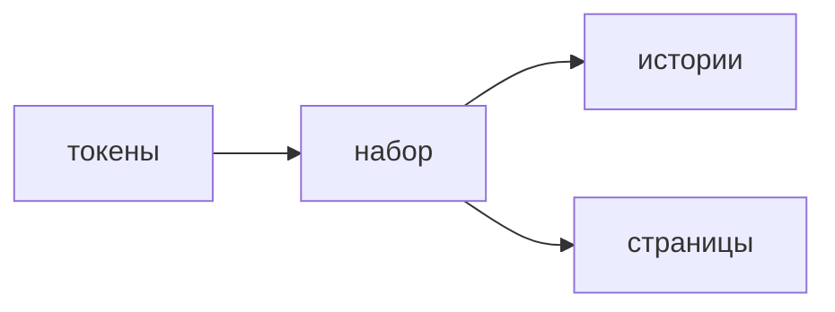

## Введение

На senior-вакансиях UI-kit и Storybook идут вместе с вёрсткой. Смысл: кнопку и таблицу можно открыть без всего приложения и увидеть пустое, занятое и ошибочное состояние.

## Раздел: История и набор

История — один компонент и конкретные пропы: по умолчанию, длинный текст, disabled, ошибка. Если состояния нет в историях, его нет и в договорённости команды.

Дизайн-система — токены цвета и отступа плюс компоненты, которые эти токены используют. Локальный цвет в экране откатывает систему назад. Новый контрол добавляют в набор, когда он нужен второму экрану, не раньше.

Storybook не заменяет тест поведения и не заменяет страницу. Он ловит визуальный контракт. Сборку историй имеет смысл гонять в CI, иначе каталог врёт относительно main.

## Раздел: Ответ вслух

У общего компонента есть истории на нормальный вид, пустоту, загрузку и ошибку. Цвета беру из токенов. Страницу из десятков историй не собираю: история показывает деталь. Если компонент используется один раз, я не тащу его в набор «на вырост».

## Раздел: Плохой ответ

Плохой ответ: «Storybook — это документация, её напишем в конце». К концу состояния уже разъехались по экранам.

## Раздел: Термины

История — story. Набор компонентов — UI kit. Токен — token. Дизайн-система — design system. Состояние — state of the component.

## Лаба

**20 минут.** Для кнопки выпишите четыре истории: default, disabled, loading, long label. Отметьте, какие из них нельзя сверстать одним только цветом из экрана.

## Схема: Где живёт компонент

## Тест

### Что такое история в Storybook?

**Ответ:** компонент в одних пропах

**Пояснение:** Отдельный кадр состояния, не весь маршрут приложения.

### Когда компонент пора нести в UI-kit?

**Ответ:** когда он нужен второму месту

**Пояснение:** Один экран может держать локальную вёрстку.

### Чем токен лучше hex в модуле страницы?

**Ответ:** цвет меняется в одном месте

**Пояснение:** Иначе тема и контраст разъезжаются.

### Storybook заменяет Testing Library?

**Ответ:** нет

**Пояснение:** История показывает вид. Тест проверяет действие и результат.

### Зачем истории в CI?

**Ответ:** каталог совпадает с main

**Пояснение:** Несобранные истории тихо описывают уже удалённые пропы.

## Шпаргалка

<ul><li>Четыре состояния: норма, пусто, ждём, ошибка</li><li>Токены, не случайный цвет</li><li>В набор со второго использования</li><li>История не равна e2e</li></ul>

## Anki

### Front: Что фиксирует story?

Back: Конкретные пропы и видимый результат компонента.

### Front: Какие состояния показать обязательно?

Back: Обычное, пустое, загрузка, ошибка, если они есть у компонента.

### Front: Что такое дизайн-токен?

Back: Именованное значение цвета, отступа или шрифта.

### Front: Почему не выносить всякую кнопку в kit сразу?

Back: Пока она одна, общий API только мешает.

### Front: Storybook и тест компонента?

Back: Каталог вида и проверка поведения решают разные задачи.

### Front: Что ломается без токенов?

Back: Одинаковые по смыслу цвета начинают отличаться на экранах.

## Итоги

- История — контракт состояния
- Набор растёт от повтора, не от желания порядка
- Вид в каталоге и действие в тесте дополняют друг друга

## Ссылки

- [HTML и доступность](/game/learn/fe-html-a11y)
- [Тесты UI](/game/learn/fe-ui-testing)
