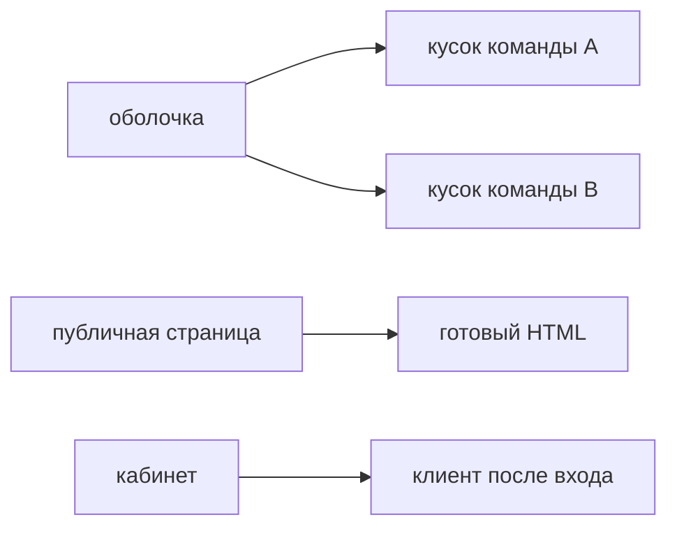

## Введение

Senior-вакансии называют микрофронтенды, Module Federation, монорепозиторий и Next.js в одном абзаце. Это две разные развилки, не обязательный набор. Первая развилка — кто и когда выкладывает интерфейс. Вторая — кто рисует первый HTML. На собеседовании выбирают одну причину и называют цену. «Так сейчас делают» ценой не считается.

Микрофронтенд нужен, когда разные команды выпускают свои куски интерфейса отдельно и не могут ждать общего релиза. Монорепозиторий без отдельной выкладки — просто общая сборка в нескольких пакетах. Next.js нужен, когда первый HTML должен прийти с сервера: публичная страница, текст для поиска, данные до выполнения клиентского кода. Кабинет за логином нормально живёт как SPA. Серверный рендер добавляет сервер, кэш и риск расхождения гидрации. Его не берут «потому что современнее».

Первому учебному экрану заметок не нужно ни то, ни другое. Ему нужен один Vite-проект. Этот выпуск как раз про то, какими словами отказаться и какими словами согласиться, когда причины уже есть.

## Раздел: Две развилки

Отдельная выкладка. Команда А выпускает кабинет заявок во вторник, команда Б выпускает справочник в четверг. Общая оболочка подгружает их куски. Module Federation (или близкий механизм удалённых модулей) позволяет оболочке взять скрипт, который собрала другая команда, и встроить его в страницу. Цена начинается сразу. Версия React должна быть одна: две копии ломают хуки и контекст на границе, и ошибка выглядит случайной. Токены и набор компонентов общие, иначе кнопки и отступы разъедутся, а фокус с клавиатуры будет разным. Сессия и способ узнать пользователя одни. Ошибка чужого куска не должна ронять оболочку целиком: нужен предохранитель, который покажет «справочник недоступен», а не белый экран. Сквозной тест проходит границу команд, и договориться, чей пайплайн его держит, тоже работа.

Если команды и так релизятся одним поездом в один день, федерация не покупает независимость. Она покупает сложность стыка. Тогда честнее один SPA или монорепозиторий с пакетами, которые собираются в один артефакт. Пакеты дают границу кода и переиспользование. Они не дают границу выкладки. На собесе эти два слова разводят явно.

Серверный рендер. Next.js (и аналоги) отдают HTML, в котором уже есть текст и разметка, затем клиент гидратирует страницу: вешает обработчики на готовое дерево. Это окупается, когда документ должны увидеть без вашего JavaScript: поисковый робот, первая отрисовка на медленной сети, публичная статья, карточка товара. Данные для этого HTML берутся на сервере, и их кэшируют, иначе сервер становится новым узким местом на каждый просмотр.

Гидрация обязана увидеть то же дерево, что прислал сервер. Расхождение — дефект: часы «сейчас» в тексте, ветка `window` только на клиенте, случайный id. Страница то мигает, то ругается в консоли, то теряет событие. Лечение — не расходиться: данные, от которых зависит разметка, приходят с сервера одинаково, браузерные API не участвуют в первом рендере.

Админка за логином этого обычно не требует. Первый полезный экран и так после запроса «кто я» и «дай заявки». HTML-оболочка с пустым корнем и клиентским приложением на Vite проще: нет серверного рантайма рядом с API, нет кэша страниц, нет гидрации. SEO внутреннего кабинета не существует. Брать Next «чтобы был один фреймворк на все фронты компании» имеет смысл только если публичные страницы уже на нём и общий навык дороже простоты кабинета. Это аргумент про людей, его так и называют, а не маскируют под «SSR быстрее».

## Раздел: Разбор на примере

Два продукта. Публичная статья о сервисе заявок: заголовок, текст, цена. Её должны прочитать без ожидания большого бандла, заголовок важен в выдаче. Здесь серверный HTML уместен. Интерактив «оставить заявку» может быть островом на странице, а не поводом рисовать весь документ только на клиенте. Кэш страницы статьи живёт минуты или часы, пока текст не сменят.

Кабинет сотрудника: список заявок, фильтр, роль. Пользователь уже вошёл. Данные персональные, их нельзя положить в общий кэш HTML. Первый экран всё равно ждёт API. Vite SPA попадает в цель. Тянуть серверный рендер ради таблицы, которая пустая без токена, значит поддерживать два способа загрузить одни и те же заявки.

Две команды кабинета, если они выпускаются в разные дни. Оболочка держит вход, шапку и меню. Команда заявок отдаёт удалённый модуль списка. Общее: одна версия React, токены, клиент авторизации, договорённость по маршрутам. Не общее: внутренние слайсы и сроки релиза. Если на практике релизы всё равно слипаются в один четверг, модуль федерации убирают и оставляют пакет в монорепозитории. Граница кода может остаться. Граница выкладки без независимых дней не нужна.

Общая библиотека кнопок живёт пакетом. Её не делают третьим микрофронтом. Кнопка не выкладывается отдельно от тех, кто её импортирует, если только вы сознательно не строите рантайм-подмену темы. Обычный пакет, собранный вместе с приложением, проще и предсказуемее.

## Раздел: Где это ломается

Режут фронт «как микросервисы бэкенда» по папкам. У бэкенда граница — сеть и данные. У экрана граница — один пользователь, одна сессия, один документ. Папки без своих релизов остаются одним приложением, только сборка сложнее, а стили дублируются.

Две копии React. Контекст оболочки не виден удалённому модулю, хуки падают с сообщением, которое не указывает на федерацию. Фиксируют shared-зависимость одной версией, не «примерно 18».

Чужой кусок без предохранителя. Исключение в справочнике роняет кабинет заявок. Граница обязана ловить ошибку модуля.

SSR ради кабинета и `Date.now()` в первом рендере. Гидрация расходится каждый запрос. Часы и случайности переносят на клиент после гидрации или отдают с сервера готовой строкой.

Кэш персональной страницы. В выдачу одного пользователя попадает HTML другого. Персональные данные не кэшируют как публичную статью. Ключ кэша включает идентичность, либо кэша HTML нет.

Монорепозиторий называют микрофронтендом в резюме. На собесе это ловят одним вопросом: можете ли вы выложить один пакет, не выкладывая второй. Если нет, это не микрофронтенд.

## Раздел: Ответ вслух

Отдельную выкладку я беру, когда команды выпускаются в разные дни и граница продукта это выдерживает: общие React, токены, сессия и предохранитель ошибки. Иначе оставляю один SPA или пакеты в одном артефакте. Next.js беру для публичной страницы, где важен готовый HTML и нет персонального кэша. Внутренний кабинет оставляю на Vite. Гидрацию не расходую на `window` и случайные значения. Общую библиотеку держу пакетом, не удалённым модулем. Если причины нет, я так и говорю: первому экрану заметок это не нужно.

## Раздел: Плохой ответ

Плохой ответ: «разрежем фронт на микросервисы, как бэкенд». Без независимых релизов разрез только множит сборки. Второй плохой ответ: «SSR всегда быстрее». Он быстрее до интерактива на публичной странице с кэшем. Он лишний на персональной таблице за логином и опасен, если кэш общий.

## Раздел: Термины

Оболочка — shell, каркас, который подгружает куски. Удалённый модуль — remote. Федерация модулей — module federation. Рендер на сервере — server-side rendering. Гидрация — hydration, клиент оживляет уже присланный HTML. Одностраничное приложение — SPA, первый HTML почти пустой, интерфейс строится в браузере. Монорепозиторий — один склад пакетов, не синоним отдельной выкладки.

## Лаба

**Цель.** Выбрать транспорт выкладки и рендера по причине, не по моде.

**Шаги.**

1. Для публичной статьи о продукте выберите серверный HTML или чистый SPA. Напишите, что именно должно быть в первом ответе: заголовок и текст.
2. Для кабинета сотрудника выберите Vite. Напишите, почему персональный список не кэшируют как статью.
3. Для двух команд, которые выпускают кабинет в разные дни, перечислите общее: версия React, токены, способ входа, предохранитель падения чужого куска.
4. Если те же команды выпускаются одним поездом, замените федерацию на пакет в одном артефакте и напишите, какая граница при этом остаётся.
5. Назовите один способ сломать гидрацию и как его не допустить в первом рендере.

**Готово, если…**

- [ ] Статья и кабинет получили разные ответы
- [ ] Микрофронт связан с разными днями выкладки
- [ ] Общие зависимости названы
- [ ] Персональный HTML не предложен к общему кэшу

## Схема: Граница выкладки

## Тест

### Чем микрофронтенд отличается от папок в одном SPA?

**Ответ:** независимой выкладкой

**Пояснение:** Папки без своего релиза остаются одним приложением.

### Что ломается первым при Module Federation?

**Ответ:** версии общего React и стилей

**Пояснение:** Две копии React и разные токены дают тихие сбои на стыке.

### Когда Next.js окупает сервер?

**Ответ:** нужен готовый HTML

**Пояснение:** Публичная страница и данные до выполнения клиентского кода.

### Почему админке часто хватает Vite?

**Ответ:** пользователь уже за логином

**Пояснение:** Первый полезный экран не обязан быть в ответе сервера.

### Монорепозиторий равен микрофронтенду?

**Ответ:** нет

**Пояснение:** Общий репозиторий может собираться и выкладываться одним артефактом.

## Шпаргалка

<ul><li>Микрофронт — разные релизы</li><li>Общие React, токены, сессия</li><li>Чужой кусок изолируют предохранителем</li><li>Next — когда важен первый HTML</li><li>Кабинет может остаться SPA</li></ul>

## Anki

### Front: Зачем Module Federation?

Back: Подгрузить кусок интерфейса, который выложила другая команда.

### Front: Что обязано быть общим у кусков?

Back: Версия React, токены и способ входа.

### Front: Что такое hydration?

Back: Клиент оживляет HTML, который уже прислал сервер.

### Front: Когда не брать SSR?

Back: Когда первый экран закрыт логином и наполняется персональными данными после запроса.

### Front: Чем опасны две копии React?

Back: Хуки и контекст ломаются на границе модулей.

### Front: Монорепо без отдельных релизов — это микрофронт?

Back: Нет, это одна поставка в нескольких пакетах.

## Мнемоника

### peg: Граница фронта

**Задание:** Три вопроса, прежде чем пилить микрофронт.

**Элементы:**
- чей контракт
- как выкладывают отдельно
- что общее

**Подсказка:** Общий стор без хозяина склеивает то, что хотели разнять.

**Ответ:** 1 контракт · 2 релиз · 3 общее

## Итоги

- Режьте интерфейс по независимым релизам, не по аналогии с бэкендом
- SSR берите ради готового публичного HTML
- Персональные страницы не кладут в общий кэш документа
- Общая библиотека дешевле федерации, пока релизы общие
- Гидрация требует того же дерева, что ушло с сервера

## Ссылки

- [Стейт-библиотеки](/game/learn/fe-state-libraries)
- [Storybook](/game/learn/fe-storybook)
