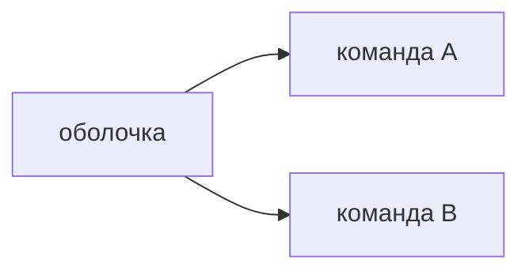

## Введение

Senior-вакансии называют микрофронтенды, Module Federation, монорепозиторий и Next.js. Это развилки, не обязательный набор. На собесе выбирают одну причину и называют цену.

## Раздел: Две развилки

Микрофронтенд нужен, когда разные команды выкладывают свои куски интерфейса отдельно. Module Federation подгружает удалённый модуль в оболочку. Цена: общие версии React, общий дизайн, ошибка чужого куска на вашей странице, сквозные тесты. Монорепозиторий без отдельной выкладки — это просто общая сборка, не микрофронтенд.

Next.js нужен, когда первый HTML должен прийти с сервера: публичная страница, поисковый текст, данные до клика. Приложение за логином, как админка заявок, нормально живёт как SPA на Vite. SSR добавляет сервер, кэш и расхождение гидрации. Его не берут «потому что современнее».

## Раздел: Ответ вслух

Отдельную выкладку я беру, когда команды релизятся в разные дни и граница продукта это выдерживает. Иначе оставляю один SPA. Next.js беру для публичной страницы, где важен готовый HTML. Внутренний кабинет оставляю на Vite. Общую библиотеку компонентов могу держать в монорепозитории и без федерации.

## Раздел: Плохой ответ

Плохой ответ: «разрежем фронт на микросервисы, как бэкенд». У бэкенда граница — сеть и данные. У экрана граница — общий пользователь и общая сессия. Разрез без независимых релизов только множит сборки.

## Раздел: Термины

Оболочка — shell. Удалённый модуль — remote. Федерация модулей — module federation. Рендер на сервере — server-side rendering. Гидрация — hydration. Одностраничное приложение — SPA.

## Лаба

**20 минут.** Для кабинета сотрудника и для публичной статьи о продукте выберите Vite SPA или Next.js. Для двух команд, которые релизят кабинет в разные дни, напишите, что должно быть общим: React, токены, авторизация.

## Схема: Граница выкладки

## Тест

### Чем микрофронтенд отличается от папок в одном SPA?

**Ответ:** независимой выкладкой

**Пояснение:** Папки без своего релиза остаются одним приложением.

### Что ломается первым при Module Federation?

**Ответ:** версии общего React и стилей

**Пояснение:** Две копии React и разные токены дают тихие сбои на стыке.

### Когда Next.js окупает сервер?

**Ответ:** нужен готовый HTML

**Пояснение:** Публичная страница и данные до выполнения клиентского кода.

### Почему админке часто хватает Vite?

**Ответ:** пользователь уже за логином

**Пояснение:** Первый полезный экран не обязан быть в ответе сервера.

### Монорепозиторий равен микрофронтенду?

**Ответ:** нет

**Пояснение:** Общий репозиторий может собираться и выкладываться одним артефактом.

## Шпаргалка

<ul><li>Микрофронт — разные релизы</li><li>Общие React, токены, сессия</li><li>Next — когда важен первый HTML</li><li>Кабинет может остаться SPA</li></ul>

## Anki

### Front: Зачем Module Federation?

Back: Подгрузить кусок интерфейса, который выложила другая команда.

### Front: Что обязано быть общим у кусков?

Back: Версия React, токены и способ входа.

### Front: Что такое hydration?

Back: Клиент оживляет HTML, который уже прислал сервер.

### Front: Когда не брать SSR?

Back: Когда первый экран всё равно закрыт логином и данными после запроса.

### Front: Чем опасны две копии React?

Back: Хуки и контекст ломаются на границе модулей.

### Front: Монорепо без отдельных релизов — это микрофронт?

Back: Нет, это одна поставка в нескольких пакетах.

## Итоги

- Режьте интерфейс по независимым релизам
- SSR берите ради готового HTML
- Общая библиотека дешевле федерации, пока релизы общие

## Ссылки

- [Стейт-библиотеки](/game/learn/fe-state-libraries)
- [Storybook](/game/learn/fe-storybook)
