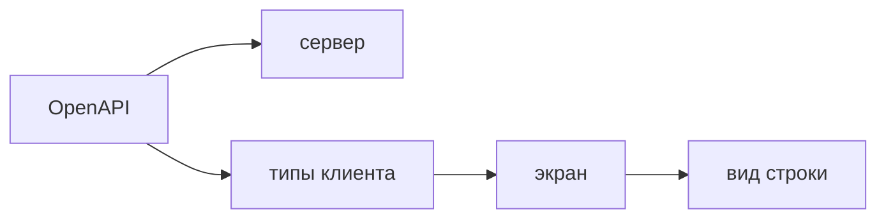

## Введение

Старший фронтенд интегрируется с сервером по спецификации, а не по примеру JSON из чата. OpenAPI описывает путь, метод, тело, ответ и ошибки. Генератор делает из этого типы и функции клиента. Экран импортирует их и не заводит второй словарь полей «как я запомнил». Два описания одного JSON расходятся без сигнала: бэкенд переименовал `title` в `name`, ручной интерфейс всё ещё считает поле строкой, сборка зелёная, пользователь видит пустой заголовок.

Контракт один на сервер и на экран. Спецификация — источник полей. Пример в Postman и тип в репозитории фронта — следствия. Если пример разошёлся со спецификацией, правят спецификацию первой, потом генерацию, потом пример. Дописывать поле только в клиенте — завести второй контракт, который CI не стережёт.

Этот выпуск проходит путь `GET /notes` и `POST /notes`: откуда берётся тип списка, какой код ждать на пустой заголовок, чем вид экрана отличается от DTO и почему `any` на ответе `fetch` прячет поломку до рантайма.

## Раздел: Генерация и граница типов

Спецификация лежит в репозитории или публикуется артефактом сборки сервера с версией. Фронт не скачивает «последний swagger с прода» втихую в локальной разработке и не коммитит результат без понимания, какая версия спеки его породила. Рядом с клиентом видно, с чем он собран: хэш файла, тег, дата. Иначе спор «у меня типы старые» нечем закрыть.

Генератор выдаёт типы тел и ответов и функции вызова. Экран не копирует эти типы вручную «чтобы короче импорт». Копия отстанет. Ручной тип живёт только как вид экрана: подпись кнопки, признак «строка выделена», форма, собранная из нескольких ответов. Это производное. Его не выдают за схему API и не отправляют назад как есть, если сервер ждёт другую форму.

`any` и широкий `object` на ответе выключают проверку полей. Опечатка `titel` компилируется. Ошибка всплывает, когда рисуют список и читают `undefined`. Узкий сгенерированный тип как раз для того, чтобы переименование стало красной сборкой, а не тикетом из прода.

Необязательное поле и отсутствие поля — часть типа. Экран решает, что показать, если `description` нет. Не подставляет чужой текст «по умолчанию», который человек примет за данные сервера, если только этот текст явно помечен как пустое состояние интерфейса.

Ошибки — тоже контракт, не одна строка «что-то пошло не так». Пустое обязательное поле у FastAPI с Pydantic обычно 422 и тело с указанием места. Нет объекта — 404. Конфликт версии или повтор — 409. Нет права — 403. Смешивать их в один тост значит лишить человека действия: при 422 надо исправить поле, при 409 — обновить карточку, при 403 — не жать снова вслепую. Клиент разбирает код и показывает ветку, которую спецификация назвала.

Генерацию гоняют в CI на том же файле спеки, что и сервер. Расхождение типов останавливает сборку фронта. Это и есть сигнал, которого нет у ручного интерфейса. Если спека ещё не обновлена, а поле уже пришло, правильный шаг — обновить спеку, не «временно» расширить тип на клиенте комментарием. Временное живёт до инцидента.

## Раздел: Разбор на примере

`GET /notes` возвращает массив объектов с `id` и `title`. `POST /notes` принимает `title` и возвращает созданный объект. Пустой `title` — 422. Несуществующий id на чтении одной заметки — 404.

Сгенерированный клиент даёт функцию списка и функцию создания. Тип элемента список не описывает руками. Компонент вызывает список, статус загрузки берёт из полки кэша, элементы рисует по `title`. Если кто-то переименует поле в спеке и забудет экран, сборка экрана красная в месте `note.title`. Это хороший красный: он до выкладки.

Создание передаёт тело типа из спеки. Лишнее поле, которого в типе нет, вставить трудно без осознанного обхода, и это правильно: сервер про него не договаривался. Пустой заголовок можно не пускать с клиента для мгновенной подсказки, но сервер всё равно проверяет сам. Сообщение 422 показывают у поля, не общим баннером «error». Текст с сервера используют, если он для человека. Внутренний стек в теле 500 на экран не выводят.

Вид строки таблицы — отдельный тип: `{ id, label }`, где `label` собран из `title`. Он может появиться в компоненте. Он не экспортируется как «тип API». Когда в ответе появится `status`, вид решают обновить явно. Пока вид читает только заголовок, новое поле его не обязано трогать, но тип ответа в клиенте уже знает про `status`, и это не `any`.

Версия спеки в CI: сервер публикует файл, фронт генерирует в проверке запроса на слияние. Если генерировать только на ноутбуке автора, коллега соберёт старый клиент и не увидит конфликта. Коммит сгенерированного кода допустим, когда все ставят одну версию генератора и дифф типов читается в ревью. Генерация только в CI тоже допустима, если артефакт воспроизводим. Недопустим режим «у каждого свой swagger.ts, который не в репозитории».

## Раздел: Где это ломается

Интерфейс пишут по примеру из чата. Пример без обязательного поля, без ошибки, без дат в формате сервера. Через спринт сервер честно шлёт `null`, экран падает на `.trim`. Спека как раз должна была сказать, что поле бывает пустым.

Клиент глотает не-200 в одну ошибку. 409 выглядит как «не сохранилось, попробуйте ещё раз», человек создаёт дубль. Код читают до текста.

`any` на время «пока бэкенд не стабилен». Время заканчивается релизом, тип так и не сузили. Временный `any` заводят на одно поле с комментарием и задачей, не на весь ответ.

Две спеки: файл в репозитории фронта и файл у сервера, их копируют руками по пятницам. Расхождение живёт неделю. Источник один, второй репозиторий подтягивает его сборкой, а не пересказом.

Генератор без ревью диффа. Обновление принесло ломающее переименование на двадцать экранов, его влили пачкой «обновил типы». Дифф сгенерированного клиента смотрят: это и есть список мест, которые надо починить до слияния.

Экран шлёт на сервер свой вид, а не DTO. Лишние поля уходят в POST, сервер либо молча игнорирует, либо внезапно начинает их требовать. На провод отдают форму из спеки.

## Раздел: Ответ вслух

Типы ответа я беру из OpenAPI, не из примера в чате. Клиент генерирую так, чтобы версия спецификации была явной в CI. Ветки ошибок разбираю по коду: 422 к полю, 404 к пустому состоянию, 409 к обновлению, а не к слепому повтору. Вид экрана могу собрать отдельно, но не объявляю его второй схемой API. Если поле пришло, а в типе его нет, обновляю спецификацию, а не расширяю клиент в одиночку. `any` на ответе не оставляю: он переносит ошибку в рантайм.

## Раздел: Плохой ответ

Плохой ответ: «Swagger только для бэкенда, на фронте свои интерфейсы». Два описания одного JSON расходятся без красной сборки. Второй плохой ответ: «сгенерированный код не смотрим, он машинный». Машинный дифф как раз показывает, какие экраны сломает смена контракта. Его читают.

## Раздел: Термины

Спецификация — OpenAPI specification, часто говорят Swagger про интерфейс просмотра. Сгенерированный клиент — generated client. Объект передачи — DTO, форма тела или ответа, не вид кнопки. Контракт — договорённость о полях и кодах. Вид экрана — view model, производное для отрисовки. Ошибка проверки тела — часто 422. Конфликт состояния — 409.

## Лаба

**Цель.** Развести спеку, клиент и текст для человека на двух методах.

**Шаги.**

1. Для `GET /notes` выпишите тип элемента так, будто его сгенерировали: `id`, `title`. Не добавляйте поле «для красоты».
2. Для `POST /notes` выпишите тело и ответ. Пустой заголовок — код 422 и сообщение у поля, не 500.
3. Чтение несуществующего id — 404 и пустое состояние экрана, не общий «error».
4. Соберите вид строки `{ id, label }` и напишите, почему его нет в OpenAPI.
5. Опишите шаг CI: спека обновилась, генерация упала на `note.title`. Что делаете до слияния, а не после выкладки.
6. Напишите, почему пример в мессенджере не заменяет этот путь.

**Готово, если…**

- [ ] Тип ответа не объявлен ручной копией «на глаз»
- [ ] 422 и 404 ведут к разным реакциям экрана
- [ ] Вид строки не выдан за DTO
- [ ] Смена поля ловится сборкой, не продом

## Схема: Один контракт

## Тест

### Откуда брать тип ответа на фронте?

**Ответ:** из спецификации

**Пояснение:** Пример JSON в переписке не версионируется вместе с сервером.

### Зачем гонять генерацию в CI?

**Ответ:** поймать расхождение до прода

**Пояснение:** Иначе экран собирается со старыми полями.

### Пустое обязательное поле. Какой код ждать от FastAPI?

**Ответ:** 422

**Пояснение:** Тело не прошло проверку. Это не 500 и не общий «error».

### Чем экранный тип отличается от DTO?

**Ответ:** это вид, не копия ответа

**Пояснение:** Можно собрать подпись кнопки. Нельзя заново описывать поля API.

### Поле пришло с сервера, в типе его нет. Что делать?

**Ответ:** обновить спецификацию

**Пояснение:** Дописывать поле только в клиенте — завести второй контракт.

## Шпаргалка

<ul><li>Спека — источник типов</li><li>Версия спеки видна в CI</li><li>Ошибки различают по коду</li><li>any на ответе API прячет поломку</li><li>Вид экрана не копирует DTO целиком</li></ul>

## Anki

### Front: Что генерируют из OpenAPI?

Back: Типы тел и ответов и вызовы методов.

### Front: Почему не писать interface вручную по примеру?

Back: Пример устареет, сборка этого не заметит.

### Front: Куда класть версию спецификации?

Back: Рядом с клиентом, чтобы было видно, с чем собран фронт.

### Front: 409 на сохранении. Что это для UI?

Back: Конфликт состояния, пользователю нужно другое действие, не повтор вслепую.

### Front: Можно ли сузить DTO для экрана?

Back: Да, если это производный вид, а не вторая схема API.

### Front: Что делает any на ответе fetch?

Back: Выключает проверку полей, ошибка всплывает в рантайме.

## Итоги

- Контракт один, спека первая
- Генерация в CI раньше ручного интерфейса
- Код ошибки — часть интерфейса, не только 200
- Вид экрана производят из типа, а не вместо него
- Дифф сгенерированного клиента читают как список поломок

## Ссылки

- [TypeScript](/game/learn/fe-event-loop)
- [FastAPI и Pydantic](/game/learn/s01e05-fastapi)
