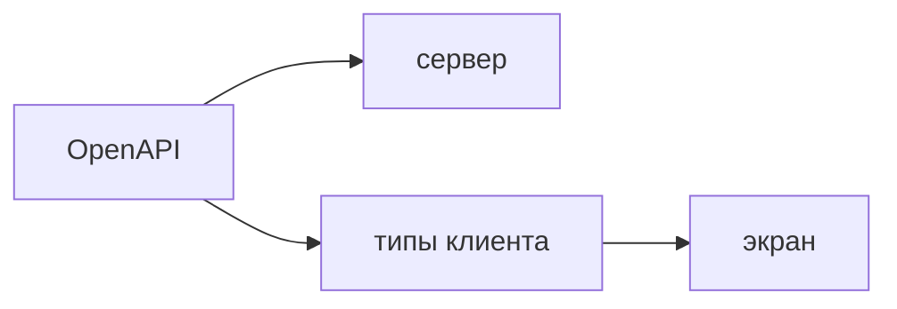

## Введение

Senior-фронтенд интегрируется с OpenAPI: генерирует типы и клиент, а не переписывает поля по памяти. Контракт один на бэкенд и экран.

## Раздел: Как этим пользоваться

Спецификация описывает путь, метод, тело и ответ. Генератор делает типы и функции. Экран импортирует их. Поле, которого нет в спецификации, на экран не добавляют «на время»: его нет и в договоре.

Ошибки тоже часть контракта: 400, 404, 409, 422. Клиент не превращает всё в одну строку «что-то пошло не так», если пользователь может исправить поле.

Смена спецификации — событие. Генерацию гоняют в CI. Расхождение типов — повод остановить сборку, а не заткнуть `any`. Ручной тип рядом с сгенерированным живёт, только если это вид экрана, а не копия DTO.

## Раздел: Ответ вслух

Типы ответа я беру из OpenAPI, не из примера в чате. Клиент генерирую и кладу в репозиторий или собираю в CI, чтобы версия спецификации была явной. Ветки ошибок разбираю по коду. Если бэкенд добавил поле, экран узнает об этом из спецификации, а не из падения в проде.

## Раздел: Плохой ответ

Плохой ответ: «Swagger только для бэкенда, на фронте свои интерфейсы». Два описания одного JSON расходятся без сигнала.

## Раздел: Термины

Спецификация — OpenAPI specification. Сгенерированный клиент — generated client. Объект передачи — DTO. Контракт — contract.

## Лаба

**25 минут.** Возьмите `GET /notes` и `POST /notes`. Выпишите типы списка и тела создания так, будто их сгенерировали. Отдельно укажите, какой код вернётся на пустой заголовок и какой текст увидит человек.

## Схема: Один контракт

## Тест

### Откуда брать тип ответа на фронте?

**Ответ:** из спецификации

**Пояснение:** Пример JSON в переписке не версионируется вместе с сервером.

### Зачем гонять генерацию в CI?

**Ответ:** поймать расхождение до прода

**Пояснение:** Иначе экран собирается со старыми полями.

### Пустое обязательное поле. Какой код ждать от FastAPI?

**Ответ:** 422

**Пояснение:** Тело не прошло проверку. Это не 500 и не общий «error».

### Чем экранный тип отличается от DTO?

**Ответ:** это вид, не копия ответа

**Пояснение:** Можно собрать подпись кнопки. Нельзя заново описывать поля API.

### Поле пришло с сервера, в типе его нет. Что делать?

**Ответ:** обновить спецификацию

**Пояснение:** Дописывать поле только в клиенте — завести второй контракт.

## Шпаргалка

<ul><li>Спека — источник типов</li><li>Ошибки различают по коду</li><li>any на ответе API прячет поломку</li><li>Вид экрана не копирует DTO целиком</li></ul>

## Anki

### Front: Что генерируют из OpenAPI?

Back: Типы тел и ответов и вызовы методов.

### Front: Почему не писать interface вручную по примеру?

Back: Пример устареет, сборка этого не заметит.

### Front: Куда класть версию спецификации?

Back: Рядом с клиентом, чтобы было видно, с чем собран фронт.

### Front: 409 на сохранении. Что это для UI?

Back: Конфликт состояния, пользователю нужно другое действие, не повтор вслепую.

### Front: Можно ли сузить DTO для экрана?

Back: Да, если это производный вид, а не вторая схема API.

### Front: Что делает any на ответе fetch?

Back: Выключает проверку полей, ошибка всплывает в рантайме.

## Итоги

- Контракт один
- Генерация в CI раньше ручного интерфейса
- Код ошибки — часть интерфейса, не только 200

## Ссылки

- [TypeScript](/game/learn/fe-typescript)
- [FastAPI и Pydantic](/game/learn/s01e05-fastapi)
